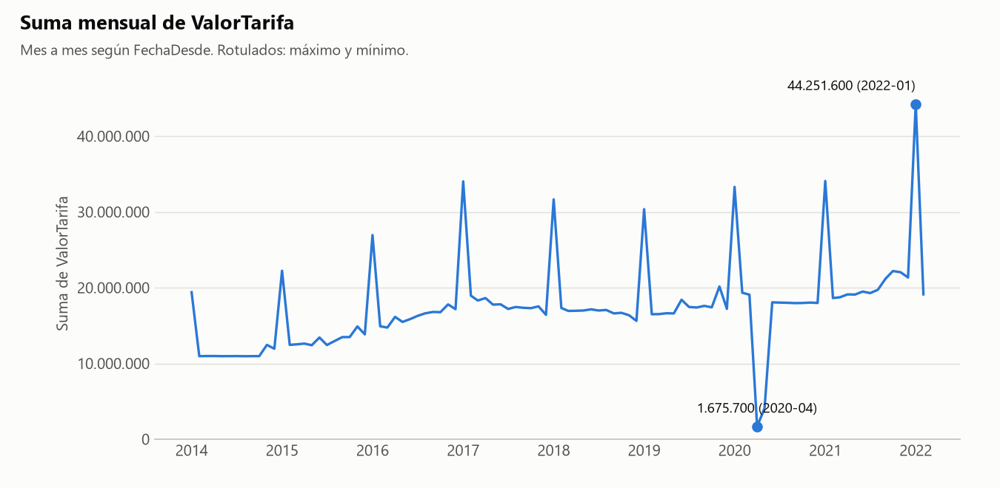
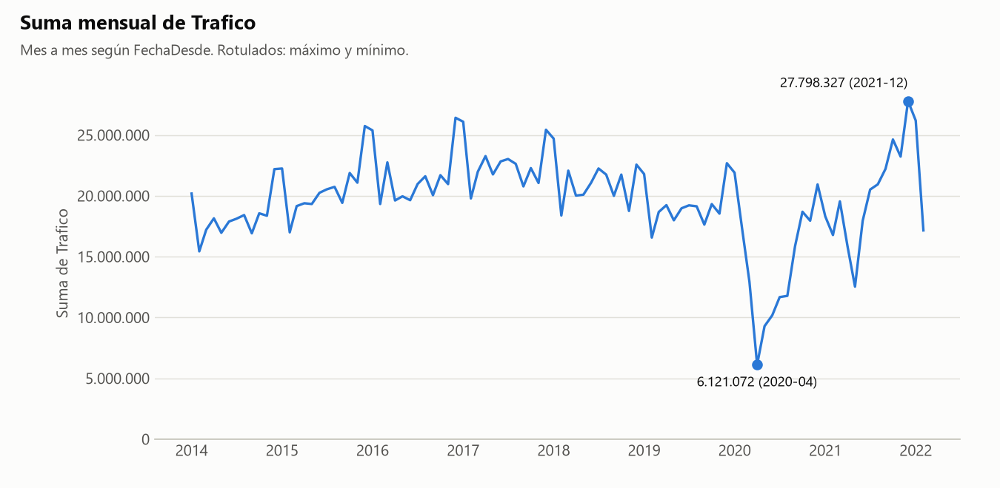
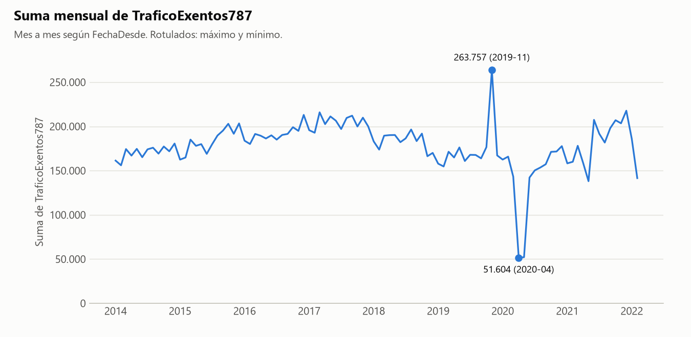
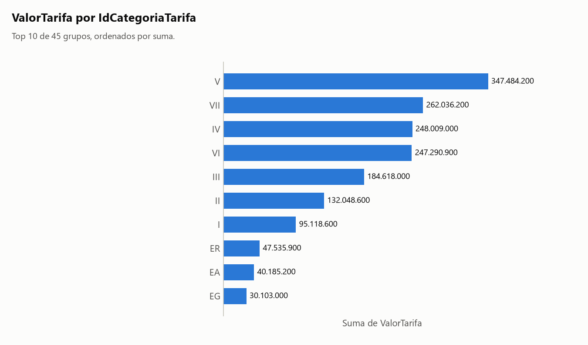
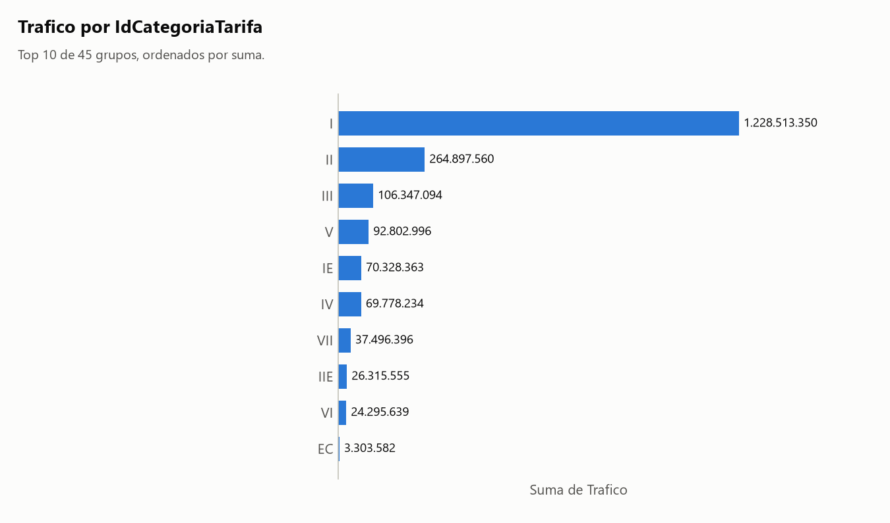
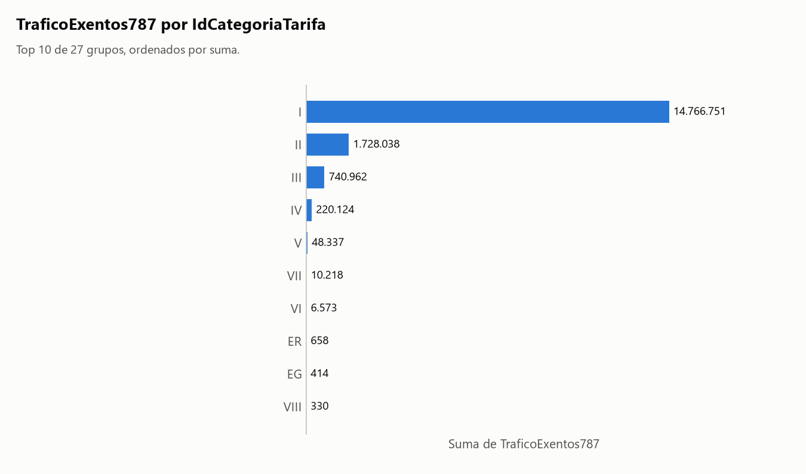
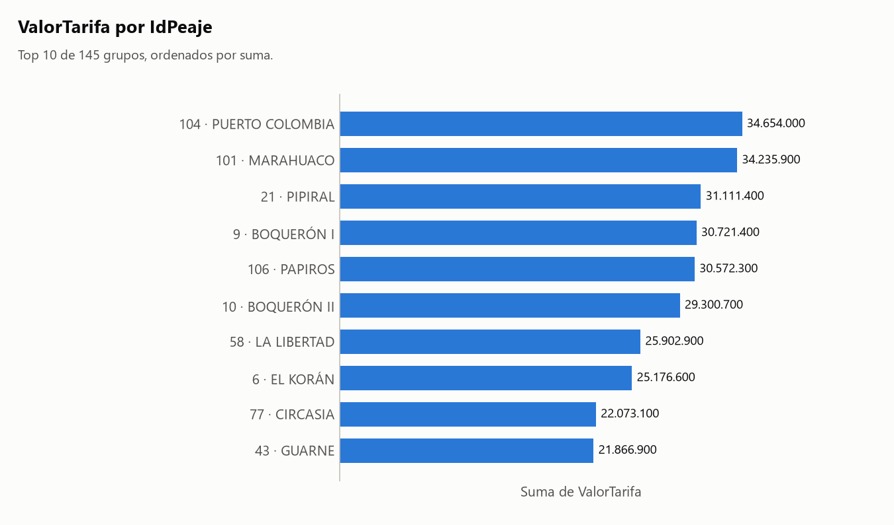
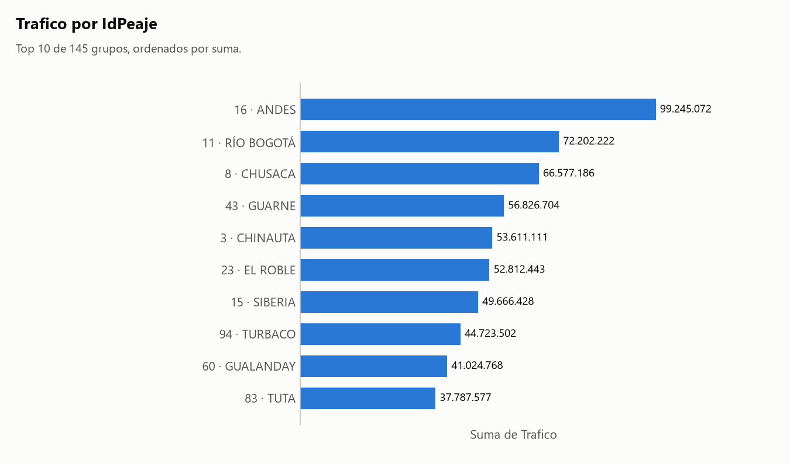
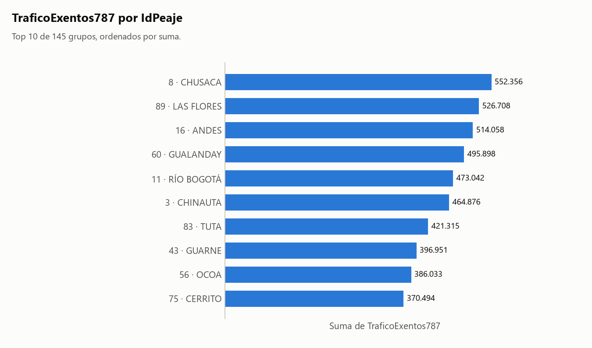
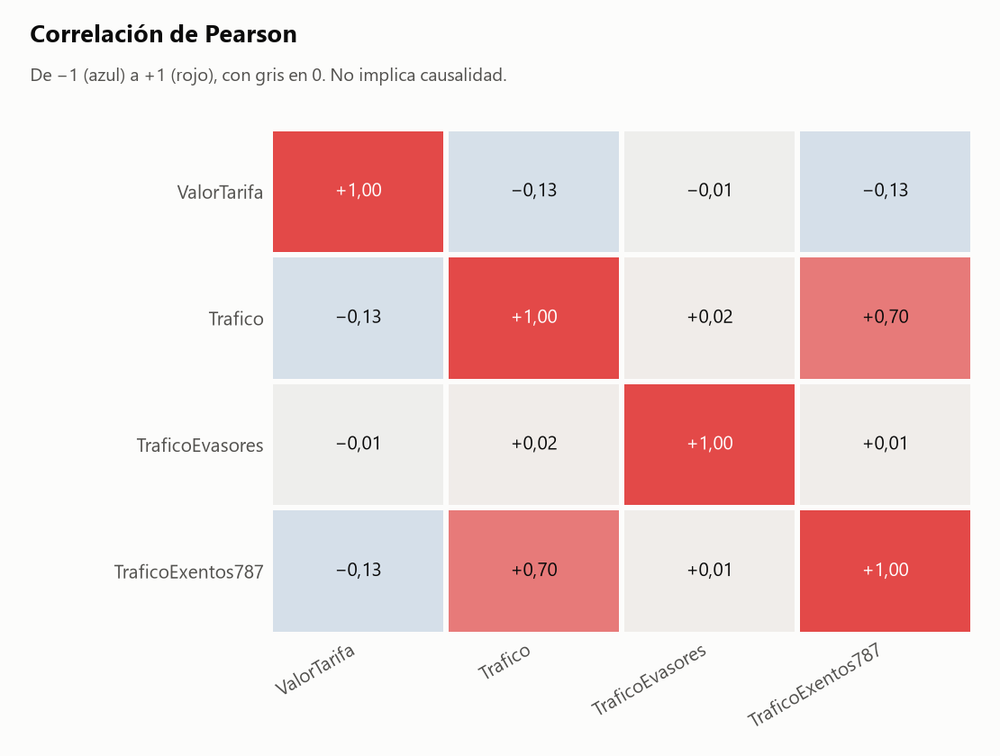

# Informe: peajes_colombia.csv

## 1. Resumen

- **Archivo:** peajes_colombia.csv
- **Filas:** 98.306
- **Columnas:** 11
- **Fecha de ejecución:** 2026-11-06 23:06

## 2. Calidad de datos

### Hallazgos

- **H1.** **Conversión de tipos:** `FechaDesde` no está en formato ISO (AAAA-MM-DD). En valores como '01/02/2024', donde el día y el mes se pueden confundir, pandas asume el mes primero. Conviene comprobarlo.
- **H2.** **Conversión de tipos:** `FechaHasta` no está en formato ISO (AAAA-MM-DD). En valores como '01/02/2024', donde el día y el mes se pueden confundir, pandas asume el mes primero. Conviene comprobarlo.
- **H3.** **Fechas de `FechaDesde`:** Faltan 2.711 de 2.954 días entre la primera y la última fecha, repartidos en 207 tramos.
- **H4.** **Agrupaciones:** Agrupar por `Peaje` puede estar mezclando entidades distintas: 1 de 144 valores aparecen junto a más de un valor de `IdPeaje`. Ejemplos: 'LA LIZAMA' (2 valores: 115, 29). Sugerencia: agrupar por `IdPeaje`.

### Sugerencias (no aplicadas)

> **Sugerencia, no aplicada.** Los huecos de `FechaDesde` no dejan un corte claro. Si quieres limitar el rango, reemplaza las fechas en: `python src/agente.py data/raw/peajes_colombia.csv --desde AAAA-MM-DD --hasta AAAA-MM-DD --columna-fecha FechaDesde`. No excluí nada.

### Fechas de `FechaDesde`

Decisiones:

- Comparé las fechas con el día de ejecución (2026-11-06) y busqué días y meses sin filas entre la primera y la última fecha.

Lo calculado:

- Rango de `FechaDesde`: 2014-01-01 a 2022-02-01.
- Ninguna fecha es posterior al día de ejecución.

| desde | hasta | dias |
|---|---|--:|
| 2014-01-02 | 2014-01-04 | 3 |
| 2014-01-08 | 2014-01-09 | 2 |
| 2014-01-11 | 2014-01-14 | 4 |
| 2014-01-17 | 2014-01-19 | 3 |
| 2014-01-21 | 2014-01-24 | 4 |
| 2014-01-26 | 2014-01-27 | 2 |
| 2014-01-29 | 2014-01-31 | 3 |
| 2014-02-02 | 2014-02-28 | 27 |
| 2014-03-02 | 2014-03-31 | 30 |
| 2014-04-02 | 2014-04-30 | 29 |
| … 192 filas omitidas | | |
| 2021-12-22 | 2021-12-31 | 10 |
| 2022-01-02 | 2022-01-05 | 4 |
| 2022-01-08 | 2022-01-14 | 7 |
| 2022-01-17 | 2022-01-19 | 3 |
| 2022-01-21 | 2022-01-31 | 11 |

Tabla completa (207 filas) en [tablas/huecos_FechaDesde.csv](tablas/huecos_FechaDesde.csv).

### Fechas de `FechaHasta`

Decisiones:

- Comparé las fechas con el día de ejecución (2026-11-06). No busqué huecos: es gemela de `FechaDesde` y darían el mismo aviso.

Lo calculado:

- Rango de `FechaHasta`: 2014-01-04 a 2022-02-28.
- Ninguna fecha es posterior al día de ejecución.

### Agrupaciones

Cálculo: `np.unique(codigos_A * unicos_B + codigos_B), para cada par con unicos(B) > unicos(A)`

Decisiones:

- Comparé 3 pares entre 3 columnas agrupables, usando todas las filas y sin muestra. Las fechas no entran: casi cualquier valor aparece en varias.
- En 3 pares algún valor de A aparece junto a más de un valor de B. Eso solo no indica una fusión, así que aviso únicamente si al menos el 95% de los valores de B corresponde a un solo A y menos del 50% de los valores de A está afectado. Si todos los valores de A se reparten, es una jerarquía o dos columnas independientes.

Detalle: [tablas/agrupaciones_Peaje_IdPeaje.csv](tablas/agrupaciones_Peaje_IdPeaje.csv).

Detalle: [tablas/agrupaciones_pares.csv](tablas/agrupaciones_pares.csv).

## 3. Clasificación de columnas

| Columna | Tipo | Rol | Top N | Únicos | Ratio | Por qué ese tipo | Por qué ese rol |
|---|---|---|---|--:|--:|---|---|
| `IdPeaje` | codigo | agrupable | sí | 145 | 0,001475 | su nombre contiene 'id', que suele indicar un código. | es código, no se puede sumar, y su ratio 0,001475 (145 valores únicos) permite agrupar. |
| `Peaje` | texto | agrupable | sí | 144 | 0,001465 | no es número, código ni fecha. | es texto, no se puede sumar, y su ratio 0,001465 (144 valores únicos) permite agrupar. |
| `IdCategoriaTarifa` | codigo | agrupable | no | 45 | 0,000458 | su nombre contiene 'id', que suele indicar un código. | es código, no se puede sumar, y su ratio 0,000458 (45 valores únicos) permite agrupar. |
| `FechaDesde` | fecha | agrupable | sí | 243 | 0,002472 | el 100% de una muestra de 1.000 valores se interpretó como fecha (p. ej. '8/21/2015'). | es una fecha con 243 valores distintos. |
| `FechaHasta` | fecha | agrupable | sí | 220 | 0,002238 | el 100% de una muestra de 1.000 valores se interpretó como fecha (p. ej. '8/31/2015'). | es una fecha con 220 valores distintos. |
| `ValorTarifa` | numero | medible | sí | 718 | 0,007304 | el 100% de sus valores son números. | es un número con 718 valores distintos. |
| `Trafico` | numero | medible | sí | 33.416 | 0,339918 | el 100% de sus valores son números. | es un número con 33.416 valores distintos. |
| `TraficoEvasores` | numero | medible | sí | 69 | 0,000702 | el 100% de sus valores son números. | es un número con 69 valores distintos. |
| `TraficoExentos787` | numero | medible | sí | 3.535 | 0,035959 | el 100% de sus valores son números. | es un número con 3.535 valores distintos. |
| `Lat` | numero | atributo | sí | 145 | 0,001475 | el 100% de sus valores son números. | tiene un solo valor por cada valor de `IdPeaje` (678,0 filas por valor en promedio): describe a la entidad, no la mide. |
| `Lon` | numero | atributo | sí | 145 | 0,001475 | el 100% de sus valores son números. | tiene un solo valor por cada valor de `IdPeaje` (678,0 filas por valor en promedio): describe a la entidad, no la mide. |

Códigos detectados por heurística; corrígelos si no lo son:

- `IdPeaje`: su nombre contiene 'id', que suele indicar un código. Para corregirlo: `--forzar IdPeaje.tipo=numero`.
- `IdCategoriaTarifa`: su nombre contiene 'id', que suele indicar un código. Para corregirlo: `--forzar IdCategoriaTarifa.tipo=numero`.

Atributos detectados por heurística; corrígelos si son medidas:

- `Lat`: tiene un solo valor por cada valor de `IdPeaje` (678,0 filas por valor en promedio): describe a la entidad, no la mide. Para corregirlo: `--forzar Lat.rol=medible`.
- `Lon`: tiene un solo valor por cada valor de `IdPeaje` (678,0 filas por valor en promedio): describe a la entidad, no la mide. Para corregirlo: `--forzar Lon.rol=medible`.

## 4. Análisis elegidos y descartados

### Elegidos

- Evolución de `ValorTarifa` por `FechaDesde`: elegí esto porque `FechaDesde` es una fecha agrupable y `ValorTarifa` es medible.
- Evolución de `Trafico` por `FechaDesde`: elegí esto porque `FechaDesde` es una fecha agrupable y `Trafico` es medible.
- Evolución de `TraficoExentos787` por `FechaDesde`: elegí esto porque `FechaDesde` es una fecha agrupable y `TraficoExentos787` es medible.
- Ranking de `IdCategoriaTarifa` por `ValorTarifa`: elegí esto porque `IdCategoriaTarifa` es agrupable (tipo codigo) y `ValorTarifa` es medible. η² ajustado: 0,659.
- Ranking de `IdCategoriaTarifa` por `Trafico`: elegí esto porque `IdCategoriaTarifa` es agrupable (tipo codigo) y `Trafico` es medible. η² ajustado: 0,361.
- Ranking de `IdCategoriaTarifa` por `TraficoExentos787`: elegí esto porque `IdCategoriaTarifa` es agrupable (tipo codigo) y `TraficoExentos787` es medible. η² ajustado: 0,349.
- Ranking de `IdPeaje` por `ValorTarifa`: elegí esto porque `IdPeaje` es agrupable (tipo codigo) y `ValorTarifa` es medible. η² ajustado: 0,185.
- Ranking de `IdPeaje` por `Trafico`: elegí esto porque `IdPeaje` es agrupable (tipo codigo) y `Trafico` es medible. η² ajustado: 0,093.
- Ranking de `IdPeaje` por `TraficoExentos787`: elegí esto porque `IdPeaje` es agrupable (tipo codigo) y `TraficoExentos787` es medible. η² ajustado: 0,039.
- Matriz de correlación: elegí esto porque hay 4 medibles (`ValorTarifa`, `Trafico`, `TraficoEvasores`, `TraficoExentos787`).
- Detección de agrupaciones: elegí esto porque hay 3 columnas agrupables que no son fecha. Resultado en la sección 2.

### Omitidos por prioridad

Omitir un análisis no excluye datos: solo evita repetir o mostrar lo menos informativo. Los rankings se ordenan por η² ajustado, que mide qué parte de la variación explican los grupos, con mínimo 0,01, hasta 3 por medida y 8 en total.

Para generarlos todos: `python src/agente.py data/raw/peajes_colombia.csv --todo`

| Análisis | η² ajustado | Motivo |
|---|--:|---|
| Evolución de `TraficoEvasores` por `FechaDesde` | — | medida casi constante; ver el resumen en la sección 5 |
| Evolución de `ValorTarifa` por `FechaHasta` | — | `FechaHasta` es gemela de `FechaDesde`: caen en el mismo mes casi siempre |
| Evolución de `Trafico` por `FechaHasta` | — | `FechaHasta` es gemela de `FechaDesde`: caen en el mismo mes casi siempre |
| Evolución de `TraficoEvasores` por `FechaHasta` | — | `FechaHasta` es gemela de `FechaDesde`: caen en el mismo mes casi siempre |
| Evolución de `TraficoExentos787` por `FechaHasta` | — | `FechaHasta` es gemela de `FechaDesde`: caen en el mismo mes casi siempre |
| Ranking de `IdPeaje` por `TraficoEvasores` | — | medida casi constante; ver el resumen en la sección 5 |
| Ranking de `Peaje` por `ValorTarifa` | — | casi equivalente a `IdPeaje`, que lo lleva como etiqueta |
| Ranking de `Peaje` por `Trafico` | — | casi equivalente a `IdPeaje`, que lo lleva como etiqueta |
| Ranking de `Peaje` por `TraficoEvasores` | — | casi equivalente a `IdPeaje`, que lo lleva como etiqueta |
| Ranking de `Peaje` por `TraficoExentos787` | — | casi equivalente a `IdPeaje`, que lo lleva como etiqueta |
| Ranking de `IdCategoriaTarifa` por `TraficoEvasores` | — | medida casi constante; ver el resumen en la sección 5 |

### Descartados

- Filtro por fecha: no excluí ninguna fila porque nadie lo pidió.
- Frecuencias: solo se usan cuando no hay ninguna columna medible, y aquí sí hay.
- `Lat` queda fuera de todos los análisis: tiene un solo valor por cada valor de `IdPeaje` (678,0 filas por valor en promedio): describe a la entidad, no la mide.
- `Lon` queda fuera de todos los análisis: tiene un solo valor por cada valor de `IdPeaje` (678,0 filas por valor en promedio): describe a la entidad, no la mide.

## 5. Resultados

### Cómo leer las tablas

Vale para todos los análisis de esta sección:

- Cálculo: `df.groupby(periodo)[medida].agg(filas='size', suma='sum', media='mean'), con periodo = mes y año de la fecha`
- Agregué por mes y por año.
- Agregué la columna `dias_con_datos` para distinguir un periodo con poco valor de un periodo con pocos días registrados.
- Cálculo: `df.groupby(grupo)[medida].agg(filas='size', suma='sum', media='mean')`
- Ordené por suma, de mayor a menor. Los nulos del grupo forman '(nulo)' para que los totales cuadren.
- 2.025 filas sin valor en `TraficoExentos787` cuentan en `filas`, pero no en `suma` ni en `media`.
- `IdPeaje` y `Peaje` son casi equivalentes: una sola tabla, agrupada por `IdPeaje` y con el valor más frecuente de `Peaje` como etiqueta.
- `IdPeaje` tiene 145 valores: el informe muestra los primeros 10 y los últimos 5; el CSV los trae todos.

### Evolución de `ValorTarifa` por `FechaDesde`

Lo calculado:

- Por año, el máximo de la suma de `ValorTarifa` es 254.918.300 en 2021 (38 días con datos) y el mínimo es 63.372.000 en 2022 (7 días con datos).
- Por mes, el máximo de la suma de `ValorTarifa` es 44.251.600 en 2022-01 (6 días con datos) y el mínimo es 1.675.700 en 2020-04 (3 días con datos).

> Aplica lo dicho en la sección 2: H3.



| periodo | filas | suma | media | dias_con_datos |
|---|--:|--:|--:|--:|
| 2014 | 9.840 | 142.493.900 | 14.481,09 | 24 |
| 2015 | 11.251 | 166.734.250 | 14.819,50 | 34 |
| 2016 | 13.131 | 205.484.850 | 15.648,83 | 34 |
| 2017 | 13.482 | 228.737.000 | 16.966,10 | 25 |
| 2018 | 11.900 | 216.313.200 | 18.177,58 | 21 |
| 2019 | 11.459 | 222.221.900 | 19.392,78 | 30 |
| 2020 | 12.035 | 203.534.400 | 16.911,87 | 30 |
| 2021 | 12.230 | 254.918.300 | 20.843,69 | 38 |
| 2022 | 2.978 | 63.372.000 | 21.280,05 | 7 |

Archivo: [tablas/evolucion_FechaDesde_ValorTarifa_anio.csv](tablas/evolucion_FechaDesde_ValorTarifa_anio.csv).

Detalle: [tablas/evolucion_FechaDesde_ValorTarifa_mes.csv](tablas/evolucion_FechaDesde_ValorTarifa_mes.csv).

### Evolución de `Trafico` por `FechaDesde`

Lo calculado:

- Por año, el máximo de la suma de `Trafico` es 270.973.294 en 2017 (25 días con datos) y el mínimo es 43.356.385 en 2022 (7 días con datos).
- Por mes, el máximo de la suma de `Trafico` es 27.798.327 en 2021-12 (2 días con datos) y el mínimo es 6.121.072 en 2020-04 (3 días con datos).

> Aplica lo dicho en la sección 2: H3.



| periodo | filas | suma | media | dias_con_datos |
|---|--:|--:|--:|--:|
| 2014 | 9.840 | 218.476.734 | 22.202,92 | 24 |
| 2015 | 11.251 | 246.823.836 | 21.937,95 | 34 |
| 2016 | 13.131 | 258.451.828 | 19.682,57 | 34 |
| 2017 | 13.482 | 270.973.294 | 20.098,89 | 25 |
| 2018 | 11.900 | 253.468.558 | 21.299,88 | 21 |
| 2019 | 11.459 | 229.823.734 | 20.056,18 | 30 |
| 2020 | 12.035 | 174.588.186 | 14.506,70 | 30 |
| 2021 | 12.230 | 240.333.892 | 19.651,18 | 38 |
| 2022 | 2.978 | 43.356.385 | 14.558,89 | 7 |

Archivo: [tablas/evolucion_FechaDesde_Trafico_anio.csv](tablas/evolucion_FechaDesde_Trafico_anio.csv).

Detalle: [tablas/evolucion_FechaDesde_Trafico_mes.csv](tablas/evolucion_FechaDesde_Trafico_mes.csv).

### Evolución de `TraficoExentos787` por `FechaDesde`

Lo calculado:

- Por año, el máximo de la suma de `TraficoExentos787` es 2.453.598 en 2017 (25 días con datos) y el mínimo es 327.396 en 2022 (7 días con datos).
- Por mes, el máximo de la suma de `TraficoExentos787` es 263.757 en 2019-11 (5 días con datos) y el mínimo es 51.604 en 2020-04 (3 días con datos).

> Aplica lo dicho en la sección 2: H3.



| periodo | filas | suma | media | dias_con_datos |
|---|--:|--:|--:|--:|
| 2014 | 9.840 | 2.047.826 | 208,11 | 24 |
| 2015 | 11.251 | 2.202.221 | 195,74 | 34 |
| 2016 | 13.131 | 2.295.433 | 174,81 | 34 |
| 2017 | 13.482 | 2.453.598 | 181,99 | 25 |
| 2018 | 11.900 | 2.203.789 | 185,19 | 21 |
| 2019 | 11.459 | 2.093.072 | 182,66 | 30 |
| 2020 | 12.035 | 1.699.209 | 141,19 | 30 |
| 2021 | 12.230 | 2.200.132 | 203,53 | 38 |
| 2022 | 2.978 | 327.396 | 137,97 | 7 |

Archivo: [tablas/evolucion_FechaDesde_TraficoExentos787_anio.csv](tablas/evolucion_FechaDesde_TraficoExentos787_anio.csv).

Detalle: [tablas/evolucion_FechaDesde_TraficoExentos787_mes.csv](tablas/evolucion_FechaDesde_TraficoExentos787_mes.csv).

### Ranking de `IdCategoriaTarifa` por `ValorTarifa`

Lo calculado:

- El máximo de la suma es 347.484.200 en 'V'; el mínimo es 0 en 'POLCA'.
- La media más alta es 48.933,00 en 'VII'.
- El grupo con más filas es 'I', con 11.190.

> **Advertencia:** El top 10 por filas y el top 10 por suma son distintos. El primero por filas es 'I'; por suma, 'V'. Solo en el top por filas: IE. Solo en el top por suma: EA. Contar filas y sumar la medida no dan el mismo orden.



| grupo | filas | suma | media | puesto_suma | puesto_filas |
|---|--:|--:|--:|--:|--:|
| V | 11.123 | 347.484.200 | 31.240,15 | 1 | 4 |
| VII | 5.355 | 262.036.200 | 48.933,00 | 2 | 8 |
| IV | 11.056 | 248.009.000 | 22.432,07 | 3 | 5 |
| VI | 5.660 | 247.290.900 | 43.690,97 | 4 | 6 |
| III | 11.162 | 184.618.000 | 16.539,87 | 5 | 3 |
| II | 11.174 | 132.048.600 | 11.817,49 | 6 | 2 |
| I | 11.190 | 95.118.600 | 8.500,32 | 7 | 1 |
| ER | 5.235 | 47.535.900 | 9.080,40 | 8 | 10 |
| EA | 4.986 | 40.185.200 | 8.059,61 | 9 | 11 |
| EG | 5.297 | 30.103.000 | 5.683,03 | 10 | 9 |
| IE | 5.625 | 19.682.800 | 3.499,16 | 11 | 7 |
| IIE | 3.598 | 17.987.600 | 4.999,33 | 12 | 12 |
| VE | 591 | 7.416.400 | 12.548,90 | 13 | 18 |
| IVE | 1.154 | 6.012.800 | 5.210,40 | 14 | 14 |
| IIIE | 1.426 | 5.590.000 | 3.920,06 | 15 | 13 |
| EC | 616 | 3.571.800 | 5.798,38 | 16 | 17 |
| IEE | 624 | 1.990.900 | 3.190,54 | 17 | 16 |
| IEEE | 415 | 1.727.700 | 4.163,13 | 18 | 19 |
| IIA | 194 | 1.012.400 | 5.218,56 | 19 | 20 |
| VIIE | 95 | 792.200 | 8.338,95 | 20 | 23 |
| VIE | 87 | 686.900 | 7.895,40 | 21 | 24 |
| IXE | 123 | 639.100 | 5.195,93 | 22 | 22 |
| IIE1 | 62 | 449.600 | 7.251,61 | 23 | 25 |
| IE10 | 154 | 398.300 | 2.586,36 | 24 | 21 |
| VIIIE | 24 | 175.000 | 7.291,67 | 25 | 28 |
| VE1 | 7 | 145.100 | 20.728,57 | 26 | 34 |
| IE1 | 39 | 139.300 | 3.571,79 | 27 | 26 |
| E2-VII | 4 | 101.000 | 25.250,00 | 28 | 36 |
| E1-VII | 4 | 100.600 | 25.150,00 | 29 | 36 |
| E1-VI | 4 | 88.400 | 22.100,00 | 30 | 36 |
| VIII | 26 | 74.800 | 2.876,92 | 31 | 27 |
| IE2 | 11 | 74.100 | 6.736,36 | 32 | 29 |
| E2-V | 4 | 68.800 | 17.200,00 | 33 | 36 |
| IX | 10 | 68.800 | 6.880,00 | 33 | 30 |
| E1-V | 4 | 68.400 | 17.100,00 | 35 | 36 |
| EXCII | 10 | 54.600 | 5.460,00 | 36 | 30 |
| EXCIII | 10 | 54.600 | 5.460,00 | 36 | 30 |
| EXCI | 10 | 33.400 | 3.340,00 | 38 | 30 |
| E1-III | 4 | 30.000 | 7.500,00 | 39 | 36 |
| E1-IV | 4 | 30.000 | 7.500,00 | 39 | 36 |
| E2-II | 4 | 29.600 | 7.400,00 | 41 | 36 |
| E2-III | 4 | 29.600 | 7.400,00 | 41 | 36 |
| E2-IV | 4 | 29.600 | 7.400,00 | 41 | 36 |
| IE3 | 7 | 26.000 | 3.714,29 | 44 | 34 |
| POLCA | 1.110 | 0 | 0,00 | 45 | 15 |

Archivo: [tablas/ranking_IdCategoriaTarifa_ValorTarifa.csv](tablas/ranking_IdCategoriaTarifa_ValorTarifa.csv).

### Ranking de `IdCategoriaTarifa` por `Trafico`

Lo calculado:

- El máximo de la suma es 1.228.513.350 en 'I'; el mínimo es 12 en 'EXCIII'.
- La media más alta es 109.786,72 en 'I'.
- El grupo con más filas es 'I', con 11.190.

> **Advertencia:** El top 10 por filas y el top 10 por suma son distintos. Solo en el top por filas: EG, ER. Solo en el top por suma: IIE, EC. Contar filas y sumar la medida no dan el mismo orden.



| grupo | filas | suma | media | puesto_suma | puesto_filas |
|---|--:|--:|--:|--:|--:|
| I | 11.190 | 1.228.513.350 | 109.786,72 | 1 | 1 |
| II | 11.174 | 264.897.560 | 23.706,60 | 2 | 2 |
| III | 11.162 | 106.347.094 | 9.527,60 | 3 | 3 |
| V | 11.123 | 92.802.996 | 8.343,34 | 4 | 4 |
| IE | 5.625 | 70.328.363 | 12.502,82 | 5 | 7 |
| IV | 11.056 | 69.778.234 | 6.311,35 | 6 | 5 |
| VII | 5.355 | 37.496.396 | 7.002,13 | 7 | 8 |
| IIE | 3.598 | 26.315.555 | 7.313,94 | 8 | 12 |
| VI | 5.660 | 24.295.639 | 4.292,52 | 9 | 6 |
| EC | 616 | 3.303.582 | 5.362,96 | 10 | 17 |
| IEE | 624 | 2.718.442 | 4.356,48 | 11 | 16 |
| IE10 | 154 | 1.955.210 | 12.696,17 | 12 | 21 |
| IIIE | 1.426 | 1.348.414 | 945,59 | 13 | 13 |
| IXE | 123 | 1.049.515 | 8.532,64 | 14 | 22 |
| IVE | 1.154 | 1.013.994 | 878,68 | 15 | 14 |
| ER | 5.235 | 1.003.186 | 191,63 | 16 | 10 |
| IEEE | 415 | 763.279 | 1.839,23 | 17 | 19 |
| IIA | 194 | 588.536 | 3.033,69 | 18 | 20 |
| VE | 591 | 446.764 | 755,95 | 19 | 18 |
| POLCA | 1.110 | 353.306 | 318,29 | 20 | 15 |
| EG | 5.297 | 235.038 | 44,37 | 21 | 9 |
| EA | 4.986 | 206.207 | 41,36 | 22 | 11 |
| IE2 | 11 | 117.773 | 10.706,64 | 23 | 29 |
| IE1 | 39 | 92.446 | 2.370,41 | 24 | 26 |
| IX | 10 | 81.504 | 8.150,40 | 25 | 30 |
| VIIE | 95 | 51.678 | 543,98 | 26 | 23 |
| IIE1 | 62 | 49.284 | 794,90 | 27 | 25 |
| VIE | 87 | 26.103 | 300,03 | 28 | 24 |
| VIIIE | 24 | 20.823 | 867,62 | 29 | 28 |
| E1-VII | 4 | 13.908 | 3.477,00 | 30 | 36 |
| E1-VI | 4 | 11.724 | 2.931,00 | 31 | 36 |
| E2-VII | 4 | 11.709 | 2.927,25 | 32 | 36 |
| E1-III | 4 | 10.326 | 2.581,50 | 33 | 36 |
| E2-III | 4 | 10.034 | 2.508,50 | 34 | 36 |
| E1-IV | 4 | 7.494 | 1.873,50 | 35 | 36 |
| E2-IV | 4 | 7.318 | 1.829,50 | 36 | 36 |
| E2-V | 4 | 7.053 | 1.763,25 | 37 | 36 |
| E1-V | 4 | 6.457 | 1.614,25 | 38 | 36 |
| VIII | 26 | 5.733 | 220,50 | 39 | 27 |
| EXCI | 10 | 1.499 | 149,90 | 40 | 30 |
| VE1 | 7 | 1.485 | 212,14 | 41 | 34 |
| E2-II | 4 | 1.247 | 311,75 | 42 | 36 |
| EXCII | 10 | 145 | 14,50 | 43 | 30 |
| IE3 | 7 | 32 | 4,57 | 44 | 34 |
| EXCIII | 10 | 12 | 1,20 | 45 | 30 |

Archivo: [tablas/ranking_IdCategoriaTarifa_Trafico.csv](tablas/ranking_IdCategoriaTarifa_Trafico.csv).

### Ranking de `IdCategoriaTarifa` por `TraficoExentos787`

Lo calculado:

- El máximo de la suma es 14.766.751 en 'I'; el mínimo es 0 en 'IE'.
- La media más alta es 1.320,23 en 'I'.
- El grupo con más filas es 'I', con 11.190.

> **Advertencia:** El top 10 por filas y el top 10 por suma son distintos. Solo en el top por filas: IE. Solo en el top por suma: VIII. Contar filas y sumar la medida no dan el mismo orden.



| grupo | filas | suma | media | puesto_suma | puesto_filas |
|---|--:|--:|--:|--:|--:|
| I | 11.190 | 14.766.751 | 1.320,23 | 1 | 1 |
| II | 11.174 | 1.728.038 | 154,65 | 2 | 2 |
| III | 11.162 | 740.962 | 66,38 | 3 | 3 |
| IV | 11.056 | 220.124 | 19,91 | 4 | 5 |
| V | 11.123 | 48.337 | 4,35 | 5 | 4 |
| VII | 5.355 | 10.218 | 1,91 | 6 | 8 |
| VI | 5.660 | 6.573 | 1,16 | 7 | 6 |
| ER | 5.235 | 658 | 0,13 | 8 | 10 |
| EG | 5.297 | 414 | 0,08 | 9 | 9 |
| VIII | 26 | 330 | 12,69 | 10 | 27 |
| EA | 4.986 | 257 | 0,05 | 11 | 11 |
| EC | 616 | 7 | 0,01 | 12 | 17 |
| IX | 10 | 7 | 0,70 | 12 | 30 |
| IE | 5.625 | 0 | 0,00 | 14 | 7 |
| IE10 | 154 | 0 | 0,00 | 14 | 21 |
| IEE | 624 | 0 | 0,00 | 14 | 16 |
| IEEE | 415 | 0 | 0,00 | 14 | 19 |
| IIA | 194 | 0 | 0,00 | 14 | 20 |
| IIE | 3.598 | 0 | 0,00 | 14 | 12 |
| IIIE | 1.426 | 0 | 0,00 | 14 | 13 |
| IVE | 1.154 | 0 | 0,00 | 14 | 14 |
| IXE | 123 | 0 | 0,00 | 14 | 22 |
| POLCA | 1.110 | 0 | 0,00 | 14 | 15 |
| VE | 591 | 0 | 0,00 | 14 | 18 |
| VIE | 87 | 0 | 0,00 | 14 | 24 |
| VIIE | 95 | 0 | 0,00 | 14 | 23 |
| VIIIE | 24 | 0 | 0,00 | 14 | 28 |
| E1-III | 4 | — | — | — | 36 |
| E1-IV | 4 | — | — | — | 36 |
| E1-V | 4 | — | — | — | 36 |
| E1-VI | 4 | — | — | — | 36 |
| E1-VII | 4 | — | — | — | 36 |
| E2-II | 4 | — | — | — | 36 |
| E2-III | 4 | — | — | — | 36 |
| E2-IV | 4 | — | — | — | 36 |
| E2-V | 4 | — | — | — | 36 |
| E2-VII | 4 | — | — | — | 36 |
| EXCI | 10 | — | — | — | 30 |
| EXCII | 10 | — | — | — | 30 |
| EXCIII | 10 | — | — | — | 30 |
| IE1 | 39 | — | — | — | 26 |
| IE2 | 11 | — | — | — | 29 |
| IE3 | 7 | — | — | — | 34 |
| IIE1 | 62 | — | — | — | 25 |
| VE1 | 7 | — | — | — | 34 |

Archivo: [tablas/ranking_IdCategoriaTarifa_TraficoExentos787.csv](tablas/ranking_IdCategoriaTarifa_TraficoExentos787.csv).

### Ranking de `IdPeaje` (con `Peaje`) por `ValorTarifa`

Lo calculado:

- El máximo de la suma es 34.654.000 en '104' (PUERTO COLOMBIA); el mínimo es 140.200 en '156' (CANO).
- La media más alta es 45.688,89 en '103' (GALAPA).
- El grupo con más filas es '83' (TUTA), con 1.357.

> Aplica lo dicho en la sección 2: H4.

> **Advertencia:** El top 10 por filas y el top 10 por suma son distintos. El primero por filas es '83'; por suma, '104'. Solo en el top por filas: 83, 15, 11, 13, 45, 64, 23, 33. Solo en el top por suma: 104, 101, 21, 106, 58, 6, 77, 43. Contar filas y sumar la medida no dan el mismo orden.



| grupo | etiqueta | filas | suma | media | puesto_suma | puesto_filas |
|---|---|--:|--:|--:|--:|--:|
| 104 | PUERTO COLOMBIA | 837 | 34.654.000 | 41.402,63 | 1 | 48 |
| 101 | MARAHUACO | 785 | 34.235.900 | 43.612,61 | 2 | 62 |
| 21 | PIPIRAL | 988 | 31.111.400 | 31.489,27 | 3 | 18 |
| 9 | BOQUERÓN I | 1.229 | 30.721.400 | 24.997,07 | 4 | 3 |
| 106 | PAPIROS | 814 | 30.572.300 | 37.558,11 | 5 | 54 |
| 10 | BOQUERÓN II | 1.158 | 29.300.700 | 25.302,85 | 6 | 7 |
| 58 | LA LIBERTAD | 850 | 25.902.900 | 30.474,00 | 7 | 45 |
| 6 | EL KORÁN | 970 | 25.176.600 | 25.955,26 | 8 | 23 |
| 77 | CIRCASIA | 768 | 22.073.100 | 28.741,02 | 9 | 66 |
| 43 | GUARNE | 876 | 21.866.900 | 24.962,21 | 10 | 38 |
| … 130 filas omitidas | | | | | | |
| 86 | LA PARADA | 716 | 1.072.000 | 1.497,21 | 141 | 80 |
| 172 | RIO SECO | 62 | 984.600 | 15.880,65 | 142 | 143 |
| 87 | EL ESCOBAL | 636 | 916.000 | 1.440,25 | 143 | 91 |
| 110 | COCORA | 33 | 843.400 | 25.557,58 | 144 | 145 |
| 156 | CANO | 34 | 140.200 | 4.123,53 | 145 | 144 |

Tabla completa (145 filas) en [tablas/ranking_IdPeaje_ValorTarifa.csv](tablas/ranking_IdPeaje_ValorTarifa.csv).

### Ranking de `IdPeaje` (con `Peaje`) por `Trafico`

Lo calculado:

- El máximo de la suma es 99.245.072 en '16' (ANDES); el mínimo es 189.981 en '127' (EL GUAICO).
- La media más alta es 102.951,32 en '16' (ANDES).
- El grupo con más filas es '83' (TUTA), con 1.357.

> Aplica lo dicho en la sección 2: H4.

> **Advertencia:** El top 10 por filas y el top 10 por suma son distintos. El primero por filas es '83'; por suma, '16'. Solo en el top por filas: 9, 13, 45, 10, 64, 33. Solo en el top por suma: 16, 8, 43, 3, 94, 60. Contar filas y sumar la medida no dan el mismo orden.



| grupo | etiqueta | filas | suma | media | puesto_suma | puesto_filas |
|---|---|--:|--:|--:|--:|--:|
| 16 | ANDES | 964 | 99.245.072 | 102.951,32 | 1 | 25 |
| 11 | RÍO BOGOTÁ | 1.185 | 72.202.222 | 60.930,15 | 2 | 4 |
| 8 | CHUSACA | 836 | 66.577.186 | 79.637,78 | 3 | 49 |
| 43 | GUARNE | 876 | 56.826.704 | 64.870,67 | 4 | 38 |
| 3 | CHINAUTA | 899 | 53.611.111 | 59.634,16 | 5 | 34 |
| 23 | EL ROBLE | 1.147 | 52.812.443 | 46.043,98 | 6 | 9 |
| 15 | SIBERIA | 1.299 | 49.666.428 | 38.234,36 | 7 | 2 |
| 94 | TURBACO | 735 | 44.723.502 | 60.848,30 | 8 | 75 |
| 60 | GUALANDAY | 971 | 41.024.768 | 42.250,02 | 9 | 22 |
| 83 | TUTA | 1.357 | 37.787.577 | 27.846,41 | 10 | 1 |
| … 130 filas omitidas | | | | | | |
| 110 | COCORA | 33 | 399.343 | 12.101,30 | 141 | 145 |
| 172 | RIO SECO | 62 | 331.241 | 5.342,60 | 142 | 143 |
| 111 | ARMERO | 128 | 295.087 | 2.305,37 | 143 | 137 |
| 173 | CABILDO | 93 | 210.456 | 2.262,97 | 144 | 140 |
| 127 | EL GUAICO | 80 | 189.981 | 2.374,76 | 145 | 142 |

Tabla completa (145 filas) en [tablas/ranking_IdPeaje_Trafico.csv](tablas/ranking_IdPeaje_Trafico.csv).

### Ranking de `IdPeaje` (con `Peaje`) por `TraficoExentos787`

Lo calculado:

- El máximo de la suma es 552.356 en '8' (CHUSACA); el mínimo es 328 en '19' (UNISABANA).
- La media más alta es 698,55 en '89' (LAS FLORES).
- El grupo con más filas es '83' (TUTA), con 1.357.

> Aplica lo dicho en la sección 2: H4.

> **Advertencia:** El top 10 por filas y el top 10 por suma son distintos. El primero por filas es '83'; por suma, '8'. Solo en el top por filas: 15, 9, 13, 45, 10, 64, 23, 33. Solo en el top por suma: 8, 89, 16, 60, 3, 43, 56, 75. Contar filas y sumar la medida no dan el mismo orden.



| grupo | etiqueta | filas | suma | media | puesto_suma | puesto_filas |
|---|---|--:|--:|--:|--:|--:|
| 8 | CHUSACA | 836 | 552.356 | 660,71 | 1 | 49 |
| 89 | LAS FLORES | 781 | 526.708 | 698,55 | 2 | 63 |
| 16 | ANDES | 964 | 514.058 | 538,84 | 3 | 25 |
| 60 | GUALANDAY | 971 | 495.898 | 516,02 | 4 | 22 |
| 11 | RÍO BOGOTÁ | 1.185 | 473.042 | 411,70 | 5 | 4 |
| 3 | CHINAUTA | 899 | 464.876 | 522,92 | 6 | 34 |
| 83 | TUTA | 1.357 | 421.315 | 319,66 | 7 | 1 |
| 43 | GUARNE | 876 | 396.951 | 459,43 | 8 | 38 |
| 56 | OCOA | 927 | 386.033 | 420,97 | 9 | 30 |
| 75 | CERRITO | 630 | 370.494 | 588,09 | 10 | 93 |
| … 130 filas omitidas | | | | | | |
| 159 | GAMARRA | 201 | 4.129 | 20,54 | 141 | 134 |
| 172 | RIO SECO | 62 | 3.808 | 61,42 | 142 | 143 |
| 110 | COCORA | 33 | 3.206 | 97,15 | 143 | 145 |
| 173 | CABILDO | 93 | 346 | 7,06 | 144 | 140 |
| 19 | UNISABANA | 353 | 328 | 0,93 | 145 | 119 |

Tabla completa (145 filas) en [tablas/ranking_IdPeaje_TraficoExentos787.csv](tablas/ranking_IdPeaje_TraficoExentos787.csv).

### Matriz de correlación

Cálculo: `df[['ValorTarifa', 'Trafico', 'TraficoEvasores', 'TraficoExentos787']].corr(method='pearson')`

Decisiones:

- Usé Pearson, que mide relación lineal. Cada par usa las filas donde ambas columnas tienen valor. Listo por separado los pares con |r| de 0.5 o más.

Lo calculado:

- `Trafico` y `TraficoExentos787` se mueven juntas: r = 0,700 (n = 96.281).

> **Advertencia:** La correlación no implica causalidad: dos variables pueden moverse juntas sin que una provoque la otra.



| r de Pearson | ValorTarifa | Trafico | TraficoEvasores | TraficoExentos787 |
|---|--:|--:|--:|--:|
| ValorTarifa | 1,00 | -0,13 | -0,01 | -0,13 |
| Trafico | -0,13 | 1,00 | 0,02 | 0,70 |
| TraficoEvasores | -0,01 | 0,02 | 1,00 | 0,01 |
| TraficoExentos787 | -0,13 | 0,70 | 0,01 | 1,00 |

Archivo: [tablas/correlacion.csv](tablas/correlacion.csv).

### `TraficoEvasores`: medida casi constante

Lo calculado:

- El valor 0 aparece en el 98,6 % de las filas con dato. No genero evolución ni rankings; sí entra en la matriz de correlación.

## 6. Límites

- "Más informativo" es un criterio estadístico, no importancia para el negocio. Un análisis omitido puede ser justo el que interesa: `--todo` los genera todos.
- No sé qué significa cada columna. Por eso cada tabla trae `filas`, `suma` y `media`: cuál es la correcta depende de si la variable es un conteo o una medida.
- No sé cómo se generaron los datos. Las cifras describen lo que hay en el archivo, no necesariamente lo que ocurrió en la realidad.
- No explico por qué cambia una cifra ni por qué dos variables se mueven juntas.
- Un hueco de calendario solo dice que no hay filas en esas fechas. Puede ser normal si el dato es semanal, mensual o no se registra en ciertos días.
- No detecto fechas con el día y el mes intercambiados cuando ambas lecturas son válidas.
- Un mismo texto puede referirse a cosas distintas (dos municipios con el mismo nombre, por ejemplo). Solo lo detecto si otra columna lo revela, y el aviso puede ser falso cuando la relación es una jerarquía legítima.
- No decido qué tramo de datos es válido. Si sugiero un filtro, es una propuesta: solo se aplica si el analista corre el comando.
- Convierto números con punto de miles y coma decimal ('1.234,5'), pero no uno con comas que siempre llevan 3 dígitos ('1,234'): puede ser 1234 o 1,234.
- La clasificación de columnas es heurística. Se corrige con `--forzar columna.tipo=valor` o `--forzar columna.rol=valor`.

## 7. Anexo: perfil completo

Salida literal de `perfilar()`. Su bloque de calidad solo cubre sus propios chequeos; la lista completa de hallazgos está en la sección 2.

```text
PERFIL DE: peajes_colombia.csv
============================================================

RESUMEN GENERAL
  Filas:    98,306
  Columnas: 11
  Memoria:  21.5 MB

COLUMNAS

  columna                      tipo              nulos     únicos
  ---------------------------------------------------------------
  IdPeaje                      str               0 (  0%)        145
  Peaje                        str               0 (  0%)        144
  IdCategoriaTarifa            str               0 (  0%)         45
  FechaDesde                   datetime64[       0 (  0%)        243
  FechaHasta                   datetime64[       0 (  0%)        220
  ValorTarifa                  int64             0 (  0%)        718
  Trafico                      int64             0 (  0%)     33,416
  TraficoEvasores              float64        2044 (  2%)         69
  TraficoExentos787            float64        2025 (  2%)      3,535
  Lat                          float64           0 (  0%)        145
  Lon                          float64           0 (  0%)        145

CALIDAD DE DATOS
  Sin problemas evidentes.

VARIABLES NUMÉRICAS

                     min     media   mediana          max
ValorTarifa         0.00 17,331.70 11,100.00   142,700.00
Trafico             0.00 19,696.63  3,657.00 1,120,843.00
TraficoEvasores     0.00      0.28      0.00     4,006.00
TraficoExentos787   0.00    182.00      0.00   101,300.00
Lat               -77.41    -74.67    -74.81       -72.09
Lon                 1.09      6.46      5.39        11.44
```
