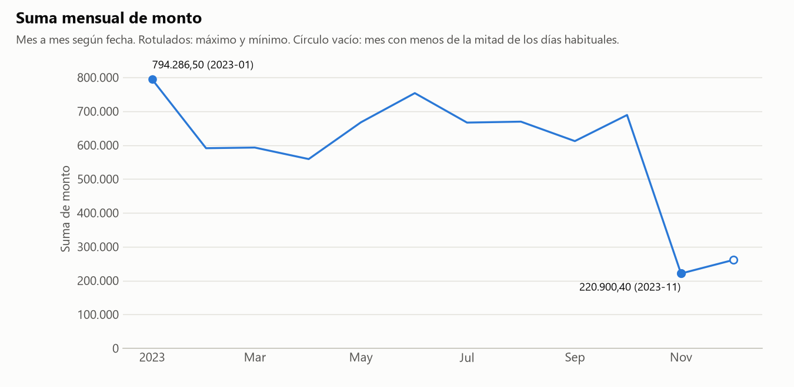
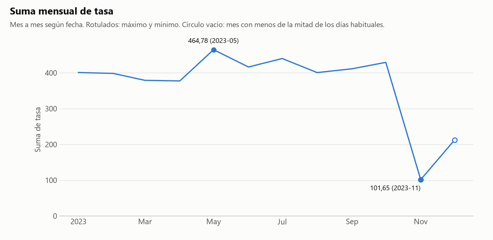
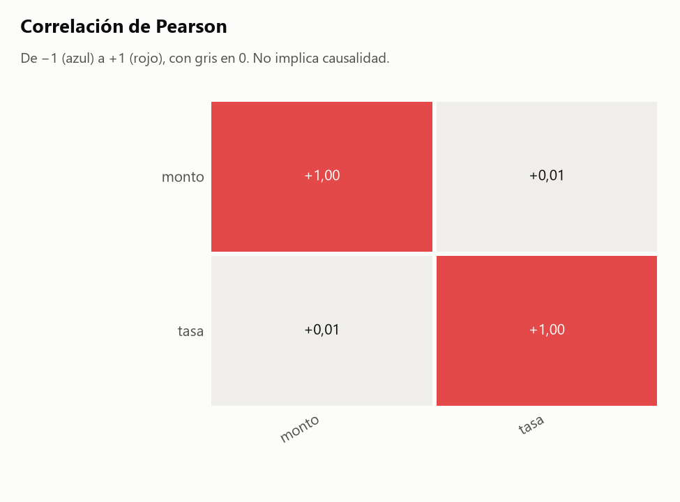

# Informe: decimales_eu.csv

## 1. Resumen

- **Archivo:** decimales_eu.csv
- **Filas:** 300
- **Columnas:** 4
- **Fecha de ejecución:** 2026-11-06 23:05

## 2. Calidad de datos

### Hallazgos

- **H1.** **Conversión de tipos:** `monto`: valores como '19.312,7' tenían punto de miles y coma decimal. Los convertí a número. El archivo original no se modificó.
- **H2.** **Conversión de tipos:** `tasa`: valores como '27,25' tenían punto de miles y coma decimal. Los convertí a número. El archivo original no se modificó.
- **H3.** **Conversión de tipos:** `fecha` no está en formato ISO (AAAA-MM-DD). En valores como '01/02/2024', donde el día y el mes se pueden confundir, pandas asume el mes primero. Conviene comprobarlo.
- **H4.** **Fechas de `fecha`:** Faltan 44 de 344 días entre la primera y la última fecha, repartidos en 12 tramos.

### Sugerencias (no aplicadas)

> **Sugerencia, no aplicada.** Los huecos de `fecha` no dejan un corte claro. Si quieres limitar el rango, reemplaza las fechas en: `python src/agente.py tests/datos_prueba/decimales_eu.csv --desde AAAA-MM-DD --hasta AAAA-MM-DD --salida reports/pruebas`. No excluí nada.

### Fechas de `fecha`

Decisiones:

- Comparé las fechas con el día de ejecución (2026-11-06) y busqué días y meses sin filas entre la primera y la última fecha.

Lo calculado:

- Rango de `fecha`: 2023-01-01 a 2023-12-10.
- Ninguna fecha es posterior al día de ejecución.

| desde | hasta | dias |
|---|---|--:|
| 2023-01-11 | 2023-01-12 | 2 |
| 2023-02-11 | 2023-02-12 | 2 |
| 2023-03-11 | 2023-03-12 | 2 |
| 2023-04-11 | 2023-04-12 | 2 |
| 2023-05-11 | 2023-05-12 | 2 |
| 2023-06-11 | 2023-06-12 | 2 |
| 2023-07-11 | 2023-07-12 | 2 |
| 2023-08-11 | 2023-08-12 | 2 |
| 2023-09-11 | 2023-09-12 | 2 |
| 2023-10-11 | 2023-10-12 | 2 |
| 2023-10-28 | 2023-10-31 | 4 |
| 2023-11-11 | 2023-11-30 | 20 |

Archivo: [tablas/huecos_fecha.csv](tablas/huecos_fecha.csv).

### Agrupaciones

Cálculo: `np.unique(codigos_A * unicos_B + codigos_B), para cada par con unicos(B) > unicos(A)`

Decisiones:

- No comparé agrupaciones: hacen falta 2 columnas agrupables y hay 1.

## 3. Clasificación de columnas

| Columna | Tipo | Rol | Top N | Únicos | Ratio | Por qué ese tipo | Por qué ese rol |
|---|---|---|---|--:|--:|---|---|
| `fecha` | fecha | agrupable | sí | 300 | 1,000000 | el 100% de una muestra de 300 valores se interpretó como fecha (p. ej. '01/01/2023'). | es una fecha con 300 valores distintos. |
| `ciudad` | texto | agrupable | no | 5 | 0,016667 | no es número, código ni fecha. | es texto, no se puede sumar, y su ratio 0,016667 (5 valores únicos) permite agrupar. |
| `monto` | numero | medible | sí | 300 | 1,000000 | el 100% de sus valores son números. | es un número con 300 valores distintos. |
| `tasa` | numero | medible | sí | 289 | 0,963333 | el 100% de sus valores son números. | es un número con 289 valores distintos. |

## 4. Análisis elegidos y descartados

### Elegidos

- Evolución de `monto` por `fecha`: elegí esto porque `fecha` es una fecha agrupable y `monto` es medible.
- Evolución de `tasa` por `fecha`: elegí esto porque `fecha` es una fecha agrupable y `tasa` es medible.
- Matriz de correlación: elegí esto porque hay 2 medibles (`monto`, `tasa`).
- Detección de agrupaciones: corre siempre, pero hacen falta 2 columnas agrupables.

### Omitidos por prioridad

Omitir un análisis no excluye datos: solo evita repetir o mostrar lo menos informativo. Los rankings se ordenan por η² ajustado, que mide qué parte de la variación explican los grupos, con mínimo 0,01, hasta 3 por medida y 8 en total.

Para generarlos todos: `python src/agente.py tests/datos_prueba/decimales_eu.csv --salida reports/pruebas --todo`

| Análisis | η² ajustado | Motivo |
|---|--:|---|
| Ranking de `ciudad` por `tasa` | 0,010 | η² ajustado menor que 0,01 |
| Ranking de `ciudad` por `monto` | 0,006 | η² ajustado menor que 0,01 |

### Descartados

- Filtro por fecha: no excluí ninguna fila porque nadie lo pidió.
- Frecuencias: solo se usan cuando no hay ninguna columna medible, y aquí sí hay.

## 5. Resultados

### Cómo leer las tablas

Vale para todos los análisis de esta sección:

- Cálculo: `df.groupby(periodo)[medida].agg(filas='size', suma='sum', media='mean'), con periodo = mes y año de la fecha`
- Agregué por mes y por año.
- Agregué la columna `dias_con_datos` para distinguir un periodo con poco valor de un periodo con pocos días registrados.

### Evolución de `monto` por `fecha`

Lo calculado:

- Por año, el máximo de la suma de `monto` es 7.076.898,40 en 2023 (300 días con datos) y el mínimo es 7.076.898,40 en 2023 (300 días con datos).
- Por mes, el máximo de la suma de `monto` es 794.286,50 en 2023-01 (29 días con datos) y el mínimo es 220.900,40 en 2023-11 (10 días con datos).

> Aplica lo dicho en la sección 2: H4.



| periodo | filas | suma | media | dias_con_datos |
|---|--:|--:|--:|--:|
| 2023 | 300 | 7.076.898,40 | 23.589,66 | 300 |

Archivo: [tablas/evolucion_fecha_monto_anio.csv](tablas/evolucion_fecha_monto_anio.csv).

Detalle: [tablas/evolucion_fecha_monto_mes.csv](tablas/evolucion_fecha_monto_mes.csv).

### Evolución de `tasa` por `fecha`

Lo calculado:

- Por año, el máximo de la suma de `tasa` es 4.432,89 en 2023 (300 días con datos) y el mínimo es 4.432,89 en 2023 (300 días con datos).
- Por mes, el máximo de la suma de `tasa` es 464,78 en 2023-05 (29 días con datos) y el mínimo es 101,65 en 2023-11 (10 días con datos).

> Aplica lo dicho en la sección 2: H4.



| periodo | filas | suma | media | dias_con_datos |
|---|--:|--:|--:|--:|
| 2023 | 300 | 4.432,89 | 14,78 | 300 |

Archivo: [tablas/evolucion_fecha_tasa_anio.csv](tablas/evolucion_fecha_tasa_anio.csv).

Detalle: [tablas/evolucion_fecha_tasa_mes.csv](tablas/evolucion_fecha_tasa_mes.csv).

### Matriz de correlación

Cálculo: `df[['monto', 'tasa']].corr(method='pearson')`

Decisiones:

- Usé Pearson, que mide relación lineal. Cada par usa las filas donde ambas columnas tienen valor. Listo por separado los pares con |r| de 0.5 o más.

Lo calculado:

- Ningún par alcanza |r| de 0.5.

> **Advertencia:** La correlación no implica causalidad: dos variables pueden moverse juntas sin que una provoque la otra.



| r de Pearson | monto | tasa |
|---|--:|--:|
| monto | 1,00 | 0,01 |
| tasa | 0,01 | 1,00 |

Archivo: [tablas/correlacion.csv](tablas/correlacion.csv).

## 6. Límites

- "Más informativo" es un criterio estadístico, no importancia para el negocio. Un análisis omitido puede ser justo el que interesa: `--todo` los genera todos.
- No sé qué significa cada columna. Por eso cada tabla trae `filas`, `suma` y `media`: cuál es la correcta depende de si la variable es un conteo o una medida.
- No sé cómo se generaron los datos. Las cifras describen lo que hay en el archivo, no necesariamente lo que ocurrió en la realidad.
- No explico por qué cambia una cifra ni por qué dos variables se mueven juntas.
- Un hueco de calendario solo dice que no hay filas en esas fechas. Puede ser normal si el dato es semanal, mensual o no se registra en ciertos días.
- No detecto fechas con el día y el mes intercambiados cuando ambas lecturas son válidas.
- Un mismo texto puede referirse a cosas distintas (dos municipios con el mismo nombre, por ejemplo). Solo lo detecto si otra columna lo revela, y el aviso puede ser falso cuando la relación es una jerarquía legítima.
- No decido qué tramo de datos es válido. Si sugiero un filtro, es una propuesta: solo se aplica si el analista corre el comando.
- Convierto números con punto de miles y coma decimal ('1.234,5'), pero no uno con comas que siempre llevan 3 dígitos ('1,234'): puede ser 1234 o 1,234.
- La clasificación de columnas es heurística. Se corrige con `--forzar columna.tipo=valor` o `--forzar columna.rol=valor`.

## 7. Anexo: perfil completo

Salida literal de `perfilar()`. Su bloque de calidad solo cubre sus propios chequeos; la lista completa de hallazgos está en la sección 2.

```text
PERFIL DE: decimales_eu.csv
============================================================

RESUMEN GENERAL
  Filas:    300
  Columnas: 4
  Memoria:  0.0 MB

COLUMNAS

  columna                      tipo              nulos     únicos
  ---------------------------------------------------------------
  fecha                        datetime64[       0 (  0%)        300
  ciudad                       str               0 (  0%)          5
  monto                        float64           0 (  0%)        300
  tasa                         float64           0 (  0%)        289

CALIDAD DE DATOS
  Sin problemas evidentes.

VARIABLES NUMÉRICAS

         min     media   mediana       max
monto 143.10 23,589.66 23,632.45 49,980.80
tasa    0.00     14.78     15.26     29.91
```
