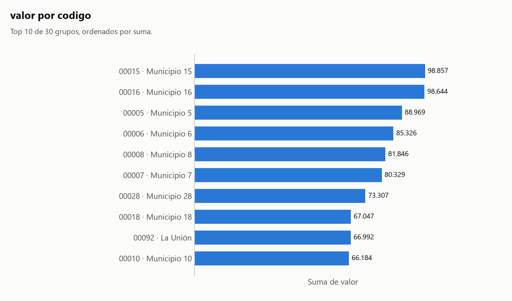

# Informe: jerarquia.csv

## 1. Resumen

- **Archivo:** jerarquia.csv
- **Filas:** 600
- **Columnas:** 3
- **Fecha de ejecución:** 2026-11-06 23:05

## 2. Calidad de datos

### Hallazgos

- **H1.** **perfilar():** 45 filas duplicadas (7.5%)
- **H2.** **Agrupaciones:** Agrupar por `nombre` puede estar mezclando entidades distintas: 1 de 29 valores aparecen junto a más de un valor de `codigo`. Ejemplos: 'La Unión' (2 valores: 00091, 00092). Sugerencia: agrupar por `codigo`.

### Agrupaciones

Cálculo: `np.unique(codigos_A * unicos_B + codigos_B), para cada par con unicos(B) > unicos(A)`

Decisiones:

- Comparé 1 pares entre 2 columnas agrupables, usando todas las filas y sin muestra. Las fechas no entran: casi cualquier valor aparece en varias.
- En 1 pares algún valor de A aparece junto a más de un valor de B. Eso solo no indica una fusión, así que aviso únicamente si al menos el 95% de los valores de B corresponde a un solo A y menos del 50% de los valores de A está afectado. Si todos los valores de A se reparten, es una jerarquía o dos columnas independientes.

Detalle: [tablas/agrupaciones_nombre_codigo.csv](tablas/agrupaciones_nombre_codigo.csv).

Detalle: [tablas/agrupaciones_pares.csv](tablas/agrupaciones_pares.csv).

## 3. Clasificación de columnas

| Columna | Tipo | Rol | Top N | Únicos | Ratio | Por qué ese tipo | Por qué ese rol |
|---|---|---|---|--:|--:|---|---|
| `codigo` | codigo | agrupable | no | 30 | 0,050000 | sus valores son dígitos, pero 600 empiezan por cero (p. ej. '00012'). Un número no lleva ceros a la izquierda. | es código, no se puede sumar, y su ratio 0,050000 (30 valores únicos) permite agrupar. |
| `nombre` | texto | agrupable | no | 29 | 0,048333 | no es número, código ni fecha. | es texto, no se puede sumar, y su ratio 0,048333 (29 valores únicos) permite agrupar. |
| `valor` | numero | medible | sí | 532 | 0,886667 | el 100% de sus valores son números. | es un número con 532 valores distintos. |

Códigos detectados por heurística; corrígelos si no lo son:

- `codigo`: sus valores son dígitos, pero 600 empiezan por cero (p. ej. '00012'). Un número no lleva ceros a la izquierda. Para corregirlo: `--forzar codigo.tipo=numero`.

## 4. Análisis elegidos y descartados

### Elegidos

- Ranking de `codigo` por `valor`: elegí esto porque `codigo` es agrupable (tipo codigo) y `valor` es medible. η² ajustado: 1,000.
- Detección de agrupaciones: elegí esto porque hay 2 columnas agrupables que no son fecha. Resultado en la sección 2.

### Omitidos por prioridad

Omitir un análisis no excluye datos: solo evita repetir o mostrar lo menos informativo. Los rankings se ordenan por η² ajustado, que mide qué parte de la variación explican los grupos, con mínimo 0,01, hasta 3 por medida y 8 en total.

Para generarlos todos: `python src/agente.py tests/datos_prueba/jerarquia.csv --salida reports/pruebas --todo`

| Análisis | η² ajustado | Motivo |
|---|--:|---|
| Ranking de `nombre` por `valor` | — | casi equivalente a `codigo`, que lo lleva como etiqueta |

### Descartados

- Filtro por fecha: no excluí ninguna fila porque nadie lo pidió.
- Evolución en el tiempo: no hay columna de fecha agrupable.
- Matriz de correlación: hacen falta 2 columnas medibles y hay 1.
- Frecuencias: solo se usan cuando no hay ninguna columna medible, y aquí sí hay.

## 5. Resultados

### Ranking de `codigo` (con `nombre`) por `valor`

Cálculo: `df.groupby(grupo)[medida].agg(filas='size', suma='sum', media='mean')`

Decisiones:

- Ordené por suma, de mayor a menor. Los nulos del grupo forman '(nulo)' para que los totales cuadren.
- `codigo` y `nombre` son casi equivalentes: una sola tabla, agrupada por `codigo` y con el valor más frecuente de `nombre` como etiqueta.

Lo calculado:

- El máximo de la suma es 98.857 en '00015' (Municipio 15); el mínimo es 3.091 en '00012' (Municipio 12).
- La media más alta es 4.942,85 en '00015' (Municipio 15).
- El grupo con más filas es '00015' (Municipio 15), con 20.

> Aplica lo dicho en la sección 2: H2.

> **Advertencia:** El top 10 por filas y el top 10 por suma son distintos. El primero por filas es '00001'; por suma, '00015'. Solo en el top por filas: 00001, 00002, 00003, 00004, 00009. Solo en el top por suma: 00015, 00016, 00028, 00018, 00092. Contar filas y sumar la medida no dan el mismo orden.



| grupo | etiqueta | filas | suma | media | puesto_suma | puesto_filas |
|---|---|--:|--:|--:|--:|--:|
| 00015 | Municipio 15 | 20 | 98.857 | 4.942,85 | 1 | 1 |
| 00016 | Municipio 16 | 20 | 98.644 | 4.932,20 | 2 | 1 |
| 00005 | Municipio 5 | 20 | 88.969 | 4.448,45 | 3 | 1 |
| 00006 | Municipio 6 | 20 | 85.326 | 4.266,30 | 4 | 1 |
| 00008 | Municipio 8 | 20 | 81.846 | 4.092,30 | 5 | 1 |
| 00007 | Municipio 7 | 20 | 80.329 | 4.016,45 | 6 | 1 |
| 00028 | Municipio 28 | 20 | 73.307 | 3.665,35 | 7 | 1 |
| 00018 | Municipio 18 | 20 | 67.047 | 3.352,35 | 8 | 1 |
| 00092 | La Unión | 20 | 66.992 | 3.349,60 | 9 | 1 |
| 00010 | Municipio 10 | 20 | 66.184 | 3.309,20 | 10 | 1 |
| 00019 | Municipio 19 | 20 | 64.078 | 3.203,90 | 11 | 1 |
| 00025 | Municipio 25 | 20 | 56.512 | 2.825,60 | 12 | 1 |
| 00027 | Municipio 27 | 20 | 53.654 | 2.682,70 | 13 | 1 |
| 00021 | Municipio 21 | 20 | 52.751 | 2.637,55 | 14 | 1 |
| 00017 | Municipio 17 | 20 | 50.743 | 2.537,15 | 15 | 1 |
| 00026 | Municipio 26 | 20 | 48.594 | 2.429,70 | 16 | 1 |
| 00004 | Municipio 4 | 20 | 48.446 | 2.422,30 | 17 | 1 |
| 00023 | Municipio 23 | 20 | 42.408 | 2.120,40 | 18 | 1 |
| 00020 | Municipio 20 | 20 | 40.306 | 2.015,30 | 19 | 1 |
| 00003 | Municipio 3 | 20 | 37.262 | 1.863,10 | 20 | 1 |
| 00091 | La Unión | 20 | 33.817 | 1.690,85 | 21 | 1 |
| 00014 | Municipio 14 | 20 | 28.554 | 1.427,70 | 22 | 1 |
| 00013 | Municipio 13 | 20 | 17.019 | 850,95 | 23 | 1 |
| 00011 | Municipio 11 | 20 | 14.494 | 724,70 | 24 | 1 |
| 00001 | Municipio 1 | 20 | 14.423 | 721,15 | 25 | 1 |
| 00024 | Municipio 24 | 20 | 6.745 | 337,25 | 26 | 1 |
| 00009 | Municipio 9 | 20 | 6.362 | 318,10 | 27 | 1 |
| 00002 | Municipio 2 | 20 | 5.052 | 252,60 | 28 | 1 |
| 00022 | Municipio 22 | 20 | 3.416 | 170,80 | 29 | 1 |
| 00012 | Municipio 12 | 20 | 3.091 | 154,55 | 30 | 1 |

Archivo: [tablas/ranking_codigo_valor.csv](tablas/ranking_codigo_valor.csv).

## 6. Límites

- "Más informativo" es un criterio estadístico, no importancia para el negocio. Un análisis omitido puede ser justo el que interesa: `--todo` los genera todos.
- No sé qué significa cada columna. Por eso cada tabla trae `filas`, `suma` y `media`: cuál es la correcta depende de si la variable es un conteo o una medida.
- No sé cómo se generaron los datos. Las cifras describen lo que hay en el archivo, no necesariamente lo que ocurrió en la realidad.
- No explico por qué cambia una cifra ni por qué dos variables se mueven juntas.
- Un hueco de calendario solo dice que no hay filas en esas fechas. Puede ser normal si el dato es semanal, mensual o no se registra en ciertos días.
- No detecto fechas con el día y el mes intercambiados cuando ambas lecturas son válidas.
- Un mismo texto puede referirse a cosas distintas (dos municipios con el mismo nombre, por ejemplo). Solo lo detecto si otra columna lo revela, y el aviso puede ser falso cuando la relación es una jerarquía legítima.
- No decido qué tramo de datos es válido. Si sugiero un filtro, es una propuesta: solo se aplica si el analista corre el comando.
- Convierto números con punto de miles y coma decimal ('1.234,5'), pero no uno con comas que siempre llevan 3 dígitos ('1,234'): puede ser 1234 o 1,234.
- La clasificación de columnas es heurística. Se corrige con `--forzar columna.tipo=valor` o `--forzar columna.rol=valor`.

## 7. Anexo: perfil completo

Salida literal de `perfilar()`. Su bloque de calidad solo cubre sus propios chequeos; la lista completa de hallazgos está en la sección 2.

```text
PERFIL DE: jerarquia.csv
============================================================

RESUMEN GENERAL
  Filas:    600
  Columnas: 3
  Memoria:  0.1 MB

COLUMNAS

  columna                      tipo              nulos     únicos
  ---------------------------------------------------------------
  codigo                       str               0 (  0%)         30
  nombre                       str               0 (  0%)         29
  valor                        int64             0 (  0%)        532

CALIDAD DE DATOS

  - 45 filas duplicadas (7.5%)

VARIABLES NUMÉRICAS

         min    media  mediana      max
valor 102.00 2,392.05 2,493.00 4,991.00
```
