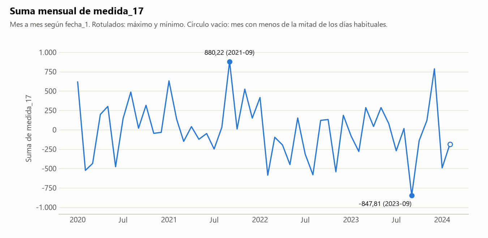
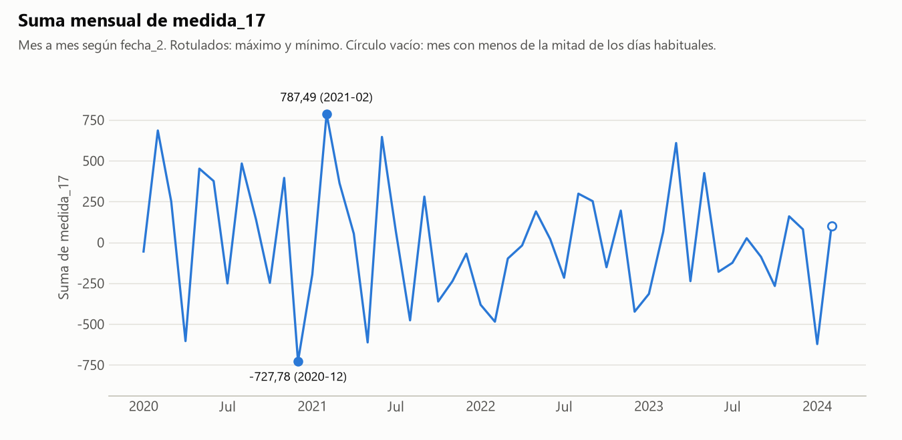
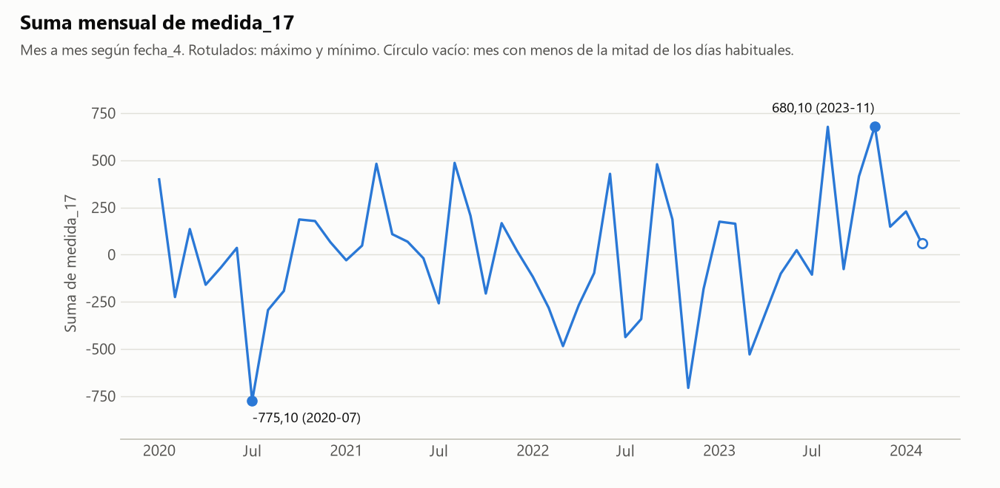
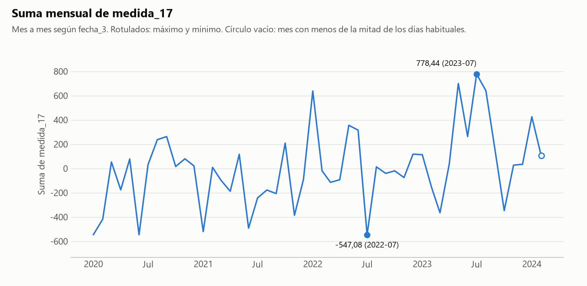
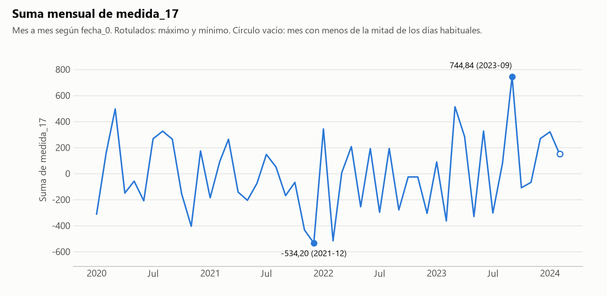
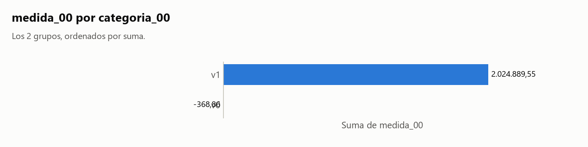
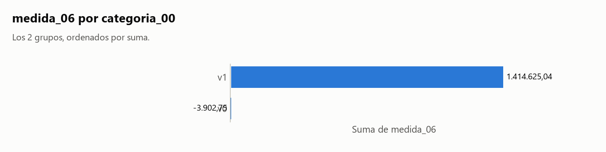
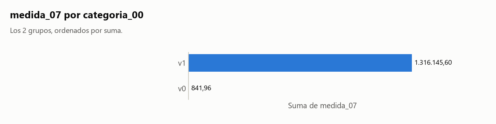
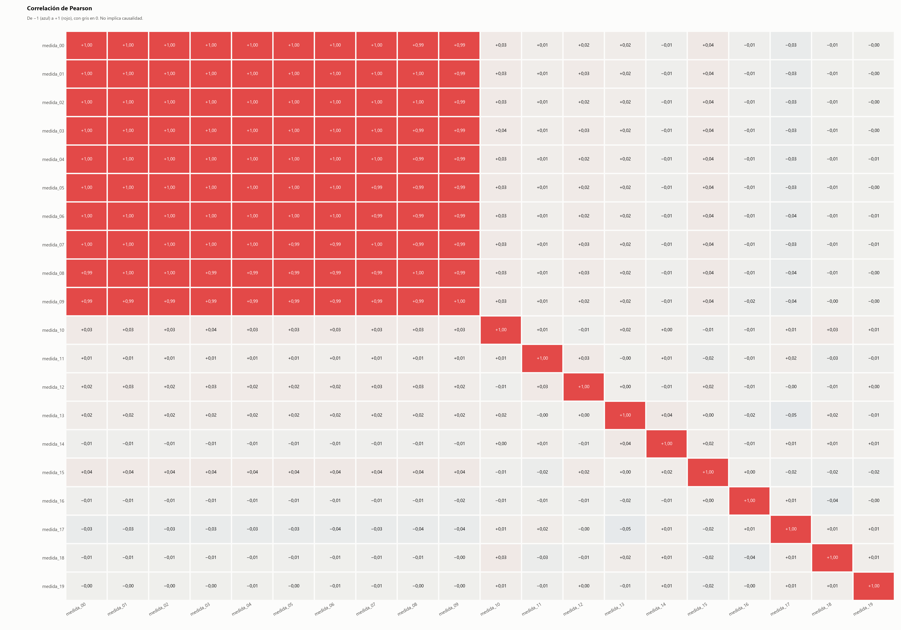

# Informe: muy_ancho.csv

## 1. Resumen

- **Archivo:** muy_ancho.csv
- **Filas:** 2.000
- **Columnas:** 50
- **Fecha de ejecución:** 2026-11-06 23:05

## 2. Calidad de datos

### Hallazgos

- **H1.** **Fechas de `fecha_0`:** Faltan 393 de 1.498 días entre la primera y la última fecha, repartidos en 293 tramos.
- **H2.** **Fechas de `fecha_1`:** Faltan 420 de 1.500 días entre la primera y la última fecha, repartidos en 298 tramos.
- **H3.** **Fechas de `fecha_2`:** Faltan 401 de 1.500 días entre la primera y la última fecha, repartidos en 291 tramos.
- **H4.** **Fechas de `fecha_3`:** Faltan 406 de 1.500 días entre la primera y la última fecha, repartidos en 290 tramos.
- **H5.** **Fechas de `fecha_4`:** Faltan 373 de 1.500 días entre la primera y la última fecha, repartidos en 281 tramos.

### Sugerencias (no aplicadas)

> **Sugerencia, no aplicada.** Los huecos de `fecha_0` no dejan un corte claro. Si quieres limitar el rango, reemplaza las fechas en: `python src/agente.py tests/datos_prueba/muy_ancho.csv --desde AAAA-MM-DD --hasta AAAA-MM-DD --columna-fecha fecha_0 --salida reports/pruebas`. No excluí nada.

> **Sugerencia, no aplicada.** Los huecos de `fecha_1` no dejan un corte claro. Si quieres limitar el rango, reemplaza las fechas en: `python src/agente.py tests/datos_prueba/muy_ancho.csv --desde AAAA-MM-DD --hasta AAAA-MM-DD --columna-fecha fecha_1 --salida reports/pruebas`. No excluí nada.

> **Sugerencia, no aplicada.** Los huecos de `fecha_2` no dejan un corte claro. Si quieres limitar el rango, reemplaza las fechas en: `python src/agente.py tests/datos_prueba/muy_ancho.csv --desde AAAA-MM-DD --hasta AAAA-MM-DD --columna-fecha fecha_2 --salida reports/pruebas`. No excluí nada.

> **Sugerencia, no aplicada.** Los huecos de `fecha_3` no dejan un corte claro. Si quieres limitar el rango, reemplaza las fechas en: `python src/agente.py tests/datos_prueba/muy_ancho.csv --desde AAAA-MM-DD --hasta AAAA-MM-DD --columna-fecha fecha_3 --salida reports/pruebas`. No excluí nada.

> **Sugerencia, no aplicada.** Los huecos de `fecha_4` no dejan un corte claro. Si quieres limitar el rango, reemplaza las fechas en: `python src/agente.py tests/datos_prueba/muy_ancho.csv --desde AAAA-MM-DD --hasta AAAA-MM-DD --columna-fecha fecha_4 --salida reports/pruebas`. No excluí nada.

### Fechas de `fecha_0`

Decisiones:

- Comparé las fechas con el día de ejecución (2026-11-06) y busqué días y meses sin filas entre la primera y la última fecha.

Lo calculado:

- Rango de `fecha_0`: 2020-01-01 a 2024-02-06.
- Ninguna fecha es posterior al día de ejecución.

| desde | hasta | dias |
|---|---|--:|
| 2020-01-03 | 2020-01-03 | 1 |
| 2020-01-05 | 2020-01-05 | 1 |
| 2020-01-07 | 2020-01-07 | 1 |
| 2020-01-10 | 2020-01-10 | 1 |
| 2020-01-16 | 2020-01-17 | 2 |
| 2020-01-19 | 2020-01-19 | 1 |
| 2020-01-31 | 2020-01-31 | 1 |
| 2020-02-05 | 2020-02-05 | 1 |
| 2020-02-12 | 2020-02-14 | 3 |
| 2020-02-16 | 2020-02-18 | 3 |
| … 278 filas omitidas | | |
| 2024-01-02 | 2024-01-02 | 1 |
| 2024-01-05 | 2024-01-05 | 1 |
| 2024-01-20 | 2024-01-20 | 1 |
| 2024-01-25 | 2024-01-25 | 1 |
| 2024-02-02 | 2024-02-02 | 1 |

Tabla completa (293 filas) en [tablas/huecos_fecha_0.csv](tablas/huecos_fecha_0.csv).

### Fechas de `fecha_1`

Decisiones:

- Comparé las fechas con el día de ejecución (2026-11-06) y busqué días y meses sin filas entre la primera y la última fecha.

Lo calculado:

- Rango de `fecha_1`: 2020-01-01 a 2024-02-08.
- Ninguna fecha es posterior al día de ejecución.

| desde | hasta | dias |
|---|---|--:|
| 2020-01-06 | 2020-01-06 | 1 |
| 2020-01-10 | 2020-01-10 | 1 |
| 2020-01-13 | 2020-01-13 | 1 |
| 2020-01-25 | 2020-01-25 | 1 |
| 2020-01-31 | 2020-01-31 | 1 |
| 2020-02-03 | 2020-02-03 | 1 |
| 2020-02-07 | 2020-02-07 | 1 |
| 2020-02-11 | 2020-02-11 | 1 |
| 2020-02-13 | 2020-02-13 | 1 |
| 2020-02-15 | 2020-02-15 | 1 |
| … 283 filas omitidas | | |
| 2023-12-21 | 2023-12-24 | 4 |
| 2024-01-02 | 2024-01-04 | 3 |
| 2024-01-19 | 2024-01-19 | 1 |
| 2024-01-31 | 2024-01-31 | 1 |
| 2024-02-02 | 2024-02-02 | 1 |

Tabla completa (298 filas) en [tablas/huecos_fecha_1.csv](tablas/huecos_fecha_1.csv).

### Fechas de `fecha_2`

Decisiones:

- Comparé las fechas con el día de ejecución (2026-11-06) y busqué días y meses sin filas entre la primera y la última fecha.

Lo calculado:

- Rango de `fecha_2`: 2020-01-01 a 2024-02-08.
- Ninguna fecha es posterior al día de ejecución.

| desde | hasta | dias |
|---|---|--:|
| 2020-01-02 | 2020-01-02 | 1 |
| 2020-01-09 | 2020-01-09 | 1 |
| 2020-01-12 | 2020-01-12 | 1 |
| 2020-01-15 | 2020-01-15 | 1 |
| 2020-01-18 | 2020-01-20 | 3 |
| 2020-01-23 | 2020-01-24 | 2 |
| 2020-01-28 | 2020-01-28 | 1 |
| 2020-01-30 | 2020-02-01 | 3 |
| 2020-02-03 | 2020-02-03 | 1 |
| 2020-02-05 | 2020-02-06 | 2 |
| … 276 filas omitidas | | |
| 2024-01-18 | 2024-01-20 | 3 |
| 2024-01-26 | 2024-01-26 | 1 |
| 2024-01-28 | 2024-01-28 | 1 |
| 2024-01-31 | 2024-01-31 | 1 |
| 2024-02-03 | 2024-02-03 | 1 |

Tabla completa (291 filas) en [tablas/huecos_fecha_2.csv](tablas/huecos_fecha_2.csv).

### Fechas de `fecha_3`

Decisiones:

- Comparé las fechas con el día de ejecución (2026-11-06) y busqué días y meses sin filas entre la primera y la última fecha.

Lo calculado:

- Rango de `fecha_3`: 2020-01-01 a 2024-02-08.
- Ninguna fecha es posterior al día de ejecución.

| desde | hasta | dias |
|---|---|--:|
| 2020-01-04 | 2020-01-05 | 2 |
| 2020-01-09 | 2020-01-09 | 1 |
| 2020-01-23 | 2020-01-23 | 1 |
| 2020-01-25 | 2020-01-27 | 3 |
| 2020-02-02 | 2020-02-04 | 3 |
| 2020-02-06 | 2020-02-06 | 1 |
| 2020-02-09 | 2020-02-09 | 1 |
| 2020-02-17 | 2020-02-18 | 2 |
| 2020-02-21 | 2020-02-21 | 1 |
| 2020-02-23 | 2020-02-24 | 2 |
| … 275 filas omitidas | | |
| 2024-01-16 | 2024-01-18 | 3 |
| 2024-01-23 | 2024-01-23 | 1 |
| 2024-01-25 | 2024-01-25 | 1 |
| 2024-01-27 | 2024-01-27 | 1 |
| 2024-01-29 | 2024-01-29 | 1 |

Tabla completa (290 filas) en [tablas/huecos_fecha_3.csv](tablas/huecos_fecha_3.csv).

### Fechas de `fecha_4`

Decisiones:

- Comparé las fechas con el día de ejecución (2026-11-06) y busqué días y meses sin filas entre la primera y la última fecha.

Lo calculado:

- Rango de `fecha_4`: 2020-01-01 a 2024-02-08.
- Ninguna fecha es posterior al día de ejecución.

| desde | hasta | dias |
|---|---|--:|
| 2020-01-02 | 2020-01-02 | 1 |
| 2020-01-07 | 2020-01-07 | 1 |
| 2020-01-13 | 2020-01-13 | 1 |
| 2020-01-17 | 2020-01-17 | 1 |
| 2020-01-20 | 2020-01-20 | 1 |
| 2020-01-29 | 2020-01-29 | 1 |
| 2020-02-07 | 2020-02-07 | 1 |
| 2020-02-10 | 2020-02-10 | 1 |
| 2020-02-20 | 2020-02-20 | 1 |
| 2020-02-22 | 2020-02-22 | 1 |
| … 266 filas omitidas | | |
| 2024-01-05 | 2024-01-05 | 1 |
| 2024-01-18 | 2024-01-18 | 1 |
| 2024-01-26 | 2024-01-26 | 1 |
| 2024-02-02 | 2024-02-02 | 1 |
| 2024-02-06 | 2024-02-06 | 1 |

Tabla completa (281 filas) en [tablas/huecos_fecha_4.csv](tablas/huecos_fecha_4.csv).

### Agrupaciones

Cálculo: `np.unique(codigos_A * unicos_B + codigos_B), para cada par con unicos(B) > unicos(A)`

Decisiones:

- Comparé 180 pares entre 20 columnas agrupables, usando todas las filas y sin muestra. Las fechas no entran: casi cualquier valor aparece en varias.
- En 180 pares algún valor de A aparece junto a más de un valor de B. Eso solo no indica una fusión, así que aviso únicamente si al menos el 95% de los valores de B corresponde a un solo A y menos del 50% de los valores de A está afectado. Si todos los valores de A se reparten, es una jerarquía o dos columnas independientes.
- Omití 10 pares con el mismo número de valores únicos.

Lo calculado:

- Ningún par cumple las condiciones para avisar.

Detalle: [tablas/agrupaciones_pares.csv](tablas/agrupaciones_pares.csv).

## 3. Clasificación de columnas

| Columna | Tipo | Rol | Top N | Únicos | Ratio | Por qué ese tipo | Por qué ese rol |
|---|---|---|---|--:|--:|---|---|
| `categoria_00` | texto | agrupable | no | 2 | 0,001000 | no es número, código ni fecha. | es texto, no se puede sumar, y su ratio 0,001000 (2 valores únicos) permite agrupar. |
| `categoria_01` | texto | agrupable | no | 3 | 0,001500 | no es número, código ni fecha. | es texto, no se puede sumar, y su ratio 0,001500 (3 valores únicos) permite agrupar. |
| `categoria_02` | texto | agrupable | no | 4 | 0,002000 | no es número, código ni fecha. | es texto, no se puede sumar, y su ratio 0,002000 (4 valores únicos) permite agrupar. |
| `categoria_03` | texto | agrupable | no | 5 | 0,002500 | no es número, código ni fecha. | es texto, no se puede sumar, y su ratio 0,002500 (5 valores únicos) permite agrupar. |
| `categoria_04` | texto | agrupable | no | 6 | 0,003000 | no es número, código ni fecha. | es texto, no se puede sumar, y su ratio 0,003000 (6 valores únicos) permite agrupar. |
| `categoria_05` | texto | agrupable | no | 7 | 0,003500 | no es número, código ni fecha. | es texto, no se puede sumar, y su ratio 0,003500 (7 valores únicos) permite agrupar. |
| `categoria_06` | texto | agrupable | no | 8 | 0,004000 | no es número, código ni fecha. | es texto, no se puede sumar, y su ratio 0,004000 (8 valores únicos) permite agrupar. |
| `categoria_07` | texto | agrupable | no | 9 | 0,004500 | no es número, código ni fecha. | es texto, no se puede sumar, y su ratio 0,004500 (9 valores únicos) permite agrupar. |
| `categoria_08` | texto | agrupable | no | 10 | 0,005000 | no es número, código ni fecha. | es texto, no se puede sumar, y su ratio 0,005000 (10 valores únicos) permite agrupar. |
| `categoria_09` | texto | agrupable | no | 11 | 0,005500 | no es número, código ni fecha. | es texto, no se puede sumar, y su ratio 0,005500 (11 valores únicos) permite agrupar. |
| `categoria_10` | texto | agrupable | no | 12 | 0,006000 | no es número, código ni fecha. | es texto, no se puede sumar, y su ratio 0,006000 (12 valores únicos) permite agrupar. |
| `categoria_11` | texto | agrupable | no | 13 | 0,006500 | no es número, código ni fecha. | es texto, no se puede sumar, y su ratio 0,006500 (13 valores únicos) permite agrupar. |
| `categoria_12` | texto | agrupable | no | 14 | 0,007000 | no es número, código ni fecha. | es texto, no se puede sumar, y su ratio 0,007000 (14 valores únicos) permite agrupar. |
| `categoria_13` | texto | agrupable | no | 15 | 0,007500 | no es número, código ni fecha. | es texto, no se puede sumar, y su ratio 0,007500 (15 valores únicos) permite agrupar. |
| `categoria_14` | texto | agrupable | no | 16 | 0,008000 | no es número, código ni fecha. | es texto, no se puede sumar, y su ratio 0,008000 (16 valores únicos) permite agrupar. |
| `medida_00` | numero | medible | sí | 1.947 | 0,973500 | el 100% de sus valores son números. | es un número con 1.947 valores distintos. |
| `medida_01` | numero | medible | sí | 1.948 | 0,974000 | el 100% de sus valores son números. | es un número con 1.948 valores distintos. |
| `medida_02` | numero | medible | sí | 1.953 | 0,976500 | el 100% de sus valores son números. | es un número con 1.953 valores distintos. |
| `medida_03` | numero | medible | sí | 1.931 | 0,965500 | el 100% de sus valores son números. | es un número con 1.931 valores distintos. |
| `medida_04` | numero | medible | sí | 1.943 | 0,971500 | el 100% de sus valores son números. | es un número con 1.943 valores distintos. |
| `medida_05` | numero | medible | sí | 1.946 | 0,973000 | el 100% de sus valores son números. | es un número con 1.946 valores distintos. |
| `medida_06` | numero | medible | sí | 1.951 | 0,975500 | el 100% de sus valores son números. | es un número con 1.951 valores distintos. |
| `medida_07` | numero | medible | sí | 1.942 | 0,971000 | el 100% de sus valores son números. | es un número con 1.942 valores distintos. |
| `medida_08` | numero | medible | sí | 1.948 | 0,974000 | el 100% de sus valores son números. | es un número con 1.948 valores distintos. |
| `medida_09` | numero | medible | sí | 1.939 | 0,969500 | el 100% de sus valores son números. | es un número con 1.939 valores distintos. |
| `medida_10` | numero | medible | sí | 1.878 | 0,939000 | el 100% de sus valores son números. | es un número con 1.878 valores distintos. |
| `medida_11` | numero | medible | sí | 1.894 | 0,947000 | el 100% de sus valores son números. | es un número con 1.894 valores distintos. |
| `medida_12` | numero | medible | sí | 1.886 | 0,943000 | el 100% de sus valores son números. | es un número con 1.886 valores distintos. |
| `medida_13` | numero | medible | sí | 1.912 | 0,956000 | el 100% de sus valores son números. | es un número con 1.912 valores distintos. |
| `medida_14` | numero | medible | sí | 1.883 | 0,941500 | el 100% de sus valores son números. | es un número con 1.883 valores distintos. |
| `medida_15` | numero | medible | sí | 1.900 | 0,950000 | el 100% de sus valores son números. | es un número con 1.900 valores distintos. |
| `medida_16` | numero | medible | sí | 1.872 | 0,936000 | el 100% de sus valores son números. | es un número con 1.872 valores distintos. |
| `medida_17` | numero | medible | sí | 1.915 | 0,957500 | el 100% de sus valores son números. | es un número con 1.915 valores distintos. |
| `medida_18` | numero | medible | sí | 1.877 | 0,938500 | el 100% de sus valores son números. | es un número con 1.877 valores distintos. |
| `medida_19` | numero | medible | sí | 1.894 | 0,947000 | el 100% de sus valores son números. | es un número con 1.894 valores distintos. |
| `fecha_0` | fecha | agrupable | sí | 1.105 | 0,552500 | el 100% de una muestra de 1.000 valores se interpretó como fecha (p. ej. '2022-12-21'). | es una fecha con 1.105 valores distintos. |
| `fecha_1` | fecha | agrupable | sí | 1.080 | 0,540000 | el 100% de una muestra de 1.000 valores se interpretó como fecha (p. ej. '2022-01-07'). | es una fecha con 1.080 valores distintos. |
| `fecha_2` | fecha | agrupable | sí | 1.099 | 0,549500 | el 100% de una muestra de 1.000 valores se interpretó como fecha (p. ej. '2021-04-03'). | es una fecha con 1.099 valores distintos. |
| `fecha_3` | fecha | agrupable | sí | 1.094 | 0,547000 | el 100% de una muestra de 1.000 valores se interpretó como fecha (p. ej. '2023-08-15'). | es una fecha con 1.094 valores distintos. |
| `fecha_4` | fecha | agrupable | sí | 1.127 | 0,563500 | el 100% de una muestra de 1.000 valores se interpretó como fecha (p. ej. '2022-12-23'). | es una fecha con 1.127 valores distintos. |
| `cod_0` | codigo | agrupable | sí | 299 | 0,149500 | sus valores son dígitos, pero 2.000 empiezan por cero (p. ej. '00291'). Un número no lleva ceros a la izquierda. | es código, no se puede sumar, y su ratio 0,149500 (299 valores únicos) permite agrupar. |
| `cod_1` | codigo | agrupable | sí | 299 | 0,149500 | sus valores son dígitos, pero 2.000 empiezan por cero (p. ej. '00145'). Un número no lleva ceros a la izquierda. | es código, no se puede sumar, y su ratio 0,149500 (299 valores únicos) permite agrupar. |
| `cod_2` | codigo | agrupable | sí | 299 | 0,149500 | sus valores son dígitos, pero 2.000 empiezan por cero (p. ej. '00211'). Un número no lleva ceros a la izquierda. | es código, no se puede sumar, y su ratio 0,149500 (299 valores únicos) permite agrupar. |
| `cod_3` | codigo | agrupable | sí | 299 | 0,149500 | sus valores son dígitos, pero 2.000 empiezan por cero (p. ej. '00073'). Un número no lleva ceros a la izquierda. | es código, no se puede sumar, y su ratio 0,149500 (299 valores únicos) permite agrupar. |
| `cod_4` | codigo | agrupable | sí | 299 | 0,149500 | sus valores son dígitos, pero 2.000 empiezan por cero (p. ej. '00165'). Un número no lleva ceros a la izquierda. | es código, no se puede sumar, y su ratio 0,149500 (299 valores únicos) permite agrupar. |
| `texto_0` | texto | ignorar | sí | 2.000 | 1,000000 | no es número, código ni fecha. | ratio 1,000000 (2.000 valores únicos), mayor que 0,5: casi único por fila, es un identificador. |
| `texto_1` | texto | ignorar | sí | 2.000 | 1,000000 | no es número, código ni fecha. | ratio 1,000000 (2.000 valores únicos), mayor que 0,5: casi único por fila, es un identificador. |
| `texto_2` | texto | ignorar | sí | 2.000 | 1,000000 | no es número, código ni fecha. | ratio 1,000000 (2.000 valores únicos), mayor que 0,5: casi único por fila, es un identificador. |
| `texto_3` | texto | ignorar | sí | 2.000 | 1,000000 | no es número, código ni fecha. | ratio 1,000000 (2.000 valores únicos), mayor que 0,5: casi único por fila, es un identificador. |
| `texto_4` | texto | ignorar | sí | 2.000 | 1,000000 | no es número, código ni fecha. | ratio 1,000000 (2.000 valores únicos), mayor que 0,5: casi único por fila, es un identificador. |

Códigos detectados por heurística; corrígelos si no lo son:

- `cod_0`: sus valores son dígitos, pero 2.000 empiezan por cero (p. ej. '00291'). Un número no lleva ceros a la izquierda. Para corregirlo: `--forzar cod_0.tipo=numero`.
- `cod_1`: sus valores son dígitos, pero 2.000 empiezan por cero (p. ej. '00145'). Un número no lleva ceros a la izquierda. Para corregirlo: `--forzar cod_1.tipo=numero`.
- `cod_2`: sus valores son dígitos, pero 2.000 empiezan por cero (p. ej. '00211'). Un número no lleva ceros a la izquierda. Para corregirlo: `--forzar cod_2.tipo=numero`.
- `cod_3`: sus valores son dígitos, pero 2.000 empiezan por cero (p. ej. '00073'). Un número no lleva ceros a la izquierda. Para corregirlo: `--forzar cod_3.tipo=numero`.
- `cod_4`: sus valores son dígitos, pero 2.000 empiezan por cero (p. ej. '00165'). Un número no lleva ceros a la izquierda. Para corregirlo: `--forzar cod_4.tipo=numero`.

## 4. Análisis elegidos y descartados

### Elegidos

- Evolución de `medida_17` por `fecha_1`: elegí esto porque `fecha_1` es una fecha agrupable y `medida_17` es medible.
- Evolución de `medida_17` por `fecha_2`: elegí esto porque `fecha_2` es una fecha agrupable y `medida_17` es medible.
- Evolución de `medida_17` por `fecha_4`: elegí esto porque `fecha_4` es una fecha agrupable y `medida_17` es medible.
- Evolución de `medida_17` por `fecha_3`: elegí esto porque `fecha_3` es una fecha agrupable y `medida_17` es medible.
- Evolución de `medida_17` por `fecha_0`: elegí esto porque `fecha_0` es una fecha agrupable y `medida_17` es medible.
- Ranking de `categoria_00` por `medida_00`: elegí esto porque `categoria_00` es agrupable (tipo texto) y `medida_00` es medible. η² ajustado: 0,997.
- Ranking de `categoria_00` por `medida_01`: elegí esto porque `categoria_00` es agrupable (tipo texto) y `medida_01` es medible. η² ajustado: 0,997.
- Ranking de `categoria_00` por `medida_02`: elegí esto porque `categoria_00` es agrupable (tipo texto) y `medida_02` es medible. η² ajustado: 0,997.
- Ranking de `categoria_00` por `medida_03`: elegí esto porque `categoria_00` es agrupable (tipo texto) y `medida_03` es medible. η² ajustado: 0,997.
- Ranking de `categoria_00` por `medida_04`: elegí esto porque `categoria_00` es agrupable (tipo texto) y `medida_04` es medible. η² ajustado: 0,996.
- Ranking de `categoria_00` por `medida_05`: elegí esto porque `categoria_00` es agrupable (tipo texto) y `medida_05` es medible. η² ajustado: 0,996.
- Ranking de `categoria_00` por `medida_06`: elegí esto porque `categoria_00` es agrupable (tipo texto) y `medida_06` es medible. η² ajustado: 0,995.
- Ranking de `categoria_00` por `medida_07`: elegí esto porque `categoria_00` es agrupable (tipo texto) y `medida_07` es medible. η² ajustado: 0,994.
- Matriz de correlación: elegí esto porque hay 20 medibles (`medida_00`, `medida_01`, `medida_02`, `medida_03`, `medida_04`, `medida_05`, `medida_06`, `medida_07`, `medida_08`, `medida_09`, `medida_10`, `medida_11`, `medida_12`, `medida_13`, `medida_14`, `medida_15`, `medida_16`, `medida_17`, `medida_18`, `medida_19`).
- Detección de agrupaciones: elegí esto porque hay 20 columnas agrupables que no son fecha. Resultado en la sección 2.

### Omitidos por prioridad

Omitir un análisis no excluye datos: solo evita repetir o mostrar lo menos informativo. Los rankings se ordenan por η² ajustado, que mide qué parte de la variación explican los grupos, con mínimo 0,01, hasta 3 por medida y 8 en total.

Para generarlos todos: `python src/agente.py tests/datos_prueba/muy_ancho.csv --salida reports/pruebas --todo`

| Análisis | η² ajustado | Motivo |
|---|--:|---|
| Evolución de `medida_12` por `fecha_2` | — | tope de 5 evoluciones; varía menos que las elegidas |
| Evolución de `medida_12` por `fecha_0` | — | tope de 5 evoluciones; varía menos que las elegidas |
| Evolución de `medida_12` por `fecha_3` | — | tope de 5 evoluciones; varía menos que las elegidas |
| Evolución de `medida_12` por `fecha_4` | — | tope de 5 evoluciones; varía menos que las elegidas |
| Evolución de `medida_12` por `fecha_1` | — | tope de 5 evoluciones; varía menos que las elegidas |
| Evolución de `medida_14` por `fecha_4` | — | tope de 5 evoluciones; varía menos que las elegidas |
| Evolución de `medida_18` por `fecha_1` | — | tope de 5 evoluciones; varía menos que las elegidas |
| Evolución de `medida_14` por `fecha_0` | — | tope de 5 evoluciones; varía menos que las elegidas |
| Evolución de `medida_14` por `fecha_2` | — | tope de 5 evoluciones; varía menos que las elegidas |
| Evolución de `medida_16` por `fecha_4` | — | tope de 5 evoluciones; varía menos que las elegidas |
| Evolución de `medida_14` por `fecha_3` | — | tope de 5 evoluciones; varía menos que las elegidas |
| Evolución de `medida_16` por `fecha_0` | — | tope de 5 evoluciones; varía menos que las elegidas |
| Evolución de `medida_16` por `fecha_2` | — | tope de 5 evoluciones; varía menos que las elegidas |
| Evolución de `medida_14` por `fecha_1` | — | tope de 5 evoluciones; varía menos que las elegidas |
| Evolución de `medida_18` por `fecha_3` | — | tope de 5 evoluciones; varía menos que las elegidas |
| Evolución de `medida_18` por `fecha_0` | — | tope de 5 evoluciones; varía menos que las elegidas |
| Evolución de `medida_19` por `fecha_2` | — | tope de 5 evoluciones; varía menos que las elegidas |
| Evolución de `medida_19` por `fecha_3` | — | tope de 5 evoluciones; varía menos que las elegidas |
| Evolución de `medida_16` por `fecha_3` | — | tope de 5 evoluciones; varía menos que las elegidas |
| Evolución de `medida_16` por `fecha_1` | — | tope de 5 evoluciones; varía menos que las elegidas |
| Evolución de `medida_19` por `fecha_0` | — | tope de 5 evoluciones; varía menos que las elegidas |
| Evolución de `medida_18` por `fecha_4` | — | tope de 5 evoluciones; varía menos que las elegidas |
| Evolución de `medida_18` por `fecha_2` | — | tope de 5 evoluciones; varía menos que las elegidas |
| Evolución de `medida_19` por `fecha_4` | — | tope de 5 evoluciones; varía menos que las elegidas |
| Evolución de `medida_19` por `fecha_1` | — | tope de 5 evoluciones; varía menos que las elegidas |
| Evolución de `medida_13` por `fecha_3` | — | tope de 5 evoluciones; varía menos que las elegidas |
| Evolución de `medida_11` por `fecha_1` | — | tope de 5 evoluciones; varía menos que las elegidas |
| Evolución de `medida_11` por `fecha_4` | — | tope de 5 evoluciones; varía menos que las elegidas |
| Evolución de `medida_13` por `fecha_2` | — | tope de 5 evoluciones; varía menos que las elegidas |
| Evolución de `medida_13` por `fecha_1` | — | tope de 5 evoluciones; varía menos que las elegidas |
| Evolución de `medida_11` por `fecha_0` | — | tope de 5 evoluciones; varía menos que las elegidas |
| Evolución de `medida_11` por `fecha_2` | — | tope de 5 evoluciones; varía menos que las elegidas |
| Evolución de `medida_13` por `fecha_4` | — | tope de 5 evoluciones; varía menos que las elegidas |
| Evolución de `medida_11` por `fecha_3` | — | tope de 5 evoluciones; varía menos que las elegidas |
| Evolución de `medida_13` por `fecha_0` | — | tope de 5 evoluciones; varía menos que las elegidas |
| Evolución de `medida_15` por `fecha_2` | — | tope de 5 evoluciones; varía menos que las elegidas |
| Evolución de `medida_15` por `fecha_4` | — | tope de 5 evoluciones; varía menos que las elegidas |
| Evolución de `medida_15` por `fecha_3` | — | tope de 5 evoluciones; varía menos que las elegidas |
| Evolución de `medida_10` por `fecha_3` | — | tope de 5 evoluciones; varía menos que las elegidas |
| Evolución de `medida_15` por `fecha_0` | — | tope de 5 evoluciones; varía menos que las elegidas |
| Evolución de `medida_15` por `fecha_1` | — | tope de 5 evoluciones; varía menos que las elegidas |
| Evolución de `medida_10` por `fecha_1` | — | tope de 5 evoluciones; varía menos que las elegidas |
| Evolución de `medida_10` por `fecha_4` | — | tope de 5 evoluciones; varía menos que las elegidas |
| Evolución de `medida_10` por `fecha_0` | — | tope de 5 evoluciones; varía menos que las elegidas |
| Evolución de `medida_10` por `fecha_2` | — | tope de 5 evoluciones; varía menos que las elegidas |
| Evolución de `medida_06` por `fecha_0` | — | tope de 5 evoluciones; varía menos que las elegidas |
| Evolución de `medida_03` por `fecha_0` | — | tope de 5 evoluciones; varía menos que las elegidas |
| Evolución de `medida_05` por `fecha_0` | — | tope de 5 evoluciones; varía menos que las elegidas |
| Evolución de `medida_08` por `fecha_0` | — | tope de 5 evoluciones; varía menos que las elegidas |
| Evolución de `medida_07` por `fecha_0` | — | tope de 5 evoluciones; varía menos que las elegidas |
| Evolución de `medida_00` por `fecha_0` | — | tope de 5 evoluciones; varía menos que las elegidas |
| Evolución de `medida_04` por `fecha_0` | — | tope de 5 evoluciones; varía menos que las elegidas |
| Evolución de `medida_02` por `fecha_0` | — | tope de 5 evoluciones; varía menos que las elegidas |
| Evolución de `medida_09` por `fecha_0` | — | tope de 5 evoluciones; varía menos que las elegidas |
| Evolución de `medida_01` por `fecha_0` | — | tope de 5 evoluciones; varía menos que las elegidas |
| Evolución de `medida_06` por `fecha_2` | — | tope de 5 evoluciones; varía menos que las elegidas |
| Evolución de `medida_00` por `fecha_2` | — | tope de 5 evoluciones; varía menos que las elegidas |
| Evolución de `medida_01` por `fecha_2` | — | tope de 5 evoluciones; varía menos que las elegidas |
| Evolución de `medida_03` por `fecha_2` | — | tope de 5 evoluciones; varía menos que las elegidas |
| Evolución de `medida_07` por `fecha_2` | — | tope de 5 evoluciones; varía menos que las elegidas |
| Evolución de `medida_02` por `fecha_2` | — | tope de 5 evoluciones; varía menos que las elegidas |
| Evolución de `medida_09` por `fecha_2` | — | tope de 5 evoluciones; varía menos que las elegidas |
| Evolución de `medida_08` por `fecha_2` | — | tope de 5 evoluciones; varía menos que las elegidas |
| Evolución de `medida_04` por `fecha_2` | — | tope de 5 evoluciones; varía menos que las elegidas |
| Evolución de `medida_05` por `fecha_2` | — | tope de 5 evoluciones; varía menos que las elegidas |
| Evolución de `medida_03` por `fecha_3` | — | tope de 5 evoluciones; varía menos que las elegidas |
| Evolución de `medida_06` por `fecha_3` | — | tope de 5 evoluciones; varía menos que las elegidas |
| Evolución de `medida_02` por `fecha_3` | — | tope de 5 evoluciones; varía menos que las elegidas |
| Evolución de `medida_08` por `fecha_3` | — | tope de 5 evoluciones; varía menos que las elegidas |
| Evolución de `medida_04` por `fecha_3` | — | tope de 5 evoluciones; varía menos que las elegidas |
| Evolución de `medida_01` por `fecha_3` | — | tope de 5 evoluciones; varía menos que las elegidas |
| Evolución de `medida_00` por `fecha_3` | — | tope de 5 evoluciones; varía menos que las elegidas |
| Evolución de `medida_07` por `fecha_3` | — | tope de 5 evoluciones; varía menos que las elegidas |
| Evolución de `medida_05` por `fecha_3` | — | tope de 5 evoluciones; varía menos que las elegidas |
| Evolución de `medida_09` por `fecha_3` | — | tope de 5 evoluciones; varía menos que las elegidas |
| Evolución de `medida_04` por `fecha_4` | — | tope de 5 evoluciones; varía menos que las elegidas |
| Evolución de `medida_07` por `fecha_4` | — | tope de 5 evoluciones; varía menos que las elegidas |
| Evolución de `medida_02` por `fecha_4` | — | tope de 5 evoluciones; varía menos que las elegidas |
| Evolución de `medida_03` por `fecha_4` | — | tope de 5 evoluciones; varía menos que las elegidas |
| Evolución de `medida_01` por `fecha_4` | — | tope de 5 evoluciones; varía menos que las elegidas |
| Evolución de `medida_06` por `fecha_4` | — | tope de 5 evoluciones; varía menos que las elegidas |
| Evolución de `medida_00` por `fecha_4` | — | tope de 5 evoluciones; varía menos que las elegidas |
| Evolución de `medida_08` por `fecha_4` | — | tope de 5 evoluciones; varía menos que las elegidas |
| Evolución de `medida_05` por `fecha_4` | — | tope de 5 evoluciones; varía menos que las elegidas |
| Evolución de `medida_09` por `fecha_4` | — | tope de 5 evoluciones; varía menos que las elegidas |
| Evolución de `medida_03` por `fecha_1` | — | tope de 5 evoluciones; varía menos que las elegidas |
| Evolución de `medida_05` por `fecha_1` | — | tope de 5 evoluciones; varía menos que las elegidas |
| Evolución de `medida_08` por `fecha_1` | — | tope de 5 evoluciones; varía menos que las elegidas |
| Evolución de `medida_06` por `fecha_1` | — | tope de 5 evoluciones; varía menos que las elegidas |
| Evolución de `medida_02` por `fecha_1` | — | tope de 5 evoluciones; varía menos que las elegidas |
| Evolución de `medida_00` por `fecha_1` | — | tope de 5 evoluciones; varía menos que las elegidas |
| Evolución de `medida_04` por `fecha_1` | — | tope de 5 evoluciones; varía menos que las elegidas |
| Evolución de `medida_09` por `fecha_1` | — | tope de 5 evoluciones; varía menos que las elegidas |
| Evolución de `medida_01` por `fecha_1` | — | tope de 5 evoluciones; varía menos que las elegidas |
| Evolución de `medida_07` por `fecha_1` | — | tope de 5 evoluciones; varía menos que las elegidas |
| Ranking de `categoria_00` por `medida_08` | 0,993 | tope de 8 rankings en total |
| Ranking de `categoria_00` por `medida_09` | 0,992 | tope de 8 rankings en total |
| Ranking de `cod_2` por `medida_13` | 0,035 | tope de 8 rankings en total |
| Ranking de `cod_0` por `medida_19` | 0,029 | tope de 8 rankings en total |
| Ranking de `cod_4` por `medida_09` | 0,029 | tope de 8 rankings en total |
| Ranking de `cod_4` por `medida_01` | 0,028 | tope de 8 rankings en total |
| Ranking de `cod_4` por `medida_03` | 0,028 | tope de 8 rankings en total |
| Ranking de `cod_4` por `medida_04` | 0,028 | tope de 8 rankings en total |
| Ranking de `cod_4` por `medida_00` | 0,027 | tope de 8 rankings en total |
| Ranking de `cod_4` por `medida_06` | 0,027 | tope de 8 rankings en total |
| Ranking de `cod_4` por `medida_02` | 0,026 | tope de 8 rankings en total |
| Ranking de `cod_4` por `medida_07` | 0,026 | tope de 8 rankings en total |
| Ranking de `cod_4` por `medida_08` | 0,026 | tope de 8 rankings en total |
| Ranking de `cod_4` por `medida_05` | 0,025 | tope de 8 rankings en total |
| Ranking de `cod_1` por `medida_03` | 0,022 | tope de 8 rankings en total |
| Ranking de `cod_1` por `medida_05` | 0,022 | tope de 8 rankings en total |
| Ranking de `cod_1` por `medida_00` | 0,021 | tope de 8 rankings en total |
| Ranking de `cod_1` por `medida_06` | 0,021 | tope de 8 rankings en total |
| Ranking de `cod_0` por `medida_15` | 0,020 | tope de 8 rankings en total |
| Ranking de `cod_1` por `medida_01` | 0,020 | tope de 8 rankings en total |
| Ranking de `cod_1` por `medida_02` | 0,020 | tope de 8 rankings en total |
| Ranking de `cod_1` por `medida_07` | 0,020 | tope de 8 rankings en total |
| Ranking de `cod_1` por `medida_09` | 0,019 | tope de 8 rankings en total |
| Ranking de `cod_0` por `medida_16` | 0,018 | tope de 8 rankings en total |
| Ranking de `cod_1` por `medida_04` | 0,018 | tope de 8 rankings en total |
| Ranking de `cod_1` por `medida_08` | 0,018 | tope de 8 rankings en total |
| Ranking de `cod_0` por `medida_18` | 0,016 | tope de 8 rankings en total |
| Ranking de `cod_3` por `medida_18` | 0,016 | tope de 8 rankings en total |
| Ranking de `cod_0` por `medida_12` | 0,014 | tope de 8 rankings en total |
| Ranking de `cod_0` por `medida_13` | 0,014 | tope de 8 rankings en total |
| Ranking de `cod_0` por `medida_11` | 0,012 | tope de 8 rankings en total |
| Ranking de `categoria_12` por `medida_12` | 0,009 | η² ajustado menor que 0,01 |
| Ranking de `cod_2` por `medida_18` | 0,009 | η² ajustado menor que 0,01 |
| Ranking de `cod_4` por `medida_17` | 0,008 | η² ajustado menor que 0,01 |
| Ranking de `cod_0` por `medida_17` | 0,007 | η² ajustado menor que 0,01 |
| Ranking de `cod_2` por `medida_17` | 0,007 | η² ajustado menor que 0,01 |
| Ranking de `categoria_09` por `medida_16` | 0,006 | η² ajustado menor que 0,01 |
| Ranking de `categoria_11` por `medida_10` | 0,006 | η² ajustado menor que 0,01 |
| Ranking de `cod_2` por `medida_14` | 0,006 | η² ajustado menor que 0,01 |
| Ranking de `cod_3` por `medida_13` | 0,006 | η² ajustado menor que 0,01 |
| Ranking de `cod_4` por `medida_11` | 0,006 | η² ajustado menor que 0,01 |
| Ranking de `categoria_11` por `medida_18` | 0,005 | η² ajustado menor que 0,01 |
| Ranking de `categoria_12` por `medida_13` | 0,005 | η² ajustado menor que 0,01 |
| Ranking de `categoria_12` por `medida_14` | 0,005 | η² ajustado menor que 0,01 |
| Ranking de `cod_1` por `medida_12` | 0,005 | η² ajustado menor que 0,01 |
| Ranking de `categoria_08` por `medida_19` | 0,004 | η² ajustado menor que 0,01 |
| Ranking de `categoria_10` por `medida_12` | 0,004 | η² ajustado menor que 0,01 |
| Ranking de `cod_4` por `medida_14` | 0,004 | η² ajustado menor que 0,01 |
| Ranking de `categoria_01` por `medida_16` | 0,003 | η² ajustado menor que 0,01 |
| Ranking de `categoria_04` por `medida_11` | 0,003 | η² ajustado menor que 0,01 |
| Ranking de `categoria_06` por `medida_10` | 0,003 | η² ajustado menor que 0,01 |
| Ranking de `categoria_08` por `medida_13` | 0,003 | η² ajustado menor que 0,01 |
| Ranking de `categoria_14` por `medida_08` | 0,003 | η² ajustado menor que 0,01 |
| Ranking de `categoria_14` por `medida_09` | 0,003 | η² ajustado menor que 0,01 |
| Ranking de `cod_1` por `medida_11` | 0,003 | η² ajustado menor que 0,01 |
| Ranking de `cod_1` por `medida_13` | 0,003 | η² ajustado menor que 0,01 |
| Ranking de `categoria_02` por `medida_13` | 0,002 | η² ajustado menor que 0,01 |
| Ranking de `categoria_04` por `medida_16` | 0,002 | η² ajustado menor que 0,01 |
| Ranking de `categoria_05` por `medida_15` | 0,002 | η² ajustado menor que 0,01 |
| Ranking de `categoria_05` por `medida_17` | 0,002 | η² ajustado menor que 0,01 |
| Ranking de `categoria_06` por `medida_13` | 0,002 | η² ajustado menor que 0,01 |
| Ranking de `categoria_07` por `medida_10` | 0,002 | η² ajustado menor que 0,01 |
| Ranking de `categoria_07` por `medida_13` | 0,002 | η² ajustado menor que 0,01 |
| Ranking de `categoria_07` por `medida_18` | 0,002 | η² ajustado menor que 0,01 |
| Ranking de `categoria_08` por `medida_11` | 0,002 | η² ajustado menor que 0,01 |
| Ranking de `categoria_09` por `medida_14` | 0,002 | η² ajustado menor que 0,01 |
| Ranking de `categoria_11` por `medida_12` | 0,002 | η² ajustado menor que 0,01 |
| Ranking de `categoria_11` por `medida_16` | 0,002 | η² ajustado menor que 0,01 |
| Ranking de `categoria_11` por `medida_19` | 0,002 | η² ajustado menor que 0,01 |
| Ranking de `categoria_12` por `medida_17` | 0,002 | η² ajustado menor que 0,01 |
| Ranking de `categoria_14` por `medida_00` | 0,002 | η² ajustado menor que 0,01 |
| Ranking de `categoria_14` por `medida_01` | 0,002 | η² ajustado menor que 0,01 |
| Ranking de `categoria_14` por `medida_02` | 0,002 | η² ajustado menor que 0,01 |
| Ranking de `categoria_14` por `medida_03` | 0,002 | η² ajustado menor que 0,01 |
| Ranking de `categoria_14` por `medida_04` | 0,002 | η² ajustado menor que 0,01 |
| Ranking de `categoria_14` por `medida_05` | 0,002 | η² ajustado menor que 0,01 |
| Ranking de `categoria_14` por `medida_06` | 0,002 | η² ajustado menor que 0,01 |
| Ranking de `categoria_14` por `medida_07` | 0,002 | η² ajustado menor que 0,01 |
| Ranking de `cod_2` por `medida_12` | 0,002 | η² ajustado menor que 0,01 |
| Ranking de `cod_2` por `medida_16` | 0,002 | η² ajustado menor que 0,01 |
| Ranking de `cod_3` por `medida_02` | 0,002 | η² ajustado menor que 0,01 |
| Ranking de `cod_3` por `medida_03` | 0,002 | η² ajustado menor que 0,01 |
| Ranking de `cod_3` por `medida_16` | 0,002 | η² ajustado menor que 0,01 |
| Ranking de `cod_4` por `medida_12` | 0,002 | η² ajustado menor que 0,01 |
| Ranking de `cod_4` por `medida_15` | 0,002 | η² ajustado menor que 0,01 |
| Ranking de `cod_4` por `medida_19` | 0,002 | η² ajustado menor que 0,01 |
| Ranking de `categoria_00` por `medida_10` | 0,001 | η² ajustado menor que 0,01 |
| Ranking de `categoria_00` por `medida_15` | 0,001 | η² ajustado menor que 0,01 |
| Ranking de `categoria_00` por `medida_17` | 0,001 | η² ajustado menor que 0,01 |
| Ranking de `categoria_01` por `medida_13` | 0,001 | η² ajustado menor que 0,01 |
| Ranking de `categoria_02` por `medida_10` | 0,001 | η² ajustado menor que 0,01 |
| Ranking de `categoria_02` por `medida_14` | 0,001 | η² ajustado menor que 0,01 |
| Ranking de `categoria_03` por `medida_00` | 0,001 | η² ajustado menor que 0,01 |
| Ranking de `categoria_03` por `medida_02` | 0,001 | η² ajustado menor que 0,01 |
| Ranking de `categoria_03` por `medida_03` | 0,001 | η² ajustado menor que 0,01 |
| Ranking de `categoria_03` por `medida_05` | 0,001 | η² ajustado menor que 0,01 |
| Ranking de `categoria_03` por `medida_06` | 0,001 | η² ajustado menor que 0,01 |
| Ranking de `categoria_03` por `medida_08` | 0,001 | η² ajustado menor que 0,01 |
| Ranking de `categoria_03` por `medida_09` | 0,001 | η² ajustado menor que 0,01 |
| Ranking de `categoria_03` por `medida_13` | 0,001 | η² ajustado menor que 0,01 |
| Ranking de `categoria_06` por `medida_14` | 0,001 | η² ajustado menor que 0,01 |
| Ranking de `categoria_06` por `medida_17` | 0,001 | η² ajustado menor que 0,01 |
| Ranking de `categoria_07` por `medida_00` | 0,001 | η² ajustado menor que 0,01 |
| Ranking de `categoria_07` por `medida_01` | 0,001 | η² ajustado menor que 0,01 |
| Ranking de `categoria_07` por `medida_02` | 0,001 | η² ajustado menor que 0,01 |
| Ranking de `categoria_07` por `medida_03` | 0,001 | η² ajustado menor que 0,01 |
| Ranking de `categoria_07` por `medida_04` | 0,001 | η² ajustado menor que 0,01 |
| Ranking de `categoria_07` por `medida_05` | 0,001 | η² ajustado menor que 0,01 |
| Ranking de `categoria_07` por `medida_06` | 0,001 | η² ajustado menor que 0,01 |
| Ranking de `categoria_07` por `medida_08` | 0,001 | η² ajustado menor que 0,01 |
| Ranking de `categoria_07` por `medida_11` | 0,001 | η² ajustado menor que 0,01 |
| Ranking de `categoria_07` por `medida_12` | 0,001 | η² ajustado menor que 0,01 |
| Ranking de `categoria_09` por `medida_11` | 0,001 | η² ajustado menor que 0,01 |
| Ranking de `categoria_09` por `medida_13` | 0,001 | η² ajustado menor que 0,01 |
| Ranking de `categoria_10` por `medida_15` | 0,001 | η² ajustado menor que 0,01 |
| Ranking de `categoria_10` por `medida_19` | 0,001 | η² ajustado menor que 0,01 |
| Ranking de `categoria_11` por `medida_11` | 0,001 | η² ajustado menor que 0,01 |
| Ranking de `categoria_13` por `medida_10` | 0,001 | η² ajustado menor que 0,01 |
| Ranking de `categoria_13` por `medida_13` | 0,001 | η² ajustado menor que 0,01 |
| Ranking de `categoria_13` por `medida_17` | 0,001 | η² ajustado menor que 0,01 |
| Ranking de `categoria_14` por `medida_10` | 0,001 | η² ajustado menor que 0,01 |
| Ranking de `cod_1` por `medida_15` | 0,001 | η² ajustado menor que 0,01 |
| Ranking de `cod_1` por `medida_17` | 0,001 | η² ajustado menor que 0,01 |
| Ranking de `cod_3` por `medida_00` | 0,001 | η² ajustado menor que 0,01 |
| Ranking de `cod_3` por `medida_06` | 0,001 | η² ajustado menor que 0,01 |
| Ranking de `cod_3` por `medida_08` | 0,001 | η² ajustado menor que 0,01 |
| Ranking de `categoria_00` por `medida_11` | -0,000 | η² ajustado menor que 0,01 |
| Ranking de `categoria_00` por `medida_12` | 0,000 | η² ajustado menor que 0,01 |
| Ranking de `categoria_00` por `medida_13` | -0,000 | η² ajustado menor que 0,01 |
| Ranking de `categoria_00` por `medida_14` | -0,000 | η² ajustado menor que 0,01 |
| Ranking de `categoria_00` por `medida_16` | -0,000 | η² ajustado menor que 0,01 |
| Ranking de `categoria_00` por `medida_18` | -0,000 | η² ajustado menor que 0,01 |
| Ranking de `categoria_00` por `medida_19` | -0,000 | η² ajustado menor que 0,01 |
| Ranking de `categoria_01` por `medida_00` | -0,000 | η² ajustado menor que 0,01 |
| Ranking de `categoria_01` por `medida_01` | 0,000 | η² ajustado menor que 0,01 |
| Ranking de `categoria_01` por `medida_02` | -0,000 | η² ajustado menor que 0,01 |
| Ranking de `categoria_01` por `medida_03` | 0,000 | η² ajustado menor que 0,01 |
| Ranking de `categoria_01` por `medida_04` | -0,000 | η² ajustado menor que 0,01 |
| Ranking de `categoria_01` por `medida_05` | 0,000 | η² ajustado menor que 0,01 |
| Ranking de `categoria_01` por `medida_06` | 0,000 | η² ajustado menor que 0,01 |
| Ranking de `categoria_01` por `medida_07` | -0,000 | η² ajustado menor que 0,01 |
| Ranking de `categoria_01` por `medida_08` | 0,000 | η² ajustado menor que 0,01 |
| Ranking de `categoria_01` por `medida_09` | -0,000 | η² ajustado menor que 0,01 |
| Ranking de `categoria_01` por `medida_11` | 0,000 | η² ajustado menor que 0,01 |
| Ranking de `categoria_01` por `medida_12` | -0,000 | η² ajustado menor que 0,01 |
| Ranking de `categoria_01` por `medida_15` | -0,000 | η² ajustado menor que 0,01 |
| Ranking de `categoria_01` por `medida_17` | 0,000 | η² ajustado menor que 0,01 |
| Ranking de `categoria_01` por `medida_18` | -0,000 | η² ajustado menor que 0,01 |
| Ranking de `categoria_01` por `medida_19` | -0,000 | η² ajustado menor que 0,01 |
| Ranking de `categoria_02` por `medida_00` | -0,000 | η² ajustado menor que 0,01 |
| Ranking de `categoria_02` por `medida_01` | -0,000 | η² ajustado menor que 0,01 |
| Ranking de `categoria_02` por `medida_02` | -0,000 | η² ajustado menor que 0,01 |
| Ranking de `categoria_02` por `medida_03` | -0,000 | η² ajustado menor que 0,01 |
| Ranking de `categoria_02` por `medida_04` | -0,000 | η² ajustado menor que 0,01 |
| Ranking de `categoria_02` por `medida_05` | -0,000 | η² ajustado menor que 0,01 |
| Ranking de `categoria_02` por `medida_06` | -0,000 | η² ajustado menor que 0,01 |
| Ranking de `categoria_02` por `medida_07` | -0,000 | η² ajustado menor que 0,01 |
| Ranking de `categoria_02` por `medida_08` | -0,000 | η² ajustado menor que 0,01 |
| Ranking de `categoria_02` por `medida_18` | -0,000 | η² ajustado menor que 0,01 |
| Ranking de `categoria_02` por `medida_19` | 0,000 | η² ajustado menor que 0,01 |
| Ranking de `categoria_03` por `medida_01` | 0,000 | η² ajustado menor que 0,01 |
| Ranking de `categoria_03` por `medida_04` | 0,000 | η² ajustado menor que 0,01 |
| Ranking de `categoria_03` por `medida_07` | 0,000 | η² ajustado menor que 0,01 |
| Ranking de `categoria_03` por `medida_11` | -0,000 | η² ajustado menor que 0,01 |
| Ranking de `categoria_03` por `medida_15` | -0,000 | η² ajustado menor que 0,01 |
| Ranking de `categoria_04` por `medida_06` | -0,000 | η² ajustado menor que 0,01 |
| Ranking de `categoria_04` por `medida_10` | 0,000 | η² ajustado menor que 0,01 |
| Ranking de `categoria_04` por `medida_14` | -0,000 | η² ajustado menor que 0,01 |
| Ranking de `categoria_04` por `medida_17` | -0,000 | η² ajustado menor que 0,01 |
| Ranking de `categoria_05` por `medida_12` | -0,000 | η² ajustado menor que 0,01 |
| Ranking de `categoria_05` por `medida_14` | 0,000 | η² ajustado menor que 0,01 |
| Ranking de `categoria_06` por `medida_12` | 0,000 | η² ajustado menor que 0,01 |
| Ranking de `categoria_06` por `medida_18` | -0,000 | η² ajustado menor que 0,01 |
| Ranking de `categoria_07` por `medida_07` | 0,000 | η² ajustado menor que 0,01 |
| Ranking de `categoria_07` por `medida_09` | 0,000 | η² ajustado menor que 0,01 |
| Ranking de `categoria_07` por `medida_15` | 0,000 | η² ajustado menor que 0,01 |
| Ranking de `categoria_07` por `medida_16` | -0,000 | η² ajustado menor que 0,01 |
| Ranking de `categoria_07` por `medida_17` | 0,000 | η² ajustado menor que 0,01 |
| Ranking de `categoria_08` por `medida_14` | 0,000 | η² ajustado menor que 0,01 |
| Ranking de `categoria_08` por `medida_16` | -0,000 | η² ajustado menor que 0,01 |
| Ranking de `categoria_08` por `medida_17` | 0,000 | η² ajustado menor que 0,01 |
| Ranking de `categoria_09` por `medida_17` | 0,000 | η² ajustado menor que 0,01 |
| Ranking de `categoria_09` por `medida_18` | 0,000 | η² ajustado menor que 0,01 |
| Ranking de `categoria_10` por `medida_13` | 0,000 | η² ajustado menor que 0,01 |
| Ranking de `categoria_10` por `medida_14` | -0,000 | η² ajustado menor que 0,01 |
| Ranking de `categoria_10` por `medida_16` | -0,000 | η² ajustado menor que 0,01 |
| Ranking de `categoria_11` por `medida_13` | -0,000 | η² ajustado menor que 0,01 |
| Ranking de `categoria_11` por `medida_14` | 0,000 | η² ajustado menor que 0,01 |
| Ranking de `categoria_11` por `medida_17` | -0,000 | η² ajustado menor que 0,01 |
| Ranking de `categoria_12` por `medida_11` | -0,000 | η² ajustado menor que 0,01 |
| Ranking de `categoria_12` por `medida_16` | 0,000 | η² ajustado menor que 0,01 |
| Ranking de `categoria_13` por `medida_12` | -0,000 | η² ajustado menor que 0,01 |
| Ranking de `categoria_13` por `medida_18` | -0,000 | η² ajustado menor que 0,01 |
| Ranking de `categoria_14` por `medida_12` | -0,000 | η² ajustado menor que 0,01 |
| Ranking de `categoria_14` por `medida_15` | 0,000 | η² ajustado menor que 0,01 |
| Ranking de `categoria_14` por `medida_19` | -0,000 | η² ajustado menor que 0,01 |
| Ranking de `cod_3` por `medida_01` | -0,000 | η² ajustado menor que 0,01 |
| Ranking de `cod_3` por `medida_04` | 0,000 | η² ajustado menor que 0,01 |
| Ranking de `cod_3` por `medida_05` | 0,000 | η² ajustado menor que 0,01 |
| Ranking de `cod_3` por `medida_07` | 0,000 | η² ajustado menor que 0,01 |
| Ranking de `cod_3` por `medida_09` | -0,000 | η² ajustado menor que 0,01 |
| Ranking de `categoria_01` por `medida_10` | -0,001 | η² ajustado menor que 0,01 |
| Ranking de `categoria_01` por `medida_14` | -0,001 | η² ajustado menor que 0,01 |
| Ranking de `categoria_02` por `medida_09` | -0,001 | η² ajustado menor que 0,01 |
| Ranking de `categoria_02` por `medida_11` | -0,001 | η² ajustado menor que 0,01 |
| Ranking de `categoria_02` por `medida_12` | -0,001 | η² ajustado menor que 0,01 |
| Ranking de `categoria_02` por `medida_15` | -0,001 | η² ajustado menor que 0,01 |
| Ranking de `categoria_02` por `medida_16` | -0,001 | η² ajustado menor que 0,01 |
| Ranking de `categoria_02` por `medida_17` | -0,001 | η² ajustado menor que 0,01 |
| Ranking de `categoria_03` por `medida_10` | -0,001 | η² ajustado menor que 0,01 |
| Ranking de `categoria_03` por `medida_14` | -0,001 | η² ajustado menor que 0,01 |
| Ranking de `categoria_03` por `medida_16` | -0,001 | η² ajustado menor que 0,01 |
| Ranking de `categoria_03` por `medida_17` | -0,001 | η² ajustado menor que 0,01 |
| Ranking de `categoria_03` por `medida_19` | -0,001 | η² ajustado menor que 0,01 |
| Ranking de `categoria_04` por `medida_00` | -0,001 | η² ajustado menor que 0,01 |
| Ranking de `categoria_04` por `medida_01` | -0,001 | η² ajustado menor que 0,01 |
| Ranking de `categoria_04` por `medida_02` | -0,001 | η² ajustado menor que 0,01 |
| Ranking de `categoria_04` por `medida_03` | -0,001 | η² ajustado menor que 0,01 |
| Ranking de `categoria_04` por `medida_04` | -0,001 | η² ajustado menor que 0,01 |
| Ranking de `categoria_04` por `medida_05` | -0,001 | η² ajustado menor que 0,01 |
| Ranking de `categoria_04` por `medida_07` | -0,001 | η² ajustado menor que 0,01 |
| Ranking de `categoria_04` por `medida_08` | -0,001 | η² ajustado menor que 0,01 |
| Ranking de `categoria_04` por `medida_09` | -0,001 | η² ajustado menor que 0,01 |
| Ranking de `categoria_04` por `medida_12` | -0,001 | η² ajustado menor que 0,01 |
| Ranking de `categoria_04` por `medida_19` | -0,001 | η² ajustado menor que 0,01 |
| Ranking de `categoria_05` por `medida_01` | -0,001 | η² ajustado menor que 0,01 |
| Ranking de `categoria_05` por `medida_02` | -0,001 | η² ajustado menor que 0,01 |
| Ranking de `categoria_05` por `medida_03` | -0,001 | η² ajustado menor que 0,01 |
| Ranking de `categoria_05` por `medida_07` | -0,001 | η² ajustado menor que 0,01 |
| Ranking de `categoria_05` por `medida_11` | -0,001 | η² ajustado menor que 0,01 |
| Ranking de `categoria_05` por `medida_18` | -0,001 | η² ajustado menor que 0,01 |
| Ranking de `categoria_05` por `medida_19` | -0,001 | η² ajustado menor que 0,01 |
| Ranking de `categoria_06` por `medida_00` | -0,001 | η² ajustado menor que 0,01 |
| Ranking de `categoria_06` por `medida_01` | -0,001 | η² ajustado menor que 0,01 |
| Ranking de `categoria_06` por `medida_02` | -0,001 | η² ajustado menor que 0,01 |
| Ranking de `categoria_06` por `medida_03` | -0,001 | η² ajustado menor que 0,01 |
| Ranking de `categoria_06` por `medida_04` | -0,001 | η² ajustado menor que 0,01 |
| Ranking de `categoria_06` por `medida_05` | -0,001 | η² ajustado menor que 0,01 |
| Ranking de `categoria_06` por `medida_06` | -0,001 | η² ajustado menor que 0,01 |
| Ranking de `categoria_06` por `medida_08` | -0,001 | η² ajustado menor que 0,01 |
| Ranking de `categoria_06` por `medida_09` | -0,001 | η² ajustado menor que 0,01 |
| Ranking de `categoria_06` por `medida_11` | -0,001 | η² ajustado menor que 0,01 |
| Ranking de `categoria_06` por `medida_15` | -0,001 | η² ajustado menor que 0,01 |
| Ranking de `categoria_07` por `medida_14` | -0,001 | η² ajustado menor que 0,01 |
| Ranking de `categoria_08` por `medida_12` | -0,001 | η² ajustado menor que 0,01 |
| Ranking de `categoria_08` por `medida_15` | -0,001 | η² ajustado menor que 0,01 |
| Ranking de `categoria_08` por `medida_18` | -0,001 | η² ajustado menor que 0,01 |
| Ranking de `categoria_09` por `medida_10` | -0,001 | η² ajustado menor que 0,01 |
| Ranking de `categoria_10` por `medida_17` | -0,001 | η² ajustado menor que 0,01 |
| Ranking de `categoria_10` por `medida_18` | -0,001 | η² ajustado menor que 0,01 |
| Ranking de `categoria_11` por `medida_15` | -0,001 | η² ajustado menor que 0,01 |
| Ranking de `categoria_12` por `medida_08` | -0,001 | η² ajustado menor que 0,01 |
| Ranking de `categoria_12` por `medida_15` | -0,001 | η² ajustado menor que 0,01 |
| Ranking de `categoria_12` por `medida_19` | -0,001 | η² ajustado menor que 0,01 |
| Ranking de `categoria_13` por `medida_16` | -0,001 | η² ajustado menor que 0,01 |
| Ranking de `categoria_13` por `medida_19` | -0,001 | η² ajustado menor que 0,01 |
| Ranking de `categoria_14` por `medida_11` | -0,001 | η² ajustado menor que 0,01 |
| Ranking de `categoria_03` por `medida_12` | -0,002 | η² ajustado menor que 0,01 |
| Ranking de `categoria_03` por `medida_18` | -0,002 | η² ajustado menor que 0,01 |
| Ranking de `categoria_04` por `medida_13` | -0,002 | η² ajustado menor que 0,01 |
| Ranking de `categoria_04` por `medida_15` | -0,002 | η² ajustado menor que 0,01 |
| Ranking de `categoria_04` por `medida_18` | -0,002 | η² ajustado menor que 0,01 |
| Ranking de `categoria_05` por `medida_00` | -0,002 | η² ajustado menor que 0,01 |
| Ranking de `categoria_05` por `medida_04` | -0,002 | η² ajustado menor que 0,01 |
| Ranking de `categoria_05` por `medida_05` | -0,002 | η² ajustado menor que 0,01 |
| Ranking de `categoria_05` por `medida_06` | -0,002 | η² ajustado menor que 0,01 |
| Ranking de `categoria_05` por `medida_08` | -0,002 | η² ajustado menor que 0,01 |
| Ranking de `categoria_05` por `medida_09` | -0,002 | η² ajustado menor que 0,01 |
| Ranking de `categoria_05` por `medida_10` | -0,002 | η² ajustado menor que 0,01 |
| Ranking de `categoria_05` por `medida_13` | -0,002 | η² ajustado menor que 0,01 |
| Ranking de `categoria_06` por `medida_07` | -0,002 | η² ajustado menor que 0,01 |
| Ranking de `categoria_06` por `medida_16` | -0,002 | η² ajustado menor que 0,01 |
| Ranking de `categoria_06` por `medida_19` | -0,002 | η² ajustado menor que 0,01 |
| Ranking de `categoria_08` por `medida_10` | -0,002 | η² ajustado menor que 0,01 |
| Ranking de `categoria_09` por `medida_00` | -0,002 | η² ajustado menor que 0,01 |
| Ranking de `categoria_09` por `medida_01` | -0,002 | η² ajustado menor que 0,01 |
| Ranking de `categoria_09` por `medida_02` | -0,002 | η² ajustado menor que 0,01 |
| Ranking de `categoria_09` por `medida_03` | -0,002 | η² ajustado menor que 0,01 |
| Ranking de `categoria_09` por `medida_05` | -0,002 | η² ajustado menor que 0,01 |
| Ranking de `categoria_09` por `medida_06` | -0,002 | η² ajustado menor que 0,01 |
| Ranking de `categoria_09` por `medida_07` | -0,002 | η² ajustado menor que 0,01 |
| Ranking de `categoria_09` por `medida_08` | -0,002 | η² ajustado menor que 0,01 |
| Ranking de `categoria_10` por `medida_00` | -0,002 | η² ajustado menor que 0,01 |
| Ranking de `categoria_10` por `medida_01` | -0,002 | η² ajustado menor que 0,01 |
| Ranking de `categoria_10` por `medida_02` | -0,002 | η² ajustado menor que 0,01 |
| Ranking de `categoria_10` por `medida_03` | -0,002 | η² ajustado menor que 0,01 |
| Ranking de `categoria_10` por `medida_04` | -0,002 | η² ajustado menor que 0,01 |
| Ranking de `categoria_10` por `medida_05` | -0,002 | η² ajustado menor que 0,01 |
| Ranking de `categoria_10` por `medida_06` | -0,002 | η² ajustado menor que 0,01 |
| Ranking de `categoria_10` por `medida_11` | -0,002 | η² ajustado menor que 0,01 |
| Ranking de `categoria_12` por `medida_00` | -0,002 | η² ajustado menor que 0,01 |
| Ranking de `categoria_12` por `medida_01` | -0,002 | η² ajustado menor que 0,01 |
| Ranking de `categoria_12` por `medida_02` | -0,002 | η² ajustado menor que 0,01 |
| Ranking de `categoria_12` por `medida_03` | -0,002 | η² ajustado menor que 0,01 |
| Ranking de `categoria_12` por `medida_04` | -0,002 | η² ajustado menor que 0,01 |
| Ranking de `categoria_12` por `medida_05` | -0,002 | η² ajustado menor que 0,01 |
| Ranking de `categoria_12` por `medida_06` | -0,002 | η² ajustado menor que 0,01 |
| Ranking de `categoria_12` por `medida_07` | -0,002 | η² ajustado menor que 0,01 |
| Ranking de `categoria_12` por `medida_09` | -0,002 | η² ajustado menor que 0,01 |
| Ranking de `categoria_12` por `medida_10` | -0,002 | η² ajustado menor que 0,01 |
| Ranking de `categoria_13` por `medida_01` | -0,002 | η² ajustado menor que 0,01 |
| Ranking de `categoria_13` por `medida_02` | -0,002 | η² ajustado menor que 0,01 |
| Ranking de `categoria_13` por `medida_04` | -0,002 | η² ajustado menor que 0,01 |
| Ranking de `categoria_13` por `medida_07` | -0,002 | η² ajustado menor que 0,01 |
| Ranking de `categoria_13` por `medida_08` | -0,002 | η² ajustado menor que 0,01 |
| Ranking de `categoria_13` por `medida_09` | -0,002 | η² ajustado menor que 0,01 |
| Ranking de `categoria_14` por `medida_13` | -0,002 | η² ajustado menor que 0,01 |
| Ranking de `categoria_14` por `medida_16` | -0,002 | η² ajustado menor que 0,01 |
| Ranking de `categoria_14` por `medida_17` | -0,002 | η² ajustado menor que 0,01 |
| Ranking de `categoria_14` por `medida_18` | -0,002 | η² ajustado menor que 0,01 |
| Ranking de `cod_0` por `medida_01` | -0,002 | η² ajustado menor que 0,01 |
| Ranking de `cod_0` por `medida_06` | -0,002 | η² ajustado menor que 0,01 |
| Ranking de `cod_1` por `medida_19` | -0,002 | η² ajustado menor que 0,01 |
| Ranking de `categoria_05` por `medida_16` | -0,003 | η² ajustado menor que 0,01 |
| Ranking de `categoria_07` por `medida_19` | -0,003 | η² ajustado menor que 0,01 |
| Ranking de `categoria_08` por `medida_00` | -0,003 | η² ajustado menor que 0,01 |
| Ranking de `categoria_08` por `medida_01` | -0,003 | η² ajustado menor que 0,01 |
| Ranking de `categoria_08` por `medida_02` | -0,003 | η² ajustado menor que 0,01 |
| Ranking de `categoria_08` por `medida_03` | -0,003 | η² ajustado menor que 0,01 |
| Ranking de `categoria_08` por `medida_04` | -0,003 | η² ajustado menor que 0,01 |
| Ranking de `categoria_08` por `medida_05` | -0,003 | η² ajustado menor que 0,01 |
| Ranking de `categoria_08` por `medida_06` | -0,003 | η² ajustado menor que 0,01 |
| Ranking de `categoria_08` por `medida_07` | -0,003 | η² ajustado menor que 0,01 |
| Ranking de `categoria_08` por `medida_08` | -0,003 | η² ajustado menor que 0,01 |
| Ranking de `categoria_08` por `medida_09` | -0,003 | η² ajustado menor que 0,01 |
| Ranking de `categoria_09` por `medida_04` | -0,003 | η² ajustado menor que 0,01 |
| Ranking de `categoria_09` por `medida_09` | -0,003 | η² ajustado menor que 0,01 |
| Ranking de `categoria_09` por `medida_12` | -0,003 | η² ajustado menor que 0,01 |
| Ranking de `categoria_09` por `medida_15` | -0,003 | η² ajustado menor que 0,01 |
| Ranking de `categoria_10` por `medida_07` | -0,003 | η² ajustado menor que 0,01 |
| Ranking de `categoria_10` por `medida_08` | -0,003 | η² ajustado menor que 0,01 |
| Ranking de `categoria_10` por `medida_09` | -0,003 | η² ajustado menor que 0,01 |
| Ranking de `categoria_10` por `medida_10` | -0,003 | η² ajustado menor que 0,01 |
| Ranking de `categoria_11` por `medida_00` | -0,003 | η² ajustado menor que 0,01 |
| Ranking de `categoria_11` por `medida_01` | -0,003 | η² ajustado menor que 0,01 |
| Ranking de `categoria_11` por `medida_02` | -0,003 | η² ajustado menor que 0,01 |
| Ranking de `categoria_11` por `medida_03` | -0,003 | η² ajustado menor que 0,01 |
| Ranking de `categoria_11` por `medida_04` | -0,003 | η² ajustado menor que 0,01 |
| Ranking de `categoria_11` por `medida_05` | -0,003 | η² ajustado menor que 0,01 |
| Ranking de `categoria_11` por `medida_06` | -0,003 | η² ajustado menor que 0,01 |
| Ranking de `categoria_11` por `medida_07` | -0,003 | η² ajustado menor que 0,01 |
| Ranking de `categoria_11` por `medida_08` | -0,003 | η² ajustado menor que 0,01 |
| Ranking de `categoria_11` por `medida_09` | -0,003 | η² ajustado menor que 0,01 |
| Ranking de `categoria_13` por `medida_00` | -0,003 | η² ajustado menor que 0,01 |
| Ranking de `categoria_13` por `medida_03` | -0,003 | η² ajustado menor que 0,01 |
| Ranking de `categoria_13` por `medida_05` | -0,003 | η² ajustado menor que 0,01 |
| Ranking de `categoria_13` por `medida_06` | -0,003 | η² ajustado menor que 0,01 |
| Ranking de `categoria_13` por `medida_11` | -0,003 | η² ajustado menor que 0,01 |
| Ranking de `categoria_13` por `medida_14` | -0,003 | η² ajustado menor que 0,01 |
| Ranking de `categoria_13` por `medida_15` | -0,003 | η² ajustado menor que 0,01 |
| Ranking de `categoria_14` por `medida_14` | -0,003 | η² ajustado menor que 0,01 |
| Ranking de `cod_0` por `medida_03` | -0,003 | η² ajustado menor que 0,01 |
| Ranking de `cod_0` por `medida_05` | -0,003 | η² ajustado menor que 0,01 |
| Ranking de `cod_0` por `medida_08` | -0,003 | η² ajustado menor que 0,01 |
| Ranking de `cod_1` por `medida_16` | -0,003 | η² ajustado menor que 0,01 |
| Ranking de `categoria_09` por `medida_19` | -0,004 | η² ajustado menor que 0,01 |
| Ranking de `categoria_12` por `medida_18` | -0,004 | η² ajustado menor que 0,01 |
| Ranking de `cod_0` por `medida_00` | -0,004 | η² ajustado menor que 0,01 |
| Ranking de `cod_0` por `medida_02` | -0,004 | η² ajustado menor que 0,01 |
| Ranking de `cod_0` por `medida_09` | -0,004 | η² ajustado menor que 0,01 |
| Ranking de `cod_3` por `medida_10` | -0,004 | η² ajustado menor que 0,01 |
| Ranking de `cod_0` por `medida_04` | -0,005 | η² ajustado menor que 0,01 |
| Ranking de `cod_0` por `medida_07` | -0,005 | η² ajustado menor que 0,01 |
| Ranking de `cod_3` por `medida_14` | -0,005 | η² ajustado menor que 0,01 |
| Ranking de `cod_0` por `medida_10` | -0,006 | η² ajustado menor que 0,01 |
| Ranking de `cod_1` por `medida_10` | -0,006 | η² ajustado menor que 0,01 |
| Ranking de `cod_1` por `medida_14` | -0,008 | η² ajustado menor que 0,01 |
| Ranking de `cod_0` por `medida_14` | -0,009 | η² ajustado menor que 0,01 |
| Ranking de `cod_3` por `medida_11` | -0,010 | η² ajustado menor que 0,01 |
| Ranking de `cod_3` por `medida_15` | -0,010 | η² ajustado menor que 0,01 |
| Ranking de `cod_3` por `medida_17` | -0,010 | η² ajustado menor que 0,01 |
| Ranking de `cod_2` por `medida_10` | -0,011 | η² ajustado menor que 0,01 |
| Ranking de `cod_4` por `medida_13` | -0,011 | η² ajustado menor que 0,01 |
| Ranking de `cod_2` por `medida_19` | -0,012 | η² ajustado menor que 0,01 |
| Ranking de `cod_3` por `medida_19` | -0,012 | η² ajustado menor que 0,01 |
| Ranking de `cod_1` por `medida_18` | -0,013 | η² ajustado menor que 0,01 |
| Ranking de `cod_2` por `medida_00` | -0,013 | η² ajustado menor que 0,01 |
| Ranking de `cod_2` por `medida_01` | -0,013 | η² ajustado menor que 0,01 |
| Ranking de `cod_2` por `medida_02` | -0,013 | η² ajustado menor que 0,01 |
| Ranking de `cod_2` por `medida_03` | -0,013 | η² ajustado menor que 0,01 |
| Ranking de `cod_2` por `medida_06` | -0,014 | η² ajustado menor que 0,01 |
| Ranking de `cod_2` por `medida_09` | -0,014 | η² ajustado menor que 0,01 |
| Ranking de `cod_2` por `medida_11` | -0,014 | η² ajustado menor que 0,01 |
| Ranking de `cod_4` por `medida_16` | -0,014 | η² ajustado menor que 0,01 |
| Ranking de `cod_2` por `medida_05` | -0,015 | η² ajustado menor que 0,01 |
| Ranking de `cod_2` por `medida_07` | -0,015 | η² ajustado menor que 0,01 |
| Ranking de `cod_2` por `medida_04` | -0,016 | η² ajustado menor que 0,01 |
| Ranking de `cod_2` por `medida_08` | -0,016 | η² ajustado menor que 0,01 |
| Ranking de `cod_3` por `medida_12` | -0,016 | η² ajustado menor que 0,01 |
| Ranking de `cod_4` por `medida_10` | -0,020 | η² ajustado menor que 0,01 |
| Ranking de `cod_4` por `medida_18` | -0,020 | η² ajustado menor que 0,01 |
| Ranking de `cod_2` por `medida_15` | -0,022 | η² ajustado menor que 0,01 |

### Descartados

- Filtro por fecha: no excluí ninguna fila porque nadie lo pidió.
- Frecuencias: solo se usan cuando no hay ninguna columna medible, y aquí sí hay.
- `texto_0` queda fuera de todos los análisis: ratio 1,000000 (2.000 valores únicos), mayor que 0,5: casi único por fila, es un identificador.
- `texto_1` queda fuera de todos los análisis: ratio 1,000000 (2.000 valores únicos), mayor que 0,5: casi único por fila, es un identificador.
- `texto_2` queda fuera de todos los análisis: ratio 1,000000 (2.000 valores únicos), mayor que 0,5: casi único por fila, es un identificador.
- `texto_3` queda fuera de todos los análisis: ratio 1,000000 (2.000 valores únicos), mayor que 0,5: casi único por fila, es un identificador.
- `texto_4` queda fuera de todos los análisis: ratio 1,000000 (2.000 valores únicos), mayor que 0,5: casi único por fila, es un identificador.

## 5. Resultados

### Cómo leer las tablas

Vale para todos los análisis de esta sección:

- Cálculo: `df.groupby(periodo)[medida].agg(filas='size', suma='sum', media='mean'), con periodo = mes y año de la fecha`
- Agregué por mes y por año.
- Agregué la columna `dias_con_datos` para distinguir un periodo con poco valor de un periodo con pocos días registrados.
- Cálculo: `df.groupby(grupo)[medida].agg(filas='size', suma='sum', media='mean')`
- Ordené por suma, de mayor a menor. Los nulos del grupo forman '(nulo)' para que los totales cuadren.

### Evolución de `medida_17` por `fecha_1`

Lo calculado:

- Por año, el máximo de la suma de `medida_17` es 1.834,82 en 2021 (259 días con datos) y el mínimo es -1.754,59 en 2022 (244 días con datos).
- Por mes, el máximo de la suma de `medida_17` es 880,22 en 2021-09 (20 días con datos) y el mínimo es -847,81 en 2023-09 (22 días con datos).

> Aplica lo dicho en la sección 2: H2.



| periodo | filas | suma | media | dias_con_datos |
|---|--:|--:|--:|--:|
| 2020 | 494 | 568,32 | 1,15 | 277 |
| 2021 | 500 | 1.834,82 | 3,67 | 259 |
| 2022 | 446 | -1.754,59 | -3,93 | 244 |
| 2023 | 506 | 0,67 | 0,00 | 267 |
| 2024 | 54 | -678,05 | -12,56 | 33 |

Archivo: [tablas/evolucion_fecha_1_medida_17_anio.csv](tablas/evolucion_fecha_1_medida_17_anio.csv).

Detalle: [tablas/evolucion_fecha_1_medida_17_mes.csv](tablas/evolucion_fecha_1_medida_17_mes.csv).

### Evolución de `medida_17` por `fecha_2`

Lo calculado:

- Por año, el máximo de la suma de `medida_17` es 899,86 en 2020 (265 días con datos) y el mínimo es -816,44 en 2022 (261 días con datos).
- Por mes, el máximo de la suma de `medida_17` es 787,49 en 2021-02 (21 días con datos) y el mínimo es -727,78 en 2020-12 (26 días con datos).

> Aplica lo dicho en la sección 2: H3.



| periodo | filas | suma | media | dias_con_datos |
|---|--:|--:|--:|--:|
| 2020 | 514 | 899,86 | 1,75 | 265 |
| 2021 | 452 | 251,81 | 0,56 | 262 |
| 2022 | 453 | -816,44 | -1,80 | 261 |
| 2023 | 526 | 156,11 | 0,30 | 285 |
| 2024 | 55 | -520,17 | -9,46 | 26 |

Archivo: [tablas/evolucion_fecha_2_medida_17_anio.csv](tablas/evolucion_fecha_2_medida_17_anio.csv).

Detalle: [tablas/evolucion_fecha_2_medida_17_mes.csv](tablas/evolucion_fecha_2_medida_17_mes.csv).

### Evolución de `medida_17` por `fecha_4`

Lo calculado:

- Por año, el máximo de la suma de `medida_17` es 1.156,46 en 2023 (271 días con datos) y el mínimo es -1.824,39 en 2022 (278 días con datos).
- Por mes, el máximo de la suma de `medida_17` es 680,10 en 2023-11 (23 días con datos) y el mínimo es -775,10 en 2020-07 (24 días con datos).

> Aplica lo dicho en la sección 2: H5.



| periodo | filas | suma | media | dias_con_datos |
|---|--:|--:|--:|--:|
| 2020 | 480 | -716,84 | -1,49 | 276 |
| 2021 | 481 | 1.069,12 | 2,22 | 269 |
| 2022 | 514 | -1.824,39 | -3,55 | 278 |
| 2023 | 471 | 1.156,46 | 2,46 | 271 |
| 2024 | 54 | 286,82 | 5,31 | 33 |

Archivo: [tablas/evolucion_fecha_4_medida_17_anio.csv](tablas/evolucion_fecha_4_medida_17_anio.csv).

Detalle: [tablas/evolucion_fecha_4_medida_17_mes.csv](tablas/evolucion_fecha_4_medida_17_mes.csv).

### Evolución de `medida_17` por `fecha_3`

Lo calculado:

- Por año, el máximo de la suma de `medida_17` es 1.869,36 en 2023 (276 días con datos) y el mínimo es -2.062,43 en 2021 (258 días con datos).
- Por mes, el máximo de la suma de `medida_17` es 778,44 en 2023-07 (25 días con datos) y el mínimo es -547,08 en 2022-07 (23 días con datos).

> Aplica lo dicho en la sección 2: H4.



| periodo | filas | suma | media | dias_con_datos |
|---|--:|--:|--:|--:|
| 2020 | 495 | -903,37 | -1,82 | 272 |
| 2021 | 447 | -2.062,43 | -4,61 | 258 |
| 2022 | 469 | 534,66 | 1,14 | 263 |
| 2023 | 531 | 1.869,36 | 3,52 | 276 |
| 2024 | 58 | 532,95 | 9,19 | 25 |

Archivo: [tablas/evolucion_fecha_3_medida_17_anio.csv](tablas/evolucion_fecha_3_medida_17_anio.csv).

Detalle: [tablas/evolucion_fecha_3_medida_17_mes.csv](tablas/evolucion_fecha_3_medida_17_mes.csv).

### Evolución de `medida_17` por `fecha_0`

Lo calculado:

- Por año, el máximo de la suma de `medida_17` es 1.129,11 en 2023 (275 días con datos) y el mínimo es -1.259,55 en 2021 (266 días con datos).
- Por mes, el máximo de la suma de `medida_17` es 744,84 en 2023-09 (22 días con datos) y el mínimo es -534,20 en 2021-12 (21 días con datos).

> Aplica lo dicho en la sección 2: H1.



| periodo | filas | suma | media | dias_con_datos |
|---|--:|--:|--:|--:|
| 2020 | 485 | 397,78 | 0,82 | 263 |
| 2021 | 503 | -1.259,55 | -2,50 | 266 |
| 2022 | 488 | -766,50 | -1,57 | 269 |
| 2023 | 479 | 1.129,11 | 2,36 | 275 |
| 2024 | 45 | 470,33 | 10,45 | 32 |

Archivo: [tablas/evolucion_fecha_0_medida_17_anio.csv](tablas/evolucion_fecha_0_medida_17_anio.csv).

Detalle: [tablas/evolucion_fecha_0_medida_17_mes.csv](tablas/evolucion_fecha_0_medida_17_mes.csv).

### Ranking de `categoria_00` por `medida_00`

Lo calculado:

- El máximo de la suma es 2.024.889,55 en 'v1'; el mínimo es -368,86 en 'v0'.
- La media más alta es 2.000,88 en 'v1'.
- El grupo con más filas es 'v1', con 1.012.



| grupo | filas | suma | media | puesto_suma | puesto_filas |
|---|--:|--:|--:|--:|--:|
| v1 | 1.012 | 2.024.889,55 | 2.000,88 | 1 | 1 |
| v0 | 988 | -368,86 | -0,37 | 2 | 2 |

Archivo: [tablas/ranking_categoria_00_medida_00.csv](tablas/ranking_categoria_00_medida_00.csv).

### Ranking de `categoria_00` por `medida_01`

Lo calculado:

- El máximo de la suma es 1.922.252,80 en 'v1'; el mínimo es -12,81 en 'v0'.
- La media más alta es 1.899,46 en 'v1'.
- El grupo con más filas es 'v1', con 1.012.


| grupo | filas | suma | media | puesto_suma | puesto_filas |
|---|--:|--:|--:|--:|--:|
| v1 | 1.012 | 1.922.252,80 | 1.899,46 | 1 | 1 |
| v0 | 988 | -12,81 | -0,01 | 2 | 2 |

Archivo: [tablas/ranking_categoria_00_medida_01.csv](tablas/ranking_categoria_00_medida_01.csv).

### Ranking de `categoria_00` por `medida_02`

Lo calculado:

- El máximo de la suma es 1.824.094,07 en 'v1'; el mínimo es -116,81 en 'v0'.
- La media más alta es 1.802,46 en 'v1'.
- El grupo con más filas es 'v1', con 1.012.


| grupo | filas | suma | media | puesto_suma | puesto_filas |
|---|--:|--:|--:|--:|--:|
| v1 | 1.012 | 1.824.094,07 | 1.802,46 | 1 | 1 |
| v0 | 988 | -116,81 | -0,12 | 2 | 2 |

Archivo: [tablas/ranking_categoria_00_medida_02.csv](tablas/ranking_categoria_00_medida_02.csv).

### Ranking de `categoria_00` por `medida_03`

Lo calculado:

- El máximo de la suma es 1.719.565,53 en 'v1'; el mínimo es -2.067,51 en 'v0'.
- La media más alta es 1.699,18 en 'v1'.
- El grupo con más filas es 'v1', con 1.012.


| grupo | filas | suma | media | puesto_suma | puesto_filas |
|---|--:|--:|--:|--:|--:|
| v1 | 1.012 | 1.719.565,53 | 1.699,18 | 1 | 1 |
| v0 | 988 | -2.067,51 | -2,09 | 2 | 2 |

Archivo: [tablas/ranking_categoria_00_medida_03.csv](tablas/ranking_categoria_00_medida_03.csv).

### Ranking de `categoria_00` por `medida_04`

Lo calculado:

- El máximo de la suma es 1.621.588,25 en 'v1'; el mínimo es 1.161,98 en 'v0'.
- La media más alta es 1.602,36 en 'v1'.
- El grupo con más filas es 'v1', con 1.012.


| grupo | filas | suma | media | puesto_suma | puesto_filas |
|---|--:|--:|--:|--:|--:|
| v1 | 1.012 | 1.621.588,25 | 1.602,36 | 1 | 1 |
| v0 | 988 | 1.161,98 | 1,18 | 2 | 2 |

Archivo: [tablas/ranking_categoria_00_medida_04.csv](tablas/ranking_categoria_00_medida_04.csv).

### Ranking de `categoria_00` por `medida_05`

Lo calculado:

- El máximo de la suma es 1.516.812,44 en 'v1'; el mínimo es 1.005,75 en 'v0'.
- La media más alta es 1.498,83 en 'v1'.
- El grupo con más filas es 'v1', con 1.012.


| grupo | filas | suma | media | puesto_suma | puesto_filas |
|---|--:|--:|--:|--:|--:|
| v1 | 1.012 | 1.516.812,44 | 1.498,83 | 1 | 1 |
| v0 | 988 | 1.005,75 | 1,02 | 2 | 2 |

Archivo: [tablas/ranking_categoria_00_medida_05.csv](tablas/ranking_categoria_00_medida_05.csv).

### Ranking de `categoria_00` por `medida_06`

Lo calculado:

- El máximo de la suma es 1.414.625,04 en 'v1'; el mínimo es -3.902,75 en 'v0'.
- La media más alta es 1.397,85 en 'v1'.
- El grupo con más filas es 'v1', con 1.012.



| grupo | filas | suma | media | puesto_suma | puesto_filas |
|---|--:|--:|--:|--:|--:|
| v1 | 1.012 | 1.414.625,04 | 1.397,85 | 1 | 1 |
| v0 | 988 | -3.902,75 | -3,95 | 2 | 2 |

Archivo: [tablas/ranking_categoria_00_medida_06.csv](tablas/ranking_categoria_00_medida_06.csv).

### Ranking de `categoria_00` por `medida_07`

Lo calculado:

- El máximo de la suma es 1.316.145,60 en 'v1'; el mínimo es 841,96 en 'v0'.
- La media más alta es 1.300,54 en 'v1'.
- El grupo con más filas es 'v1', con 1.012.



| grupo | filas | suma | media | puesto_suma | puesto_filas |
|---|--:|--:|--:|--:|--:|
| v1 | 1.012 | 1.316.145,60 | 1.300,54 | 1 | 1 |
| v0 | 988 | 841,96 | 0,85 | 2 | 2 |

Archivo: [tablas/ranking_categoria_00_medida_07.csv](tablas/ranking_categoria_00_medida_07.csv).

### Matriz de correlación

Cálculo: `df[['medida_00', 'medida_01', 'medida_02', 'medida_03', 'medida_04', 'medida_05', 'medida_06', 'medida_07', 'medida_08', 'medida_09', 'medida_10', 'medida_11', 'medida_12', 'medida_13', 'medida_14', 'medida_15', 'medida_16', 'medida_17', 'medida_18', 'medida_19']].corr(method='pearson')`

Decisiones:

- Usé Pearson, que mide relación lineal. Cada par usa las filas donde ambas columnas tienen valor. Listo por separado los pares con |r| de 0.5 o más.

Lo calculado:

- `medida_00` y `medida_01` se mueven juntas: r = 0,997 (n = 2.000).
- `medida_00` y `medida_02` se mueven juntas: r = 0,997 (n = 2.000).
- `medida_00` y `medida_03` se mueven juntas: r = 0,997 (n = 2.000).
- `medida_00` y `medida_04` se mueven juntas: r = 0,997 (n = 2.000).
- `medida_00` y `medida_05` se mueven juntas: r = 0,997 (n = 2.000).
- `medida_00` y `medida_06` se mueven juntas: r = 0,996 (n = 2.000).
- `medida_00` y `medida_07` se mueven juntas: r = 0,996 (n = 2.000).
- `medida_00` y `medida_08` se mueven juntas: r = 0,995 (n = 2.000).
- `medida_00` y `medida_09` se mueven juntas: r = 0,994 (n = 2.000).
- `medida_01` y `medida_02` se mueven juntas: r = 0,997 (n = 2.000).
- `medida_01` y `medida_03` se mueven juntas: r = 0,997 (n = 2.000).
- `medida_01` y `medida_04` se mueven juntas: r = 0,997 (n = 2.000).
- `medida_01` y `medida_05` se mueven juntas: r = 0,996 (n = 2.000).
- `medida_01` y `medida_06` se mueven juntas: r = 0,996 (n = 2.000).
- `medida_01` y `medida_07` se mueven juntas: r = 0,995 (n = 2.000).
- `medida_01` y `medida_08` se mueven juntas: r = 0,995 (n = 2.000).
- `medida_01` y `medida_09` se mueven juntas: r = 0,994 (n = 2.000).
- `medida_02` y `medida_03` se mueven juntas: r = 0,997 (n = 2.000).
- `medida_02` y `medida_04` se mueven juntas: r = 0,997 (n = 2.000).
- `medida_02` y `medida_05` se mueven juntas: r = 0,996 (n = 2.000).
- `medida_02` y `medida_06` se mueven juntas: r = 0,996 (n = 2.000).
- `medida_02` y `medida_07` se mueven juntas: r = 0,995 (n = 2.000).
- `medida_02` y `medida_08` se mueven juntas: r = 0,995 (n = 2.000).
- `medida_02` y `medida_09` se mueven juntas: r = 0,994 (n = 2.000).
- `medida_03` y `medida_04` se mueven juntas: r = 0,996 (n = 2.000).
- `medida_03` y `medida_05` se mueven juntas: r = 0,996 (n = 2.000).
- `medida_03` y `medida_06` se mueven juntas: r = 0,996 (n = 2.000).
- `medida_03` y `medida_07` se mueven juntas: r = 0,995 (n = 2.000).
- `medida_03` y `medida_08` se mueven juntas: r = 0,995 (n = 2.000).
- `medida_03` y `medida_09` se mueven juntas: r = 0,994 (n = 2.000).
- `medida_04` y `medida_05` se mueven juntas: r = 0,996 (n = 2.000).
- `medida_04` y `medida_06` se mueven juntas: r = 0,995 (n = 2.000).
- `medida_04` y `medida_07` se mueven juntas: r = 0,995 (n = 2.000).
- `medida_04` y `medida_08` se mueven juntas: r = 0,994 (n = 2.000).
- `medida_04` y `medida_09` se mueven juntas: r = 0,994 (n = 2.000).
- `medida_05` y `medida_06` se mueven juntas: r = 0,995 (n = 2.000).
- `medida_05` y `medida_07` se mueven juntas: r = 0,995 (n = 2.000).
- `medida_05` y `medida_08` se mueven juntas: r = 0,994 (n = 2.000).
- `medida_05` y `medida_09` se mueven juntas: r = 0,994 (n = 2.000).
- `medida_06` y `medida_07` se mueven juntas: r = 0,995 (n = 2.000).
- `medida_06` y `medida_08` se mueven juntas: r = 0,994 (n = 2.000).
- `medida_06` y `medida_09` se mueven juntas: r = 0,993 (n = 2.000).
- `medida_07` y `medida_08` se mueven juntas: r = 0,993 (n = 2.000).
- `medida_07` y `medida_09` se mueven juntas: r = 0,993 (n = 2.000).
- `medida_08` y `medida_09` se mueven juntas: r = 0,992 (n = 2.000).

> **Advertencia:** La correlación no implica causalidad: dos variables pueden moverse juntas sin que una provoque la otra.



| r de Pearson | medida_00 | medida_01 | medida_02 | medida_03 | medida_04 | medida_05 | medida_06 | medida_07 | medida_08 | medida_09 | medida_10 | medida_11 | medida_12 | medida_13 | medida_14 | medida_15 | medida_16 | medida_17 | medida_18 | medida_19 |
|---|--:|--:|--:|--:|--:|--:|--:|--:|--:|--:|--:|--:|--:|--:|--:|--:|--:|--:|--:|--:|
| medida_00 | 1,00 | 1,00 | 1,00 | 1,00 | 1,00 | 1,00 | 1,00 | 1,00 | 0,99 | 0,99 | 0,03 | 0,01 | 0,02 | 0,02 | -0,01 | 0,04 | -0,01 | -0,03 | -0,01 | -0,00 |
| medida_01 | 1,00 | 1,00 | 1,00 | 1,00 | 1,00 | 1,00 | 1,00 | 1,00 | 1,00 | 0,99 | 0,03 | 0,01 | 0,03 | 0,02 | -0,01 | 0,04 | -0,01 | -0,03 | -0,01 | -0,00 |
| medida_02 | 1,00 | 1,00 | 1,00 | 1,00 | 1,00 | 1,00 | 1,00 | 1,00 | 1,00 | 0,99 | 0,03 | 0,01 | 0,02 | 0,02 | -0,01 | 0,04 | -0,01 | -0,03 | -0,01 | -0,00 |
| medida_03 | 1,00 | 1,00 | 1,00 | 1,00 | 1,00 | 1,00 | 1,00 | 1,00 | 0,99 | 0,99 | 0,04 | 0,01 | 0,03 | 0,02 | -0,01 | 0,04 | -0,01 | -0,03 | -0,01 | -0,00 |
| medida_04 | 1,00 | 1,00 | 1,00 | 1,00 | 1,00 | 1,00 | 1,00 | 1,00 | 0,99 | 0,99 | 0,03 | 0,01 | 0,02 | 0,02 | -0,01 | 0,04 | -0,01 | -0,03 | -0,01 | -0,01 |
| medida_05 | 1,00 | 1,00 | 1,00 | 1,00 | 1,00 | 1,00 | 1,00 | 0,99 | 0,99 | 0,99 | 0,03 | 0,01 | 0,02 | 0,02 | -0,01 | 0,04 | -0,01 | -0,03 | -0,01 | -0,00 |
| medida_06 | 1,00 | 1,00 | 1,00 | 1,00 | 1,00 | 1,00 | 1,00 | 0,99 | 0,99 | 0,99 | 0,03 | 0,01 | 0,02 | 0,02 | -0,01 | 0,04 | -0,01 | -0,04 | -0,01 | -0,01 |
| medida_07 | 1,00 | 1,00 | 1,00 | 1,00 | 1,00 | 0,99 | 0,99 | 1,00 | 0,99 | 0,99 | 0,03 | 0,01 | 0,03 | 0,02 | -0,01 | 0,04 | -0,01 | -0,03 | -0,01 | -0,01 |
| medida_08 | 0,99 | 1,00 | 1,00 | 0,99 | 0,99 | 0,99 | 0,99 | 0,99 | 1,00 | 0,99 | 0,03 | 0,01 | 0,03 | 0,02 | -0,01 | 0,04 | -0,01 | -0,04 | -0,01 | -0,00 |
| medida_09 | 0,99 | 0,99 | 0,99 | 0,99 | 0,99 | 0,99 | 0,99 | 0,99 | 0,99 | 1,00 | 0,03 | 0,01 | 0,02 | 0,02 | -0,01 | 0,04 | -0,02 | -0,04 | -0,00 | -0,00 |
| medida_10 | 0,03 | 0,03 | 0,03 | 0,04 | 0,03 | 0,03 | 0,03 | 0,03 | 0,03 | 0,03 | 1,00 | 0,01 | -0,01 | 0,02 | 0,00 | -0,01 | -0,01 | 0,01 | 0,03 | 0,01 |
| medida_11 | 0,01 | 0,01 | 0,01 | 0,01 | 0,01 | 0,01 | 0,01 | 0,01 | 0,01 | 0,01 | 0,01 | 1,00 | 0,03 | -0,00 | 0,01 | -0,02 | -0,01 | 0,02 | -0,03 | -0,01 |
| medida_12 | 0,02 | 0,03 | 0,02 | 0,03 | 0,02 | 0,02 | 0,02 | 0,03 | 0,03 | 0,02 | -0,01 | 0,03 | 1,00 | 0,00 | -0,01 | 0,02 | -0,01 | -0,00 | -0,01 | 0,00 |
| medida_13 | 0,02 | 0,02 | 0,02 | 0,02 | 0,02 | 0,02 | 0,02 | 0,02 | 0,02 | 0,02 | 0,02 | -0,00 | 0,00 | 1,00 | 0,04 | 0,00 | -0,02 | -0,05 | 0,02 | -0,01 |
| medida_14 | -0,01 | -0,01 | -0,01 | -0,01 | -0,01 | -0,01 | -0,01 | -0,01 | -0,01 | -0,01 | 0,00 | 0,01 | -0,01 | 0,04 | 1,00 | 0,02 | -0,01 | 0,01 | 0,01 | 0,01 |
| medida_15 | 0,04 | 0,04 | 0,04 | 0,04 | 0,04 | 0,04 | 0,04 | 0,04 | 0,04 | 0,04 | -0,01 | -0,02 | 0,02 | 0,00 | 0,02 | 1,00 | 0,00 | -0,02 | -0,02 | -0,02 |
| medida_16 | -0,01 | -0,01 | -0,01 | -0,01 | -0,01 | -0,01 | -0,01 | -0,01 | -0,01 | -0,02 | -0,01 | -0,01 | -0,01 | -0,02 | -0,01 | 0,00 | 1,00 | 0,01 | -0,04 | -0,00 |
| medida_17 | -0,03 | -0,03 | -0,03 | -0,03 | -0,03 | -0,03 | -0,04 | -0,03 | -0,04 | -0,04 | 0,01 | 0,02 | -0,00 | -0,05 | 0,01 | -0,02 | 0,01 | 1,00 | 0,01 | 0,01 |
| medida_18 | -0,01 | -0,01 | -0,01 | -0,01 | -0,01 | -0,01 | -0,01 | -0,01 | -0,01 | -0,00 | 0,03 | -0,03 | -0,01 | 0,02 | 0,01 | -0,02 | -0,04 | 0,01 | 1,00 | 0,01 |
| medida_19 | -0,00 | -0,00 | -0,00 | -0,00 | -0,01 | -0,00 | -0,01 | -0,01 | -0,00 | -0,00 | 0,01 | -0,01 | 0,00 | -0,01 | 0,01 | -0,02 | -0,00 | 0,01 | 0,01 | 1,00 |

Archivo: [tablas/correlacion.csv](tablas/correlacion.csv).

## 6. Límites

- "Más informativo" es un criterio estadístico, no importancia para el negocio. Un análisis omitido puede ser justo el que interesa: `--todo` los genera todos.
- No sé qué significa cada columna. Por eso cada tabla trae `filas`, `suma` y `media`: cuál es la correcta depende de si la variable es un conteo o una medida.
- No sé cómo se generaron los datos. Las cifras describen lo que hay en el archivo, no necesariamente lo que ocurrió en la realidad.
- No explico por qué cambia una cifra ni por qué dos variables se mueven juntas.
- Un hueco de calendario solo dice que no hay filas en esas fechas. Puede ser normal si el dato es semanal, mensual o no se registra en ciertos días.
- No detecto fechas con el día y el mes intercambiados cuando ambas lecturas son válidas.
- Un mismo texto puede referirse a cosas distintas (dos municipios con el mismo nombre, por ejemplo). Solo lo detecto si otra columna lo revela, y el aviso puede ser falso cuando la relación es una jerarquía legítima.
- No decido qué tramo de datos es válido. Si sugiero un filtro, es una propuesta: solo se aplica si el analista corre el comando.
- Convierto números con punto de miles y coma decimal ('1.234,5'), pero no uno con comas que siempre llevan 3 dígitos ('1,234'): puede ser 1234 o 1,234.
- La clasificación de columnas es heurística. Se corrige con `--forzar columna.tipo=valor` o `--forzar columna.rol=valor`.

## 7. Anexo: perfil completo

Salida literal de `perfilar()`. Su bloque de calidad solo cubre sus propios chequeos; la lista completa de hallazgos está en la sección 2.

```text
PERFIL DE: muy_ancho.csv
============================================================

RESUMEN GENERAL
  Filas:    2,000
  Columnas: 50
  Memoria:  2.9 MB

COLUMNAS

  columna                      tipo              nulos     únicos
  ---------------------------------------------------------------
  categoria_00                 str               0 (  0%)          2
  categoria_01                 str               0 (  0%)          3
  categoria_02                 str               0 (  0%)          4
  categoria_03                 str               0 (  0%)          5
  categoria_04                 str               0 (  0%)          6
  categoria_05                 str               0 (  0%)          7
  categoria_06                 str               0 (  0%)          8
  categoria_07                 str               0 (  0%)          9
  categoria_08                 str               0 (  0%)         10
  categoria_09                 str               0 (  0%)         11
  categoria_10                 str               0 (  0%)         12
  categoria_11                 str               0 (  0%)         13
  categoria_12                 str               0 (  0%)         14
  categoria_13                 str               0 (  0%)         15
  categoria_14                 str               0 (  0%)         16
  medida_00                    float64           0 (  0%)      1,947
  medida_01                    float64           0 (  0%)      1,948
  medida_02                    float64           0 (  0%)      1,953
  medida_03                    float64           0 (  0%)      1,931
  medida_04                    float64           0 (  0%)      1,943
  medida_05                    float64           0 (  0%)      1,946
  medida_06                    float64           0 (  0%)      1,951
  medida_07                    float64           0 (  0%)      1,942
  medida_08                    float64           0 (  0%)      1,948
  medida_09                    float64           0 (  0%)      1,939
  medida_10                    float64           0 (  0%)      1,878
  medida_11                    float64           0 (  0%)      1,894
  medida_12                    float64           0 (  0%)      1,886
  medida_13                    float64           0 (  0%)      1,912
  medida_14                    float64           0 (  0%)      1,883
  medida_15                    float64           0 (  0%)      1,900
  medida_16                    float64           0 (  0%)      1,872
  medida_17                    float64           0 (  0%)      1,915
  medida_18                    float64           0 (  0%)      1,877
  medida_19                    float64           0 (  0%)      1,894
  fecha_0                      datetime64[       0 (  0%)      1,105
  fecha_1                      datetime64[       0 (  0%)      1,080
  fecha_2                      datetime64[       0 (  0%)      1,099
  fecha_3                      datetime64[       0 (  0%)      1,094
  fecha_4                      datetime64[       0 (  0%)      1,127
  cod_0                        str               0 (  0%)        299
  cod_1                        str               0 (  0%)        299
  cod_2                        str               0 (  0%)        299
  cod_3                        str               0 (  0%)        299
  cod_4                        str               0 (  0%)        299
  texto_0                      str               0 (  0%)      2,000
  texto_1                      str               0 (  0%)      2,000
  texto_2                      str               0 (  0%)      2,000
  texto_3                      str               0 (  0%)      2,000
  texto_4                      str               0 (  0%)      2,000

CALIDAD DE DATOS
  Sin problemas evidentes.

VARIABLES NUMÉRICAS

              min    media  mediana      max
medida_00 -170.50 1,012.26 1,883.25 2,157.70
medida_01 -160.12   961.12 1,781.95 2,043.85
medida_02 -176.01   911.99 1,690.11 1,962.06
medida_03 -169.21   858.75 1,592.86 1,855.22
medida_04 -137.33   811.38 1,486.70 1,755.72
medida_05 -159.51   758.91 1,380.10 1,647.58
medida_06 -209.96   705.36 1,283.53 1,551.05
medida_07 -184.32   658.49 1,180.53 1,452.45
medida_08 -141.41   606.75 1,080.04 1,361.31
medida_09 -150.71   556.46   988.61 1,260.22
medida_10 -237.21    -2.64    -2.82   195.49
medida_11 -182.43     1.47     1.92   167.46
medida_12 -187.28    -0.32    -0.07   183.44
medida_13 -154.22    -1.47    -2.25   189.64
medida_14 -166.08    -0.70    -1.94   160.82
medida_15 -157.89     1.95     3.75   164.81
medida_16 -178.55     0.94     0.32   174.96
medida_17 -193.27    -0.01    -1.81   158.77
medida_18 -163.54     1.00     0.87   177.10
medida_19 -152.03     1.00     2.39   158.38
```
