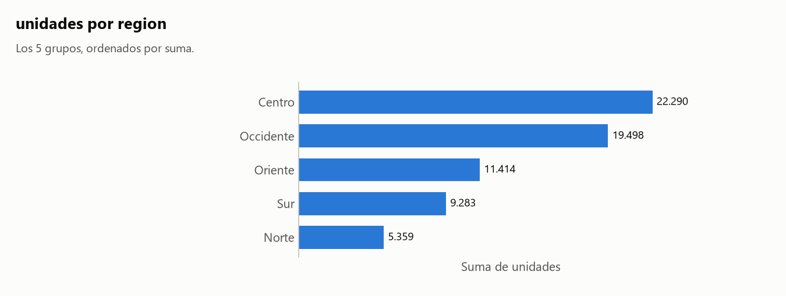
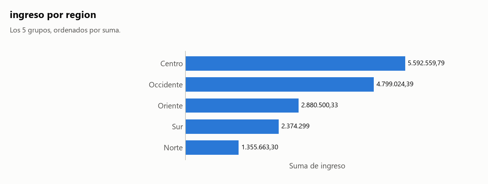
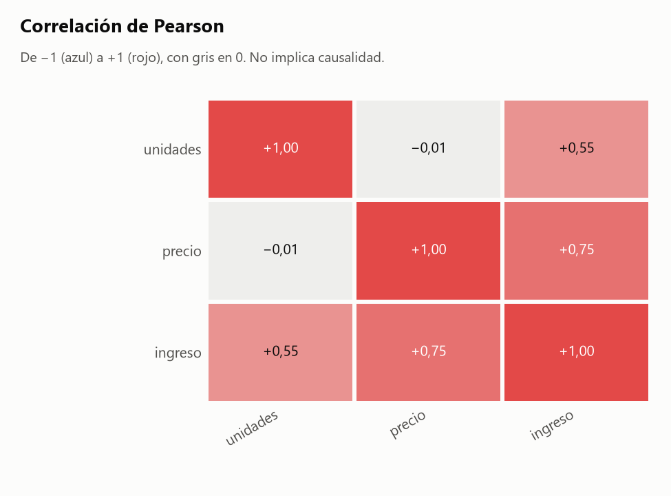

# Informe: sin_fechas.csv

## 1. Resumen

- **Archivo:** sin_fechas.csv
- **Filas:** 1.000
- **Columnas:** 5
- **Fecha de ejecución:** 2026-11-06 23:04

## 2. Calidad de datos

### Hallazgos

No hay problemas de calidad en lo que el agente revisa: `perfilar()`, conversión de tipos, fechas y agrupaciones.

### Agrupaciones

Cálculo: `np.unique(codigos_A * unicos_B + codigos_B), para cada par con unicos(B) > unicos(A)`

Decisiones:

- Comparé 1 pares entre 2 columnas agrupables, usando todas las filas y sin muestra. Las fechas no entran: casi cualquier valor aparece en varias.
- En 1 pares algún valor de A aparece junto a más de un valor de B. Eso solo no indica una fusión, así que aviso únicamente si al menos el 95% de los valores de B corresponde a un solo A y menos del 50% de los valores de A está afectado. Si todos los valores de A se reparten, es una jerarquía o dos columnas independientes.

Lo calculado:

- Ningún par cumple las condiciones para avisar.

Detalle: [tablas/agrupaciones_pares.csv](tablas/agrupaciones_pares.csv).

## 3. Clasificación de columnas

| Columna | Tipo | Rol | Top N | Únicos | Ratio | Por qué ese tipo | Por qué ese rol |
|---|---|---|---|--:|--:|---|---|
| `region` | texto | agrupable | no | 5 | 0,005000 | no es número, código ni fecha. | es texto, no se puede sumar, y su ratio 0,005000 (5 valores únicos) permite agrupar. |
| `producto` | texto | agrupable | no | 12 | 0,012000 | no es número, código ni fecha. | es texto, no se puede sumar, y su ratio 0,012000 (12 valores únicos) permite agrupar. |
| `unidades` | numero | medible | sí | 75 | 0,075000 | el 100% de sus valores son números. | es un número con 75 valores distintos. |
| `precio` | numero | medible | sí | 989 | 0,989000 | el 100% de sus valores son números. | es un número con 989 valores distintos. |
| `ingreso` | numero | medible | sí | 1.000 | 1,000000 | el 100% de sus valores son números. | es un número con 1.000 valores distintos. |

## 4. Análisis elegidos y descartados

### Elegidos

- Ranking de `region` por `unidades`: elegí esto porque `region` es agrupable (tipo texto) y `unidades` es medible. η² ajustado: 0,979.
- Ranking de `region` por `ingreso`: elegí esto porque `region` es agrupable (tipo texto) y `ingreso` es medible. η² ajustado: 0,291.
- Matriz de correlación: elegí esto porque hay 3 medibles (`unidades`, `precio`, `ingreso`).
- Detección de agrupaciones: elegí esto porque hay 2 columnas agrupables que no son fecha. Resultado en la sección 2.

### Omitidos por prioridad

Omitir un análisis no excluye datos: solo evita repetir o mostrar lo menos informativo. Los rankings se ordenan por η² ajustado, que mide qué parte de la variación explican los grupos, con mínimo 0,01, hasta 3 por medida y 8 en total.

Para generarlos todos: `python src/agente.py tests/datos_prueba/sin_fechas.csv --salida reports/pruebas --todo`

| Análisis | η² ajustado | Motivo |
|---|--:|---|
| Ranking de `producto` por `ingreso` | 0,000 | η² ajustado menor que 0,01 |
| Ranking de `producto` por `unidades` | -0,001 | η² ajustado menor que 0,01 |
| Ranking de `region` por `precio` | -0,003 | η² ajustado menor que 0,01 |
| Ranking de `producto` por `precio` | -0,007 | η² ajustado menor que 0,01 |

### Descartados

- Filtro por fecha: no excluí ninguna fila porque nadie lo pidió.
- Evolución en el tiempo: no hay columna de fecha agrupable.
- Frecuencias: solo se usan cuando no hay ninguna columna medible, y aquí sí hay.

## 5. Resultados

### Cómo leer las tablas

Vale para todos los análisis de esta sección:

- Cálculo: `df.groupby(grupo)[medida].agg(filas='size', suma='sum', media='mean')`
- Ordené por suma, de mayor a menor. Los nulos del grupo forman '(nulo)' para que los totales cuadren.

### Ranking de `region` por `unidades`

Lo calculado:

- El máximo de la suma es 22.290 en 'Centro'; el mínimo es 5.359 en 'Norte'.
- La media más alta es 106,65 en 'Centro'.
- El grupo con más filas es 'Occidente', con 223.

> **Advertencia:** El top 2 por filas y el top 2 por suma son distintos. El primero por filas es 'Occidente'; por suma, 'Centro'. Contar filas y sumar la medida no dan el mismo orden.



| grupo | filas | suma | media | puesto_suma | puesto_filas |
|---|--:|--:|--:|--:|--:|
| Centro | 209 | 22.290 | 106,65 | 1 | 2 |
| Occidente | 223 | 19.498 | 87,43 | 2 | 1 |
| Oriente | 172 | 11.414 | 66,36 | 3 | 5 |
| Sur | 197 | 9.283 | 47,12 | 4 | 4 |
| Norte | 199 | 5.359 | 26,93 | 5 | 3 |

Archivo: [tablas/ranking_region_unidades.csv](tablas/ranking_region_unidades.csv).

### Ranking de `region` por `ingreso`

Lo calculado:

- El máximo de la suma es 5.592.559,79 en 'Centro'; el mínimo es 1.355.663,30 en 'Norte'.
- La media más alta es 26.758,66 en 'Centro'.
- El grupo con más filas es 'Occidente', con 223.

> **Advertencia:** El top 2 por filas y el top 2 por suma son distintos. El primero por filas es 'Occidente'; por suma, 'Centro'. Contar filas y sumar la medida no dan el mismo orden.



| grupo | filas | suma | media | puesto_suma | puesto_filas |
|---|--:|--:|--:|--:|--:|
| Centro | 209 | 5.592.559,79 | 26.758,66 | 1 | 2 |
| Occidente | 223 | 4.799.024,39 | 21.520,29 | 2 | 1 |
| Oriente | 172 | 2.880.500,33 | 16.747,09 | 3 | 5 |
| Sur | 197 | 2.374.299,00 | 12.052,28 | 4 | 4 |
| Norte | 199 | 1.355.663,30 | 6.812,38 | 5 | 3 |

Archivo: [tablas/ranking_region_ingreso.csv](tablas/ranking_region_ingreso.csv).

### Matriz de correlación

Cálculo: `df[['unidades', 'precio', 'ingreso']].corr(method='pearson')`

Decisiones:

- Usé Pearson, que mide relación lineal. Cada par usa las filas donde ambas columnas tienen valor. Listo por separado los pares con |r| de 0.5 o más.

Lo calculado:

- `unidades` y `ingreso` se mueven juntas: r = 0,554 (n = 1.000).
- `precio` y `ingreso` se mueven juntas: r = 0,754 (n = 1.000).

> **Advertencia:** La correlación no implica causalidad: dos variables pueden moverse juntas sin que una provoque la otra.



| r de Pearson | unidades | precio | ingreso |
|---|--:|--:|--:|
| unidades | 1,00 | -0,01 | 0,55 |
| precio | -0,01 | 1,00 | 0,75 |
| ingreso | 0,55 | 0,75 | 1,00 |

Archivo: [tablas/correlacion.csv](tablas/correlacion.csv).

## 6. Límites

- "Más informativo" es un criterio estadístico, no importancia para el negocio. Un análisis omitido puede ser justo el que interesa: `--todo` los genera todos.
- No sé qué significa cada columna. Por eso cada tabla trae `filas`, `suma` y `media`: cuál es la correcta depende de si la variable es un conteo o una medida.
- No sé cómo se generaron los datos. Las cifras describen lo que hay en el archivo, no necesariamente lo que ocurrió en la realidad.
- No explico por qué cambia una cifra ni por qué dos variables se mueven juntas.
- Un hueco de calendario solo dice que no hay filas en esas fechas. Puede ser normal si el dato es semanal, mensual o no se registra en ciertos días.
- No detecto fechas con el día y el mes intercambiados cuando ambas lecturas son válidas.
- Un mismo texto puede referirse a cosas distintas (dos municipios con el mismo nombre, por ejemplo). Solo lo detecto si otra columna lo revela, y el aviso puede ser falso cuando la relación es una jerarquía legítima.
- No decido qué tramo de datos es válido. Si sugiero un filtro, es una propuesta: solo se aplica si el analista corre el comando.
- Convierto números con punto de miles y coma decimal ('1.234,5'), pero no uno con comas que siempre llevan 3 dígitos ('1,234'): puede ser 1234 o 1,234.
- La clasificación de columnas es heurística. Se corrige con `--forzar columna.tipo=valor` o `--forzar columna.rol=valor`.

## 7. Anexo: perfil completo

Salida literal de `perfilar()`. Su bloque de calidad solo cubre sus propios chequeos; la lista completa de hallazgos está en la sección 2.

```text
PERFIL DE: sin_fechas.csv
============================================================

RESUMEN GENERAL
  Filas:    1,000
  Columnas: 5
  Memoria:  0.1 MB

COLUMNAS

  columna                      tipo              nulos     únicos
  ---------------------------------------------------------------
  region                       str               0 (  0%)          5
  producto                     str               0 (  0%)         12
  unidades                     int64             0 (  0%)         75
  precio                       float64           0 (  0%)        989
  ingreso                      float64           0 (  0%)      1,000

CALIDAD DE DATOS
  Sin problemas evidentes.

VARIABLES NUMÉRICAS

            min     media   mediana       max
unidades  20.00     67.84     68.00    114.00
precio    10.79    251.10    252.59    498.77
ingreso  524.27 17,002.05 13,499.35 61,231.07
```
