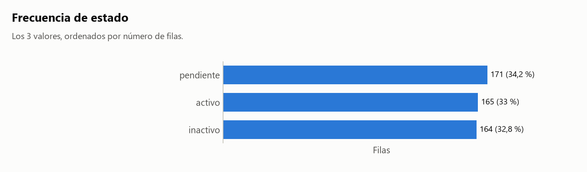
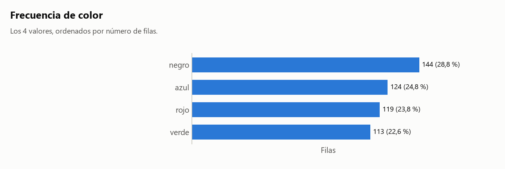
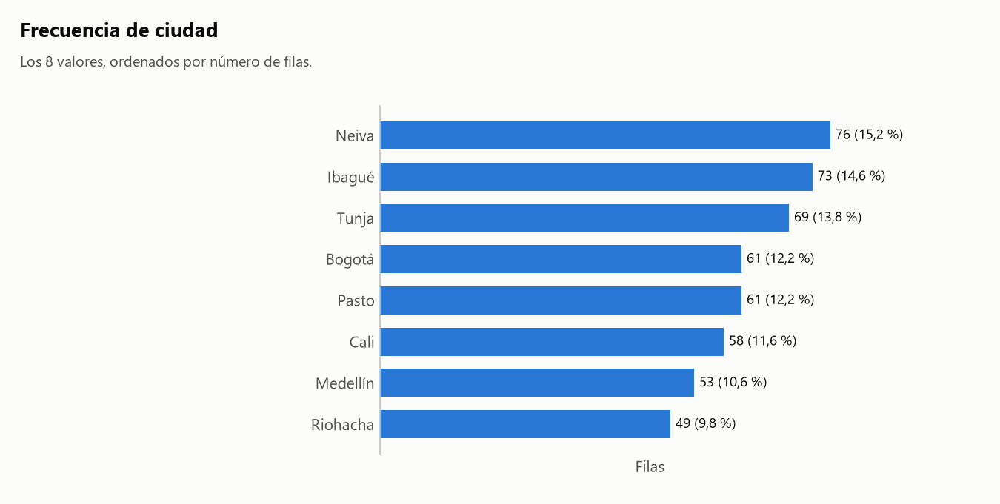

# Informe: solo_texto.csv

## 1. Resumen

- **Archivo:** solo_texto.csv
- **Filas:** 500
- **Columnas:** 4
- **Fecha de ejecución:** 2026-11-06 23:04

## 2. Calidad de datos

### Hallazgos

No hay problemas de calidad en lo que el agente revisa: `perfilar()`, conversión de tipos, fechas y agrupaciones.

### Agrupaciones

Cálculo: `np.unique(codigos_A * unicos_B + codigos_B), para cada par con unicos(B) > unicos(A)`

Decisiones:

- Comparé 3 pares entre 3 columnas agrupables, usando todas las filas y sin muestra. Las fechas no entran: casi cualquier valor aparece en varias.
- En 3 pares algún valor de A aparece junto a más de un valor de B. Eso solo no indica una fusión, así que aviso únicamente si al menos el 95% de los valores de B corresponde a un solo A y menos del 50% de los valores de A está afectado. Si todos los valores de A se reparten, es una jerarquía o dos columnas independientes.

Lo calculado:

- Ningún par cumple las condiciones para avisar.

Detalle: [tablas/agrupaciones_pares.csv](tablas/agrupaciones_pares.csv).

## 3. Clasificación de columnas

| Columna | Tipo | Rol | Top N | Únicos | Ratio | Por qué ese tipo | Por qué ese rol |
|---|---|---|---|--:|--:|---|---|
| `ciudad` | texto | agrupable | no | 8 | 0,016000 | no es número, código ni fecha. | es texto, no se puede sumar, y su ratio 0,016000 (8 valores únicos) permite agrupar. |
| `color` | texto | agrupable | no | 4 | 0,008000 | no es número, código ni fecha. | es texto, no se puede sumar, y su ratio 0,008000 (4 valores únicos) permite agrupar. |
| `estado` | texto | agrupable | no | 3 | 0,006000 | no es número, código ni fecha. | es texto, no se puede sumar, y su ratio 0,006000 (3 valores únicos) permite agrupar. |
| `comentario` | texto | ignorar | sí | 500 | 1,000000 | no es número, código ni fecha. | ratio 1,000000 (500 valores únicos), mayor que 0,5: casi único por fila, es un identificador. |

## 4. Análisis elegidos y descartados

### Elegidos

- Frecuencias de `estado`: elegí esto porque no hay ninguna columna medible y `estado` es agrupable.
- Frecuencias de `color`: elegí esto porque no hay ninguna columna medible y `color` es agrupable.
- Frecuencias de `ciudad`: elegí esto porque no hay ninguna columna medible y `ciudad` es agrupable.
- Detección de agrupaciones: elegí esto porque hay 3 columnas agrupables que no son fecha. Resultado en la sección 2.

### Descartados

- Filtro por fecha: no excluí ninguna fila porque nadie lo pidió.
- Evolución en el tiempo: no hay columna de fecha agrupable.
- Ranking por categoría: no hay columna medible.
- Matriz de correlación: hacen falta 2 columnas medibles y hay 0.
- `comentario` queda fuera de todos los análisis: ratio 1,000000 (500 valores únicos), mayor que 0,5: casi único por fila, es un identificador.

## 5. Resultados

### Cómo leer las tablas

Vale para todos los análisis de esta sección:

- Conté filas por valor, de mayor a menor. Los nulos forman el grupo '(nulo)' y cuentan en el porcentaje.

### Frecuencias de `estado`

Cálculo: `df['estado'].value_counts(dropna=False)`

Lo calculado:

- El valor más frecuente es 'pendiente', con 171 filas; el menos frecuente es 'inactivo', con 164.



| valor | conteo | porcentaje |
|---|--:|--:|
| pendiente | 171 | 34,20 |
| activo | 165 | 33,00 |
| inactivo | 164 | 32,80 |

Archivo: [tablas/frecuencias_estado.csv](tablas/frecuencias_estado.csv).

### Frecuencias de `color`

Cálculo: `df['color'].value_counts(dropna=False)`

Lo calculado:

- El valor más frecuente es 'negro', con 144 filas; el menos frecuente es 'verde', con 113.



| valor | conteo | porcentaje |
|---|--:|--:|
| negro | 144 | 28,80 |
| azul | 124 | 24,80 |
| rojo | 119 | 23,80 |
| verde | 113 | 22,60 |

Archivo: [tablas/frecuencias_color.csv](tablas/frecuencias_color.csv).

### Frecuencias de `ciudad`

Cálculo: `df['ciudad'].value_counts(dropna=False)`

Lo calculado:

- El valor más frecuente es 'Neiva', con 76 filas; el menos frecuente es 'Riohacha', con 49.



| valor | conteo | porcentaje |
|---|--:|--:|
| Neiva | 76 | 15,20 |
| Ibagué | 73 | 14,60 |
| Tunja | 69 | 13,80 |
| Bogotá | 61 | 12,20 |
| Pasto | 61 | 12,20 |
| Cali | 58 | 11,60 |
| Medellín | 53 | 10,60 |
| Riohacha | 49 | 9,80 |

Archivo: [tablas/frecuencias_ciudad.csv](tablas/frecuencias_ciudad.csv).

## 6. Límites

- "Más informativo" es un criterio estadístico, no importancia para el negocio. Un análisis omitido puede ser justo el que interesa: `--todo` los genera todos.
- No sé qué significa cada columna. Por eso cada tabla trae `filas`, `suma` y `media`: cuál es la correcta depende de si la variable es un conteo o una medida.
- No sé cómo se generaron los datos. Las cifras describen lo que hay en el archivo, no necesariamente lo que ocurrió en la realidad.
- No explico por qué cambia una cifra ni por qué dos variables se mueven juntas.
- Un hueco de calendario solo dice que no hay filas en esas fechas. Puede ser normal si el dato es semanal, mensual o no se registra en ciertos días.
- No detecto fechas con el día y el mes intercambiados cuando ambas lecturas son válidas.
- Un mismo texto puede referirse a cosas distintas (dos municipios con el mismo nombre, por ejemplo). Solo lo detecto si otra columna lo revela, y el aviso puede ser falso cuando la relación es una jerarquía legítima.
- No decido qué tramo de datos es válido. Si sugiero un filtro, es una propuesta: solo se aplica si el analista corre el comando.
- Convierto números con punto de miles y coma decimal ('1.234,5'), pero no uno con comas que siempre llevan 3 dígitos ('1,234'): puede ser 1234 o 1,234.
- La clasificación de columnas es heurística. Se corrige con `--forzar columna.tipo=valor` o `--forzar columna.rol=valor`.

## 7. Anexo: perfil completo

Salida literal de `perfilar()`. Su bloque de calidad solo cubre sus propios chequeos; la lista completa de hallazgos está en la sección 2.

```text
PERFIL DE: solo_texto.csv
============================================================

RESUMEN GENERAL
  Filas:    500
  Columnas: 4
  Memoria:  0.1 MB

COLUMNAS

  columna                      tipo              nulos     únicos
  ---------------------------------------------------------------
  ciudad                       str               0 (  0%)          8
  color                        str               0 (  0%)          4
  estado                       str               0 (  0%)          3
  comentario                   str               0 (  0%)        500

CALIDAD DE DATOS
  Sin problemas evidentes.
```
