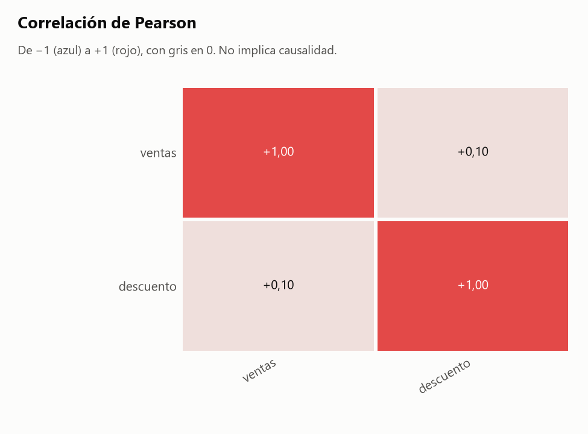

# Informe: sucio.csv

## 1. Resumen

- **Archivo:** sucio.csv
- **Filas:** 500
- **Columnas:** 5
- **Fecha de ejecución:** 2026-11-06 23:05

## 2. Calidad de datos

### Hallazgos

- **H1.** **perfilar():** 57 filas duplicadas (11.4%)
- **H2.** **perfilar():** Columnas totalmente vacías: observaciones
- **H3.** **perfilar():** Columnas con un solo valor: pais
- **H4.** **perfilar():** Más del 30% de nulos en: descuento (46%), observaciones (100%)
- **H5.** **perfilar():** 'ciudad' tiene categorías repetidas por mayúsculas o espacios

### Agrupaciones

Cálculo: `np.unique(codigos_A * unicos_B + codigos_B), para cada par con unicos(B) > unicos(A)`

Decisiones:

- No comparé agrupaciones: hacen falta 2 columnas agrupables y hay 1.

## 3. Clasificación de columnas

| Columna | Tipo | Rol | Top N | Únicos | Ratio | Por qué ese tipo | Por qué ese rol |
|---|---|---|---|--:|--:|---|---|
| `ciudad` | texto | agrupable | no | 8 | 0,016000 | no es número, código ni fecha. | es texto, no se puede sumar, y su ratio 0,016000 (8 valores únicos) permite agrupar. |
| `ventas` | numero | medible | sí | 297 | 0,594000 | el 100% de sus valores son números. | es un número con 297 valores distintos. |
| `descuento` | numero | medible | sí | 241 | 0,482000 | el 100% de sus valores son números. | es un número con 241 valores distintos. |
| `pais` | texto | ignorar | no | 1 | 0,002000 | no es número, código ni fecha. | tiene un solo valor ('Colombia'). |
| `observaciones` | texto | ignorar | no | 0 | 0,000000 | no tiene valores de los cuales deducir un tipo. | está totalmente vacía. |

## 4. Análisis elegidos y descartados

### Elegidos

- Matriz de correlación: elegí esto porque hay 2 medibles (`ventas`, `descuento`).
- Detección de agrupaciones: corre siempre, pero hacen falta 2 columnas agrupables.

### Omitidos por prioridad

Omitir un análisis no excluye datos: solo evita repetir o mostrar lo menos informativo. Los rankings se ordenan por η² ajustado, que mide qué parte de la variación explican los grupos, con mínimo 0,01, hasta 3 por medida y 8 en total.

Para generarlos todos: `python src/agente.py tests/datos_prueba/sucio.csv --salida reports/pruebas --todo`

| Análisis | η² ajustado | Motivo |
|---|--:|---|
| Ranking de `ciudad` por `ventas` | -0,005 | η² ajustado menor que 0,01 |
| Ranking de `ciudad` por `descuento` | -0,005 | η² ajustado menor que 0,01 |

### Descartados

- Filtro por fecha: no excluí ninguna fila porque nadie lo pidió.
- Evolución en el tiempo: no hay columna de fecha agrupable.
- Frecuencias: solo se usan cuando no hay ninguna columna medible, y aquí sí hay.
- `pais` queda fuera de todos los análisis: tiene un solo valor ('Colombia').
- `observaciones` queda fuera de todos los análisis: está totalmente vacía.

## 5. Resultados

### Matriz de correlación

Cálculo: `df[['ventas', 'descuento']].corr(method='pearson')`

Decisiones:

- Usé Pearson, que mide relación lineal. Cada par usa las filas donde ambas columnas tienen valor. Listo por separado los pares con |r| de 0.5 o más.

Lo calculado:

- Ningún par alcanza |r| de 0.5.

> **Advertencia:** La correlación no implica causalidad: dos variables pueden moverse juntas sin que una provoque la otra.



| r de Pearson | ventas | descuento |
|---|--:|--:|
| ventas | 1,00 | 0,10 |
| descuento | 0,10 | 1,00 |

Archivo: [tablas/correlacion.csv](tablas/correlacion.csv).

## 6. Límites

- "Más informativo" es un criterio estadístico, no importancia para el negocio. Un análisis omitido puede ser justo el que interesa: `--todo` los genera todos.
- No sé qué significa cada columna. Por eso cada tabla trae `filas`, `suma` y `media`: cuál es la correcta depende de si la variable es un conteo o una medida.
- No sé cómo se generaron los datos. Las cifras describen lo que hay en el archivo, no necesariamente lo que ocurrió en la realidad.
- No explico por qué cambia una cifra ni por qué dos variables se mueven juntas.
- Un hueco de calendario solo dice que no hay filas en esas fechas. Puede ser normal si el dato es semanal, mensual o no se registra en ciertos días.
- No detecto fechas con el día y el mes intercambiados cuando ambas lecturas son válidas.
- Un mismo texto puede referirse a cosas distintas (dos municipios con el mismo nombre, por ejemplo). Solo lo detecto si otra columna lo revela, y el aviso puede ser falso cuando la relación es una jerarquía legítima.
- No decido qué tramo de datos es válido. Si sugiero un filtro, es una propuesta: solo se aplica si el analista corre el comando.
- Convierto números con punto de miles y coma decimal ('1.234,5'), pero no uno con comas que siempre llevan 3 dígitos ('1,234'): puede ser 1234 o 1,234.
- La clasificación de columnas es heurística. Se corrige con `--forzar columna.tipo=valor` o `--forzar columna.rol=valor`.

## 7. Anexo: perfil completo

Salida literal de `perfilar()`. Su bloque de calidad solo cubre sus propios chequeos; la lista completa de hallazgos está en la sección 2.

```text
PERFIL DE: sucio.csv
============================================================

RESUMEN GENERAL
  Filas:    500
  Columnas: 5
  Memoria:  0.1 MB

COLUMNAS

  columna                      tipo              nulos     únicos
  ---------------------------------------------------------------
  ciudad                       str               0 (  0%)          8
  ventas                       int64             0 (  0%)        297
  descuento                    float64         229 ( 46%)        241
  pais                         str               0 (  0%)          1
  observaciones                str             500 (100%)          0

CALIDAD DE DATOS

  - 57 filas duplicadas (11.4%)
  - Columnas totalmente vacías: observaciones
  - Columnas con un solo valor: pais
  - Más del 30% de nulos en: descuento (46%), observaciones (100%)
  - 'ciudad' tiene categorías repetidas por mayúsculas o espacios

VARIABLES NUMÉRICAS

           min  media  mediana    max
ventas    1.00 240.01   239.50 499.00
descuento 1.73  49.22    47.00  99.69
```
