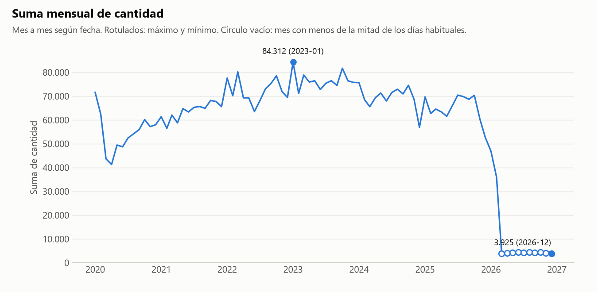
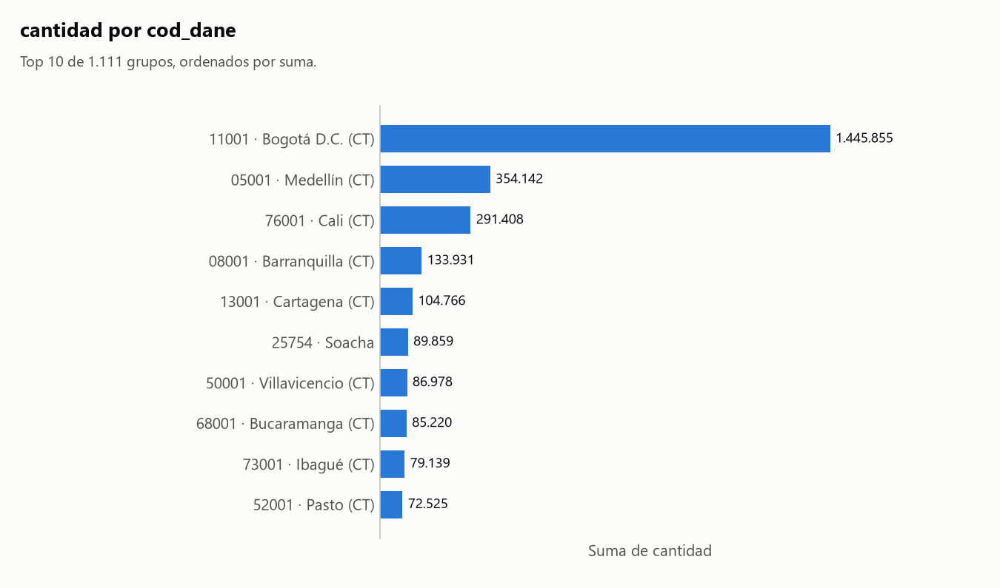
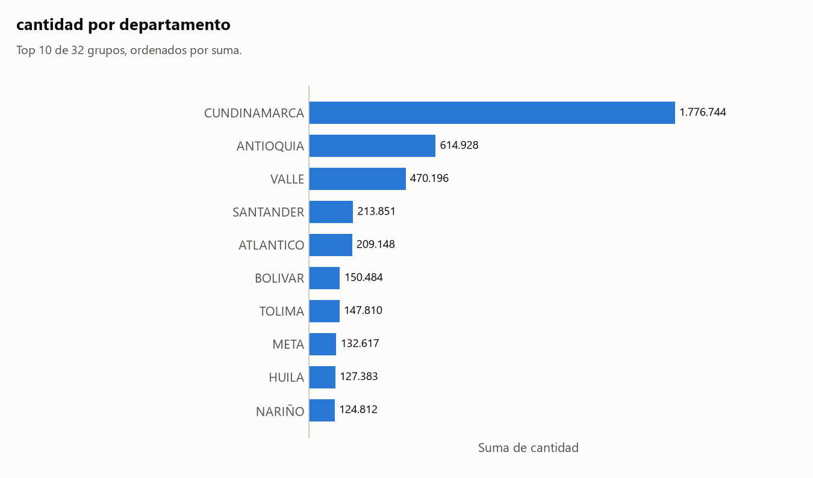
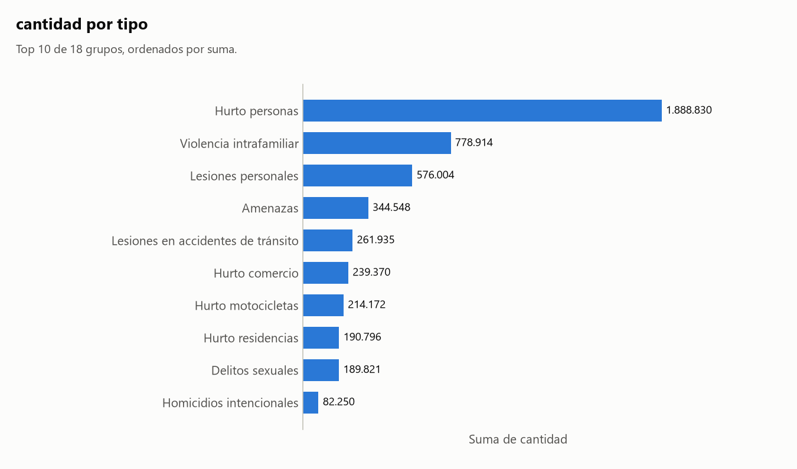

# Informe: v_delitos.csv

## 1. Resumen

- **Archivo:** v_delitos.csv
- **Filas:** 2.382.453
- **Columnas:** 10
- **Fecha de ejecución:** 2026-11-06 23:06

## 2. Calidad de datos

### Hallazgos

- **H1.** **Fechas de `fecha`:** 1.798 filas tienen fecha posterior al día de ejecución, hasta 2026-12-02.
- **H2.** **Fechas de `fecha`:** Faltan 277 de 2.528 días entre la primera y la última fecha, repartidos en 11 tramos.
- **H3.** **Agrupaciones:** Agrupar por `tipo` puede estar mezclando entidades distintas: 6 de 18 valores aparecen junto a más de un valor de `delito`. Ejemplos: 'Delitos sexuales' (23 valores: ARTÍCULO 205. ACCESO CARNAL VIOLENTO, ARTÍCULO 205. DELITOS SEXUALES, ARTÍCULO 206. ACTO SEXUAL VIOLENTO, ARTÍCULO 207. ACCESO CARNAL O ACTO SEXUAL EN PERSONA PUESTA EN INCAPACIDAD DE RESISTIR y 19 más); 'Lesiones personales' (11 valores: ARTICULO 120 LESIONES CULPOSAS, ARTÍCULO 111. LESIONES PERSONALES, ARTÍCULO 112. INCAPACIDAD PARA TRABAJAR O ENFERMEDAD, ARTÍCULO 113. DEFORMIDAD y 7 más); 'Homicidios en accidentes de tránsito' (2 valores: ARTÍCULO 109. HOMICIDIO CULPOSO (EN ACCIDENTE DE TRÁNSITO), ARTÍCULO 110. HOMICIDIO CULPOSO (CIRCUNSTANCIAS DE AGRAVACIÓN)). Sugerencia: agrupar por `delito`.
- **H4.** **Agrupaciones:** Agrupar por `municipio` puede estar mezclando entidades distintas: 62 de 1.029 valores aparecen junto a más de un valor de `cod_dane`. Ejemplos: 'Buenavista' (4 valores: 15109, 23079, 63111, 70110); 'La Unión' (4 valores: 05400, 52399, 70400, 76400); 'Villanueva' (4 valores: 13873, 44874, 68872, 85440). Sugerencia: agrupar por `cod_dane`.

### Sugerencias (no aplicadas)

> **Sugerencia, no aplicada.** Para excluir el tramo sospechoso de `fecha`: `python src/agente.py data/raw/v_delitos.csv --hasta 2025-12-31`. Por qué ese corte: todos los huecos están después de 2025-12-31, el último mes completo antes del primero. Dejaría fuera 54.809 filas (2,30 %). No excluí nada: este informe sigue incluyendo ese tramo. Decidir si son válidas le corresponde al analista.

### Fechas de `fecha`

Decisiones:

- Comparé las fechas con el día de ejecución (2026-11-06) y busqué días y meses sin filas entre la primera y la última fecha.

Lo calculado:

- Rango de `fecha`: 2020-01-01 a 2026-12-02.

| desde | hasta | dias |
|---|---|--:|
| 2026-01-03 | 2026-01-12 | 10 |
| 2026-02-03 | 2026-02-12 | 10 |
| 2026-03-03 | 2026-03-31 | 29 |
| 2026-04-03 | 2026-04-30 | 28 |
| 2026-05-03 | 2026-05-31 | 29 |
| 2026-06-03 | 2026-06-30 | 28 |
| 2026-07-03 | 2026-07-31 | 29 |
| 2026-08-03 | 2026-08-31 | 29 |
| 2026-09-03 | 2026-09-30 | 28 |
| 2026-10-03 | 2026-10-31 | 29 |
| 2026-11-03 | 2026-11-30 | 28 |

Archivo: [tablas/huecos_fecha.csv](tablas/huecos_fecha.csv).

### Agrupaciones

Cálculo: `np.unique(codigos_A * unicos_B + codigos_B), para cada par con unicos(B) > unicos(A)`

Decisiones:

- Comparé 28 pares entre 8 columnas agrupables, usando todas las filas y sin muestra. Las fechas no entran: casi cualquier valor aparece en varias.
- En 28 pares algún valor de A aparece junto a más de un valor de B. Eso solo no indica una fusión, así que aviso únicamente si al menos el 95% de los valores de B corresponde a un solo A y menos del 50% de los valores de A está afectado. Si todos los valores de A se reparten, es una jerarquía o dos columnas independientes.

Detalle: [tablas/agrupaciones_tipo_delito.csv](tablas/agrupaciones_tipo_delito.csv).

Detalle: [tablas/agrupaciones_municipio_cod_dane.csv](tablas/agrupaciones_municipio_cod_dane.csv).

Detalle: [tablas/agrupaciones_pares.csv](tablas/agrupaciones_pares.csv).

## 3. Clasificación de columnas

| Columna | Tipo | Rol | Top N | Únicos | Ratio | Por qué ese tipo | Por qué ese rol |
|---|---|---|---|--:|--:|---|---|
| `tipo` | texto | agrupable | no | 18 | 0,000008 | no es número, código ni fecha. | es texto, no se puede sumar, y su ratio 0,000008 (18 valores únicos) permite agrupar. |
| `delito` | texto | agrupable | sí | 54 | 0,000023 | no es número, código ni fecha. | es texto, no se puede sumar, y su ratio 0,000023 (54 valores únicos) permite agrupar. |
| `tipo_arma` | texto | agrupable | sí | 56 | 0,000024 | no es número, código ni fecha. | es texto, no se puede sumar, y su ratio 0,000024 (56 valores únicos) permite agrupar. |
| `departamento` | texto | agrupable | no | 32 | 0,000013 | no es número, código ni fecha. | es texto, no se puede sumar, y su ratio 0,000013 (32 valores únicos) permite agrupar. |
| `municipio` | texto | agrupable | sí | 1.029 | 0,000432 | no es número, código ni fecha. | es texto, no se puede sumar, y su ratio 0,000432 (1.029 valores únicos) permite agrupar. |
| `cod_dane` | codigo | agrupable | sí | 1.111 | 0,000466 | sus valores son dígitos, pero 413.816 empiezan por cero (p. ej. '05001'). Un número no lleva ceros a la izquierda. | es código, no se puede sumar, y su ratio 0,000466 (1.111 valores únicos) permite agrupar. |
| `genero` | texto | agrupable | no | 3 | 0,000001 | no es número, código ni fecha. | es texto, no se puede sumar, y su ratio 0,000001 (3 valores únicos) permite agrupar. |
| `rango_edad` | texto | agrupable | no | 4 | 0,000002 | no es número, código ni fecha. | es texto, no se puede sumar, y su ratio 0,000002 (4 valores únicos) permite agrupar. |
| `fecha` | fecha | agrupable | sí | 2.251 | 0,000945 | el 100% de una muestra de 1.000 valores se interpretó como fecha (p. ej. '2020-12-15'). | es una fecha con 2.251 valores distintos. |
| `cantidad` | numero | medible | sí | 246 | 0,000103 | el 100% de sus valores son números. | es un número con 246 valores distintos. |

Códigos detectados por heurística; corrígelos si no lo son:

- `cod_dane`: sus valores son dígitos, pero 413.816 empiezan por cero (p. ej. '05001'). Un número no lleva ceros a la izquierda. Para corregirlo: `--forzar cod_dane.tipo=numero`.

## 4. Análisis elegidos y descartados

### Elegidos

- Evolución de `cantidad` por `fecha`: elegí esto porque `fecha` es una fecha agrupable y `cantidad` es medible.
- Ranking de `cod_dane` por `cantidad`: elegí esto porque `cod_dane` es agrupable (tipo codigo) y `cantidad` es medible. η² ajustado: 0,101.
- Ranking de `departamento` por `cantidad`: elegí esto porque `departamento` es agrupable (tipo texto) y `cantidad` es medible. η² ajustado: 0,033.
- Ranking de `tipo` por `cantidad`: elegí esto porque `tipo` es agrupable (tipo texto) y `cantidad` es medible. η² ajustado: 0,017.
- Detección de agrupaciones: elegí esto porque hay 8 columnas agrupables que no son fecha. Resultado en la sección 2.

### Omitidos por prioridad

Omitir un análisis no excluye datos: solo evita repetir o mostrar lo menos informativo. Los rankings se ordenan por η² ajustado, que mide qué parte de la variación explican los grupos, con mínimo 0,01, hasta 3 por medida y 8 en total.

Para generarlos todos: `python src/agente.py data/raw/v_delitos.csv --todo`

| Análisis | η² ajustado | Motivo |
|---|--:|---|
| Ranking de `municipio` por `cantidad` | — | casi equivalente a `cod_dane`, que lo lleva como etiqueta |
| Ranking de `delito` por `cantidad` | 0,017 | tope de 3 rankings por medida |
| Ranking de `tipo_arma` por `cantidad` | 0,004 | η² ajustado menor que 0,01 |
| Ranking de `rango_edad` por `cantidad` | 0,001 | η² ajustado menor que 0,01 |
| Ranking de `genero` por `cantidad` | 0,000 | η² ajustado menor que 0,01 |

### Descartados

- Filtro por fecha: no excluí ninguna fila porque nadie lo pidió.
- Matriz de correlación: hacen falta 2 columnas medibles y hay 1.
- Frecuencias: solo se usan cuando no hay ninguna columna medible, y aquí sí hay.

## 5. Resultados

### Cómo leer las tablas

Vale para todos los análisis de esta sección:

- Cálculo: `df.groupby(grupo)[medida].agg(filas='size', suma='sum', media='mean')`
- Ordené por suma, de mayor a menor. Los nulos del grupo forman '(nulo)' para que los totales cuadren.

### Evolución de `cantidad` por `fecha`

Cálculo: `df.groupby(periodo)[medida].agg(filas='size', suma='sum', media='mean'), con periodo = mes y año de la fecha`

Decisiones:

- Agregué por mes y por año.
- Agregué la columna `dias_con_datos` para distinguir un periodo con poco valor de un periodo con pocos días registrados.

Lo calculado:

- Por año, el máximo de la suma de `cantidad` es 919.963 en 2023 (365 días con datos) y el mínimo es 124.906 en 2026 (59 días con datos).
- Por mes, el máximo de la suma de `cantidad` es 84.312 en 2023-01 (31 días con datos) y el mínimo es 3.925 en 2026-12 (2 días con datos).

> Aplica lo dicho en la sección 2: H2.



| periodo | filas | suma | media | dias_con_datos |
|---|--:|--:|--:|--:|
| 2020 | 347.080 | 655.220 | 1,89 | 366 |
| 2021 | 376.317 | 764.354 | 2,03 | 365 |
| 2022 | 418.456 | 866.659 | 2,07 | 365 |
| 2023 | 421.180 | 919.963 | 2,18 | 365 |
| 2024 | 397.860 | 834.143 | 2,10 | 366 |
| 2025 | 366.751 | 780.225 | 2,13 | 365 |
| 2026 | 54.809 | 124.906 | 2,28 | 59 |

Archivo: [tablas/evolucion_fecha_cantidad_anio.csv](tablas/evolucion_fecha_cantidad_anio.csv).

Detalle: [tablas/evolucion_fecha_cantidad_mes.csv](tablas/evolucion_fecha_cantidad_mes.csv).

### Ranking de `cod_dane` (con `municipio`) por `cantidad`

Decisiones:

- `cod_dane` y `municipio` son casi equivalentes: una sola tabla, agrupada por `cod_dane` y con el valor más frecuente de `municipio` como etiqueta.
- `cod_dane` tiene 1.111 valores: el informe muestra los primeros 10 y los últimos 5; el CSV los trae todos.

Lo calculado:

- El máximo de la suma es 1.445.855 en '11001' (Bogotá D.C. (CT)); el mínimo es 1 en '52000'.
- La media más alta es 8,88 en '11001' (Bogotá D.C. (CT)).
- El grupo con más filas es '11001' (Bogotá D.C. (CT)), con 162.850.

> Aplica lo dicho en la sección 2: H4.

> **Advertencia:** El top 10 por filas y el top 10 por suma son distintos. Solo en el top por filas: 54001. Solo en el top por suma: 52001. Contar filas y sumar la medida no dan el mismo orden.



| grupo | etiqueta | filas | suma | media | puesto_suma | puesto_filas |
|---|---|--:|--:|--:|--:|--:|
| 11001 | Bogotá D.C. (CT) | 162.850 | 1.445.855 | 8,88 | 1 | 1 |
| 05001 | Medellín (CT) | 89.178 | 354.142 | 3,97 | 2 | 3 |
| 76001 | Cali (CT) | 92.042 | 291.408 | 3,17 | 3 | 2 |
| 08001 | Barranquilla (CT) | 54.335 | 133.931 | 2,46 | 4 | 4 |
| 13001 | Cartagena (CT) | 47.344 | 104.766 | 2,21 | 5 | 5 |
| 25754 | Soacha | 38.114 | 89.859 | 2,36 | 6 | 9 |
| 50001 | Villavicencio (CT) | 45.229 | 86.978 | 1,92 | 7 | 6 |
| 68001 | Bucaramanga (CT) | 40.777 | 85.220 | 2,09 | 8 | 7 |
| 73001 | Ibagué (CT) | 39.446 | 79.139 | 2,01 | 9 | 8 |
| 52001 | Pasto (CT) | 35.470 | 72.525 | 2,04 | 10 | 11 |
| … 1.096 filas omitidas | | | | | | |
| 91669 | Puerto Santander | 17 | 17 | 1,00 | 1.106 | 1.104 |
| 85136 | La Salina | 14 | 14 | 1,00 | 1.108 | 1.107 |
| 91460 | Mirití - Paraná | 8 | 8 | 1,00 | 1.109 | 1.109 |
| 94886 | Cacahual | 4 | 4 | 1,00 | 1.110 | 1.110 |
| 52000 | — | 1 | 1 | 1,00 | 1.111 | 1.111 |

Tabla completa (1.111 filas) en [tablas/ranking_cod_dane_cantidad.csv](tablas/ranking_cod_dane_cantidad.csv).

### Ranking de `departamento` por `cantidad`

Lo calculado:

- El máximo de la suma es 1.776.744 en 'CUNDINAMARCA'; el mínimo es 2.014 en 'VAUPES'.
- La media más alta es 4,53 en 'CUNDINAMARCA'.
- El grupo con más filas es 'CUNDINAMARCA', con 392.043.

> **Advertencia:** El top 10 por filas y el top 10 por suma son distintos. Solo en el top por filas: CAUCA. Solo en el top por suma: NARIÑO. Contar filas y sumar la medida no dan el mismo orden.



| grupo | filas | suma | media | puesto_suma | puesto_filas |
|---|--:|--:|--:|--:|--:|
| CUNDINAMARCA | 392.043 | 1.776.744 | 4,53 | 1 | 1 |
| ANTIOQUIA | 303.288 | 614.928 | 2,03 | 2 | 2 |
| VALLE | 238.517 | 470.196 | 1,97 | 3 | 3 |
| SANTANDER | 143.318 | 213.851 | 1,49 | 4 | 4 |
| ATLANTICO | 110.528 | 209.148 | 1,89 | 5 | 5 |
| BOLIVAR | 87.739 | 150.484 | 1,72 | 6 | 8 |
| TOLIMA | 99.079 | 147.810 | 1,49 | 7 | 6 |
| META | 85.062 | 132.617 | 1,56 | 8 | 10 |
| HUILA | 90.657 | 127.383 | 1,41 | 9 | 7 |
| NARIÑO | 79.701 | 124.812 | 1,57 | 10 | 12 |
| CAUCA | 87.327 | 116.306 | 1,33 | 11 | 9 |
| BOYACA | 84.776 | 105.493 | 1,24 | 12 | 11 |
| NORTE DE SANTANDER | 73.012 | 101.920 | 1,40 | 13 | 13 |
| CESAR | 71.094 | 95.944 | 1,35 | 14 | 14 |
| MAGDALENA | 57.373 | 86.468 | 1,51 | 15 | 15 |
| RISARALDA | 55.477 | 79.868 | 1,44 | 16 | 16 |
| CORDOBA | 50.875 | 62.827 | 1,23 | 17 | 17 |
| CALDAS | 43.507 | 53.690 | 1,23 | 18 | 18 |
| QUINDIO | 36.249 | 45.470 | 1,25 | 19 | 20 |
| SUCRE | 36.731 | 44.481 | 1,21 | 20 | 19 |
| CASANARE | 31.824 | 40.042 | 1,26 | 21 | 21 |
| GUAJIRA | 31.327 | 37.193 | 1,19 | 22 | 22 |
| CAQUETA | 21.963 | 26.917 | 1,23 | 23 | 23 |
| CHOCO | 18.922 | 22.061 | 1,17 | 24 | 24 |
| PUTUMAYO | 16.280 | 18.235 | 1,12 | 25 | 25 |
| ARAUCA | 12.474 | 14.226 | 1,14 | 26 | 26 |
| GUAVIARE | 6.725 | 7.820 | 1,16 | 27 | 27 |
| SAN ANDRES | 6.631 | 7.697 | 1,16 | 28 | 28 |
| AMAZONAS | 3.227 | 3.520 | 1,09 | 29 | 29 |
| VICHADA | 2.606 | 2.788 | 1,07 | 30 | 30 |
| GUAINIA | 2.317 | 2.517 | 1,09 | 31 | 31 |
| VAUPES | 1.804 | 2.014 | 1,12 | 32 | 32 |

Archivo: [tablas/ranking_departamento_cantidad.csv](tablas/ranking_departamento_cantidad.csv).

### Ranking de `tipo` por `cantidad`

Lo calculado:

- El máximo de la suma es 1.888.830 en 'Hurto personas'; el mínimo es 548 en 'Hurto entidades financieras'.
- La media más alta es 3,38 en 'Hurto personas'.
- El grupo con más filas es 'Hurto personas', con 558.061.

> Aplica lo dicho en la sección 2: H3.



| grupo | filas | suma | media | puesto_suma | puesto_filas |
|---|--:|--:|--:|--:|--:|
| Hurto personas | 558.061 | 1.888.830 | 3,38 | 1 | 1 |
| Violencia intrafamiliar | 331.968 | 778.914 | 2,35 | 2 | 3 |
| Lesiones personales | 339.791 | 576.004 | 1,70 | 3 | 2 |
| Amenazas | 199.293 | 344.548 | 1,73 | 4 | 4 |
| Lesiones en accidentes de tránsito | 159.318 | 261.935 | 1,64 | 5 | 5 |
| Hurto comercio | 134.756 | 239.370 | 1,78 | 6 | 9 |
| Hurto motocicletas | 142.842 | 214.172 | 1,50 | 7 | 8 |
| Hurto residencias | 142.892 | 190.796 | 1,34 | 8 | 7 |
| Delitos sexuales | 158.537 | 189.821 | 1,20 | 9 | 6 |
| Homicidios intencionales | 68.043 | 82.250 | 1,21 | 10 | 10 |
| Hurto vehículos | 41.715 | 61.778 | 1,48 | 11 | 12 |
| Extorsión | 51.815 | 57.568 | 1,11 | 12 | 11 |
| Homicidios en accidentes de tránsito | 37.899 | 43.076 | 1,14 | 13 | 13 |
| Hurto cabezas de ganado | 10.801 | 11.014 | 1,02 | 14 | 14 |
| Secuestro | 1.364 | 1.923 | 1,41 | 15 | 16 |
| Terrorismo | 1.796 | 1.884 | 1,05 | 16 | 15 |
| Hurto pirateria terrestre | 1.029 | 1.039 | 1,01 | 17 | 17 |
| Hurto entidades financieras | 533 | 548 | 1,03 | 18 | 18 |

Archivo: [tablas/ranking_tipo_cantidad.csv](tablas/ranking_tipo_cantidad.csv).

## 6. Límites

- "Más informativo" es un criterio estadístico, no importancia para el negocio. Un análisis omitido puede ser justo el que interesa: `--todo` los genera todos.
- No sé qué significa cada columna. Por eso cada tabla trae `filas`, `suma` y `media`: cuál es la correcta depende de si la variable es un conteo o una medida.
- No sé cómo se generaron los datos. Las cifras describen lo que hay en el archivo, no necesariamente lo que ocurrió en la realidad.
- No explico por qué cambia una cifra ni por qué dos variables se mueven juntas.
- Un hueco de calendario solo dice que no hay filas en esas fechas. Puede ser normal si el dato es semanal, mensual o no se registra en ciertos días.
- No detecto fechas con el día y el mes intercambiados cuando ambas lecturas son válidas.
- Un mismo texto puede referirse a cosas distintas (dos municipios con el mismo nombre, por ejemplo). Solo lo detecto si otra columna lo revela, y el aviso puede ser falso cuando la relación es una jerarquía legítima.
- No decido qué tramo de datos es válido. Si sugiero un filtro, es una propuesta: solo se aplica si el analista corre el comando.
- Convierto números con punto de miles y coma decimal ('1.234,5'), pero no uno con comas que siempre llevan 3 dígitos ('1,234'): puede ser 1234 o 1,234.
- La clasificación de columnas es heurística. Se corrige con `--forzar columna.tipo=valor` o `--forzar columna.rol=valor`.

## 7. Anexo: perfil completo

Salida literal de `perfilar()`. Su bloque de calidad solo cubre sus propios chequeos; la lista completa de hallazgos está en la sección 2.

```text
PERFIL DE: v_delitos.csv
============================================================

RESUMEN GENERAL
  Filas:    2,382,453
  Columnas: 10
  Memoria:  1329.3 MB

COLUMNAS

  columna                      tipo              nulos     únicos
  ---------------------------------------------------------------
  tipo                         str               0 (  0%)         18
  delito                       str               0 (  0%)         54
  tipo_arma                    str               0 (  0%)         56
  departamento                 str               0 (  0%)         32
  municipio                    str               1 (  0%)      1,029
  cod_dane                     str               0 (  0%)      1,111
  genero                       str               0 (  0%)          3
  rango_edad                   str               0 (  0%)          4
  fecha                        datetime64[       0 (  0%)      2,251
  cantidad                     int64             0 (  0%)        246

CALIDAD DE DATOS
  Sin problemas evidentes.

VARIABLES NUMÉRICAS

          min  media  mediana    max
cantidad 1.00   2.08     1.00 302.00
```
